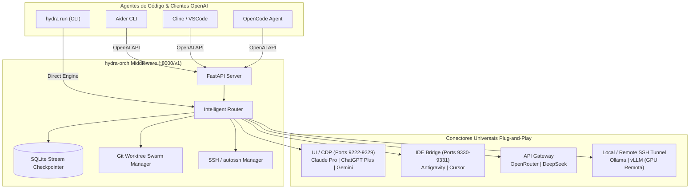

# 🐉 hydra-orch: Orquestrador Universal Autônomo de LLMs

[](https://python.org)
[](LICENSE)
[](https://fastapi.tiangolo.com)

**hydra-orch** é um middleware local de engenharia de software open-source que unifica assinaturas de interface gráfica (Claude Pro, ChatGPT Plus, Gemini Pro), IDEs agênticas (Antigravity, Cursor), APIs (OpenRouter, DeepSeek) e modelos locais/remotos (Ollama/vLLM via túnel SSH) sob um **único servidor local compatível com a API da OpenAI (`http://localhost:8000/v1`)**.

Ele atua como o cérebro central para alimentar agentes de código autônomos como **Cline, Aider, OpenCode, Cursor** ou pode ser disparado diretamente via linha de comando (`hydra run`).

---

## Estado da implementação

O núcleo e o control plane dos **Marcos M1 a M4 (`T01`–`T28`, 204 SP, Gate `G-M4`)** estão implementados e validados em suíte hermética offline (`python -m pytest tests -q` → **568 testes aprovados**). O repositório entrega CLI estendida (`hydra` com comandos M1 + **21 subgrupos**), API FastAPI + SSE (`77` paths OpenAPI `3.0.3` com Bearer auth PBKDF2-SHA256, CORS estrito e redaction), persistência SQLite WAL (`migration/0001` + `0002`), isolamento em *Git worktrees*, modos **Swarm (Wave 0+1) / Relay / Persist**, pausas HITL, conflitos 3-way, orçamento 80%/100%, PR packaging, memória consentida, discovery opt-in, SecretRef/MCP, extensões isoladas, preferências/WCAG AA e túnel SSH estrito (`StrictHostKeyChecking=yes`). Permanecem fora da validação offline a certificação real de CLIs/provedores pagos (`driver-certification`, opt-in no CI) e o frontend Web UI (há apenas o contrato em [`doc/b_spc/a_ui/README.md`](doc/b_spc/a_ui/README.md)).

Consulte a [configuração de runtime](doc/b_spc/configuracao_runtime.md) e o [backlog](doc/a_context/backlog.md) para os contratos e o estado de cada entrega.

## 🏗️ Arquitetura do Sistema



---

## ⚡ Pilares Técnicos Principais

### 1. Conectores Universais (Plug-and-Play)
- **UI / Chrome DevTools Protocol (`9222-9229`):** Conecta diretamente a instâncias web/PWA do Chrome/Edge via WebSocket CDP. Injeta prompts e lê o stream do DOM em tempo real, **sem roubar o foco da janela do usuário**.
- **IDE Agêntica:** Integração direta com os runners de Antigravity e Cursor.
- **API Gateway:** Suporte nativo com fallback a provedores OpenAI-compatíveis, OpenRouter e DeepSeek.
- **Local / SSH:** Conexão a instâncias locais do Ollama/vLLM ou abertura automática de túneis criptografados (`autossh` / `ssh -L`) para direcionar inferência para uma máquina ou servidor com GPU dedicada na rede local.

### 2. Resiliência e Auto-Resume (Stream Checkpointer)
- Persistência contínua de tokens gerados em banco SQLite local (`.orchestrator/checkpoints.sqlite`).
- Detecção em tempo real de fim de cotas (ex: cota de 5 horas do Claude Pro, rate-limits 429).
- Suporta duas estratégias configuráveis:
  - **Hot-Handoff:** Transfere imediatamente o código incompleto com prompt contextual para o próximo modelo da esteira (ex: Claude Pro ➡️ ChatGPT Plus ➡️ DeepSeek).
  - **Auto-Resume:** Pausa a geração, calcula o tempo restante do timer de recarga e retoma sozinho a geração no mesmo ponto assim que a cota for restabelecida.

### 3. Isolamento de Código por Git Worktrees (Modo 1 - Swarm)
- Prompts macros (ex: *"Construa uma aplicação completa de barbearia com agenda e pagamentos"*) são particionados em sub-tarefas por complexidade.
- Criação de um **Contrato Base Imutável** (`.orchestrator/CONTRACT.md`) com schemas e fronteiras de arquivos.
- Criação de **Git Worktrees** isolados (`.orchestrator/worktree/`) em branches paralelas: nenhuma IA sobrescreve o arquivo da outra.
- Merge automatizado e execução de suíte de testes (`pytest`) antes da unificação final na branch principal.

---

## 🎯 Os 3 Modos de Operação

| Modo | Nome | Descrição | Casos de Uso Típicos |
|---|---|---|---|
| **Modo 1** | **Swarm Paralelo** | Enxame multi-sessão que distribui tarefas por peso e complexidade entre Claude, GPT, Gemini, DeepSeek e Ollama via Git Worktrees. | Desenvolvimento de novos módulos, refatorações abrangentes, projetos do zero. |
| **Modo 2** | **Esteira Sequencial (Relay)** | Pipeline tolerante a falhas com hot-swap instantâneo se limites ou cotas de tokens acabarem. | Sessões contínuas de codificação no Cline/Aider sem interrupção. |
| **Modo 3** | **Foco Persistente** | Mantém um modelo primário (ex: Claude Pro) com espera ativa e retomada automática quando a cota expirar. | Tarefas de máxima precisão onde não se deseja trocar de modelo. |

---

## 🚀 Instalação e Início Rápido

### 1. Clonar e Instalar Dependências

```bash
cd hydra-orch
pip install -e .
```

### 2. Configurar o `config.yaml`

O YAML versionado contém a configuração canônica. Por padrão, somente o adaptador Ollama local está habilitado; é necessário ter o serviço e o modelo configurado disponíveis. As demais integrações exigem habilitação explícita. Para desenvolvimento, instale também os testes com `python -m pip install -e ".[dev]"`.

```yaml
hydra:
  default_mode: 2
  inference_fallback_chain: [coder]
providers:
  remote_local:
    local:
      enabled: true
      base_url: "http://127.0.0.1:11434"
      default_model: "qwen2.5-coder:7b"
omniroute:
  enabled: false
  connection_mode: disabled
  logical_models:
    coder:
      primary: "local/qwen2.5-coder:7b"
```

O driver `execution.driver: codex` e os provedores configurados seguem validação estrita em `config.py`; execução com provedores externos reais depende das CLIs/credenciais disponíveis no ambiente (ou use `--execute --dry-run` no `hydra submit` para testar o pipeline offline). Credenciais de API usam nomes de variáveis de ambiente (`api_key_env`), campos desconhecidos são recusados e o procedimento de migração está em [configuracao_runtime.md](doc/b_spc/configuracao_runtime.md#7-falhas-e-migração).

### 3. Iniciar o Servidor Proxy OpenAI

```bash
# Defina a credencial local obrigatória do servidor (Bearer auth PBKDF2-SHA256)
export HYDRA_API_TOKEN="meu-token-local-seguro-com-mais-de-32-chars"   # PowerShell: $env:HYDRA_API_TOKEN="..."
hydra serve --host 127.0.0.1 --port 8000
```

Seu servidor estará pronto em `http://localhost:8000/v1`.

### 4. Conectar Agentes de Código

#### No **Cline** (VSCode):
- **API Provider:** `OpenAI Compatible`
- **Base URL:** `http://localhost:8000/v1`
- **API Key:** `hydra` (ou qualquer valor)
- **Model ID:** `hydra-default` ou `hydra-relay`; `hydra-persistent` exige uma rota primária habilitada

#### No **Aider**:
```bash
aider --openai-api-base http://localhost:8000/v1 --openai-api-key hydra --model openai/hydra-default
```

### 5. Execução Direta via CLI

```bash
# Executar prompt no Modo Relay padrão com live streaming
hydra run "Crie um endpoint FastAPI com autenticação JWT e documentação Swagger"

# Selecionar explicitamente um alias de inferência
hydra run "Explique como testar um endpoint FastAPI" --mode relay --provider fast_classifier

# Verificar status dos provedores e conexões ativas
hydra status
```

---

## 📁 Estrutura de Pastas

```
hydra-orch/
├── config.yaml                     # Configuração central de portas, limites e modos
├── pyproject.toml                  # Metadados e dependências do pacote Python
├── README.md                       # Apresentação do produto e início rápido
├── AGENTS.md                       # Diretrizes de governança para agentes autônomos
├── doc/                            # Documentação canônica do projeto (10 etapas ordenadas)
│   ├── README.md                   # Navegação e visão geral da documentação
│   ├── a_context/                  # Contexto, achados do Alethe, plano mestre e taxonomia
│   ├── b_spc/                      # Especificações formais e PRDs canônicos (funcional e técnico)
│   ├── c_activity/                 # Diagramas de atividades e fluxos
│   ├── d_mer/                      # Modelo Entidade-Relacionamento e esquemas SQLite
│   ├── e_class/                    # Diagramas de classes e interfaces
│   ├── f_api/                      # Especificações OpenAPI e rotas HTTP
│   ├── g_code/                     # Arquitetura de pacotes e módulos
│   ├── h_test/                     # Planos e matriz de testes
│   ├── i_infra/                    # Infraestrutura, túneis SSH e conectividade
│   └── j_manual/                   # Manuais de operação, runbooks e guias

├── migration/                      # DDL versionado SQLite (0001_initial_core.sql + 0002_control_plane.sql)
├── ws/                             # Espaço de trabalho operacional delimitado
│   ├── README.md                   # Diretrizes gerais do workspace
│   ├── a_input/                    # Entradas, briefs e contratos versionados
│   │   └── README.md
│   └── b_output/                   # Saídas locais e evidências (git-ignored)
│       └── README.md
├── tests/                          # Suíte offline hermética (568 testes: M1–M4, CI negativo, segurança, a11y)
│   ├── test_ci_negative_gate.py    # Gate G-M4 (OpenAPI, CLI 21 grupos, negativos e WCAG AA)
│   └── test_*.py                   # Unit, integração, controle Git, SSE, extensões, budget e CLI/API
└── src/
    └── hydra_orch/
        ├── __init__.py             # Inicialização do pacote
        ├── cli.py                  # CLI Typer (M1 + 21 subgrupos, --json/--output, exit codes 0/1/2/3)
        ├── config.py               # Loader e validação Pydantic estrita de config.yaml
        ├── model.py                # Contratos canônicos, state machines e enums
        ├── server.py               # FastAPI OpenAI-compatible + Control Plane & SSE (77 paths)
        ├── core/                   # RunService, Checkpointer, Git/Conflict, Auth/Redaction, Memory/Discovery, Extensions, Budget/PR, A11y
        ├── bridge/                 # WorkerRunner (cwd + tree kill), MCP, OmniRoute, SSH Tunnel, TransportRegistry, ExtensionRunner
        ├── engine/                 # Orquestração Swarm (Wave 0+1), Relay, Persist, Healer e Decomposer
        └── adapter/                # Conectores UI CDP, IDE Bridge, API Gateway e Local/Remote
```

---

## 🛡️ Licença
Distribuído sob licença MIT. Consulte `LICENSE` para mais detalhes.

## Contexto de desenvolvimento e investigação

Os marcos **M1 a M4 (`T01`–`T28`)** e o **Gate `G-M4`** foram concluídos e validados em testes herméticos offline (**568 testes**). Para próximos passos pós-M4 (certificação real de drivers externos, eventual frontend Web UI e ideias futuras em Parking Lot), consulte [`doc/a_context/roadmap.md`](doc/a_context/roadmap.md) e [`doc/a_context/ideia_futura.md`](doc/a_context/ideia_futura.md).

O [plano de especificação e desenvolvimento](doc/a_context/plano_desenvolvimento.md) registra a revisão do checkout, as lacunas priorizadas e a sequência de entregas com critérios de aceite. O primeiro marco é uma tarefa local com executor, diff e checks verificáveis; a expansão para swarm, retomada e interface visual depende desses gates.

Consulte [Contexto de orquestração e investigação do Alethe](doc/a_context/CONTEXTO-ORQUESTRACAO.md) para o protocolo de comunicação estudado, as evidências disponíveis, as lacunas observadas no Hydra e a sequência proposta de implementação. A referência distingue geração de texto de execução efetiva de agentes em workspaces. A taxonomia oficial do repositório está documentada em [doc/a_context/taxonomia_file_system.md](doc/a_context/taxonomia_file_system.md).

Consulte também a [arquitetura Hydra + OmniRoute + interface visual](doc/g_code/architecture.md) e o [PRD técnico com contratos de execução](doc/b_spc/prd_tecnico.md). O Hydra pode usar o OmniRoute como gateway opcional; a interface visual será construída sobre a API do control plane, sem duplicar a lógica do backend.

## Instruções para IAs e versionamento

A política compartilhada está em [AGENTS.md](AGENTS.md): conferir o Git e atualizar com segurança no início de cada tarefa; validar, commitar e fazer push das alterações concluídas ao final. A autorização é permanente neste projeto, respeitando alterações locais, workers, conflitos e permissões.

Foram incluídos encaminhamentos para Claude Code, Gemini CLI, GitHub Copilot, Cursor e Windsurf. Outras ferramentas devem receber `AGENTS.md` como contexto explícito. O carregamento depende do cliente; estes arquivos não executam Git sozinhos nem concedem acesso ao GitHub.
