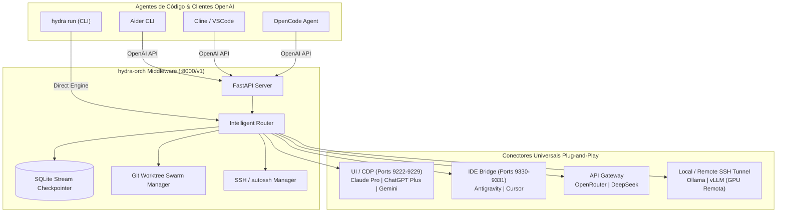

# 🐉 hydra-orch: Orquestrador Universal Autônomo de LLMs

[](https://python.org)
[](LICENSE)
[](https://fastapi.tiangolo.com)

**hydra-orch** é um middleware local de engenharia de software open-source que unifica assinaturas de interface gráfica (Claude Pro, ChatGPT Plus, Gemini Pro), IDEs agênticas (Antigravity, Cursor), APIs (OpenRouter, DeepSeek) e modelos locais/remotos (Ollama/vLLM via túnel SSH) sob um **único servidor local compatível com a API da OpenAI (`http://localhost:8000/v1`)**.

Ele atua como o cérebro central para alimentar agentes de código autônomos como **Cline, Aider, OpenCode, Cursor** ou pode ser disparado diretamente via linha de comando (`hydra run`).

---

## 🏗️ Arquitetura do Sistema



---

## ⚡ Pilares Técnicos Principais

### 1. Conectores Universais (Plug-and-Play)
- **UI / Chrome DevTools Protocol (`9222-9229`):** Conecta diretamente a instâncias web/PWA do Chrome/Edge via WebSocket CDP. Injeta prompts e lê o stream do DOM em tempo real, **sem roubar o foco da janela do usuário**.
- **IDE Agêntica:** Integração direta com os runners de Antigravity e Cursor.
- **API Gateway:** Suporte nativo com fallback a provedores OpenAI-compatíveis, OpenRouter e DeepSeek.
- **Local / SSH:** Conexão a instâncias locais do Ollama/vLLM ou abertura automática de túneis criptografados (`autossh` / `ssh -L`) para direcionar inferência para uma máquina ou servidor com GPU dedicada na rede local.

### 2. Resiliência e Auto-Resume (Stream Checkpointer)
- Persistência contínua de tokens gerados em banco SQLite local (`.orchestrator/checkpoints.sqlite`).
- Detecção em tempo real de fim de cotas (ex: cota de 5 horas do Claude Pro, rate-limits 429).
- Suporta duas estratégias configuráveis:
  - **Hot-Handoff:** Transfere imediatamente o código incompleto com prompt contextual para o próximo modelo da esteira (ex: Claude Pro ➡️ ChatGPT Plus ➡️ DeepSeek).
  - **Auto-Resume:** Pausa a geração, calcula o tempo restante do timer de recarga e retoma sozinho a geração no mesmo ponto assim que a cota for restabelecida.

### 3. Isolamento de Código por Git Worktrees (Modo 1 - Swarm)
- Prompts macros (ex: *"Construa uma aplicação completa de barbearia com agenda e pagamentos"*) são particionados em sub-tarefas por complexidade.
- Criação de um **Contrato Base Imutável** (`.orchestrator/CONTRACT.md`) com schemas e fronteiras de arquivos.
- Criação de **Git Worktrees** isolados (`.orchestrator/worktrees/`) em branches paralelas: nenhuma IA sobrescreve o arquivo da outra.
- Merge automatizado e execução de suíte de testes (`pytest`) antes da unificação final na branch principal.

---

## 🎯 Os 3 Modos de Operação

| Modo | Nome | Descrição | Casos de Uso Típicos |
|---|---|---|---|
| **Modo 1** | **Swarm Paralelo** | Enxame multi-sessão que distribui tarefas por peso e complexidade entre Claude, GPT, Gemini, DeepSeek e Ollama via Git Worktrees. | Desenvolvimento de novos módulos, refatorações abrangentes, projetos do zero. |
| **Modo 2** | **Esteira Sequencial (Relay)** | Pipeline tolerante a falhas com hot-swap instantâneo se limites ou cotas de tokens acabarem. | Sessões contínuas de codificação no Cline/Aider sem interrupção. |
| **Modo 3** | **Foco Persistente** | Mantém um modelo primário (ex: Claude Pro) com espera ativa e retomada automática quando a cota expirar. | Tarefas de máxima precisão onde não se deseja trocar de modelo. |

---

## 🚀 Instalação e Início Rápido

### 1. Clonar e Instalar Dependências

```bash
cd hydra-orch
pip install -e .
```

### 2. Configurar o `config.yaml`

O arquivo `config.yaml` permite personalizar portas CDP, credenciais e a esteira de fallback:

```yaml
orchestrator:
  default_mode: "relay"
  resilience:
    on_limit_action: "hot_handoff"
    handoff_fallback_chain:
      - "claude_pro"
      - "chatgpt_plus"
      - "deepseek"
      - "openrouter"
      - "ollama_local"

providers:
  ui_cdp:
    claude_pro:
      enabled: true
      cdp_port: 9222
  api_gateway:
    deepseek:
      enabled: true
      base_url: "https://api.deepseek.com/v1"
      api_key_env: "DEEPSEEK_API_KEY"
```

### 3. Iniciar o Servidor Proxy OpenAI

```bash
hydra serve --host 127.0.0.1 --port 8000
```

Seu servidor estará pronto em `http://localhost:8000/v1`.

### 4. Conectar Agentes de Código

#### No **Cline** (VSCode):
- **API Provider:** `OpenAI Compatible`
- **Base URL:** `http://localhost:8000/v1`
- **API Key:** `hydra` (ou qualquer valor)
- **Model ID:** `hydra-default` (ou `hydra-swarm`, `hydra-relay`, `hydra-persistent`)

#### No **Aider**:
```bash
aider --openai-api-base http://localhost:8000/v1 --openai-api-key hydra --model openai/hydra-default
```

### 5. Execução Direta via CLI

```bash
# Executar prompt no Modo Relay padrão com live streaming
hydra run "Crie um endpoint FastAPI com autenticação JWT e documentação Swagger"

# Executar prompt no Modo Swarm Paralelo (Git Worktrees)
hydra run "Crie uma aplicação completa de barbearia com backend e frontend" --mode swarm

# Verificar status dos provedores e conexões ativas
hydra status
```

---

## 📁 Estrutura de Pastas

```
hydra-orch/
├── config.yaml                     # Configuração central de portas, limites e modos
├── pyproject.toml                  # Metadados e dependências do pacote Python
├── tests/                          # Suíte de testes automatizados
└── src/
    └── hydra_orch/
        ├── __init__.py
        ├── cli.py                  # CLI com typer e rich (hydra serve, hydra run, hydra status)
        ├── config.py               # Loader e validação Pydantic de config.yaml
        ├── models.py               # Schemas OpenAI Chat Completions & Streaming
        ├── server.py               # Servidor FastAPI proxy OpenAI (/v1/chat/completions)
        ├── core/
        │   ├── checkpointer.py     # SQLite stream checkpointer & hot-handoff logic
        │   ├── router.py           # Orquestrador central dos 3 modos de execução
        │   ├── ssh_tunnel.py       # Gerenciador de túneis autossh para GPUs remotas
        │   └── swarm.py            # Particionamento, Contratos e Git Worktrees
        └── adapters/
            ├── base.py             # Interface BaseAdapter e LimitHitException
            ├── ui_cdp.py           # Conector Chrome DevTools Protocol (9222-9229)
            ├── ide_bridge.py       # Ponte com IDEs Antigravity e Cursor
            ├── api_gateway.py      # Conector OpenRouter / DeepSeek REST SSE
            └── remote_local.py     # Conector Ollama / vLLM local ou via SSH
```

---

## 🛡️ Licença
Distribuído sob licença MIT. Consulte `LICENSE` para mais detalhes.
