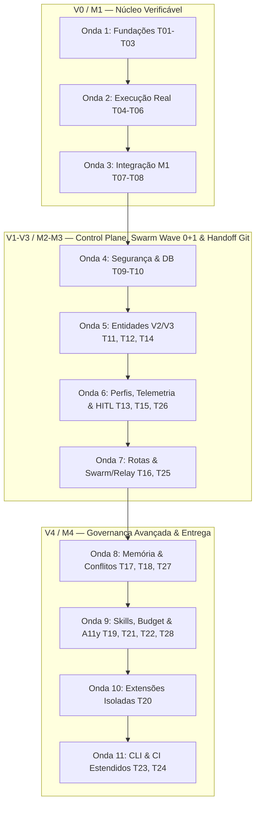

# backlog — Backlog Operacional das Tasks do hydra-orch

**Identificador Formal:** `backlog.md`  
**Caminho Canônico:** `doc/a_context/backlog.md`  
**Versão:** `v02_00_0000` 
**Status:** `APROVADO / ESCOPO ENXUTO (T01 a T28)` 
**Autoridade:** Derivado normativo de [`doc/b_spc/prd_tecnico.md`](../b_spc/prd_tecnico.md) (§8), [`doc/b_spc/prd_funcional.md`](../b_spc/prd_funcional.md) e [`doc/a_context/plano_desenvolvimento.md`](plano_desenvolvimento.md).  
**Escopo:** Catálogo operacional das 28 tasks normativas de Engenharia de Software (T01 a T28), prioridades (P0–P2), estimativas de complexidade relativa (204 Story Points), 11 ondas de execução, matriz de mitigação de colisão de arquivos para agentes e políticas de engenharia. Ideias periféricas (antigas T29 a T44) estão isoladas em [`ideia_futura.md`](ideia_futura.md).

---

## 1. Purpose (Propósito)

Fornecer uma ferramenta operacional determinística de engenharia de software para o planejamento, alocação, execução e rastreamento das 28 tarefas técnicas de implementação (**T01 a T28**) do `hydra-orch`.

O backlog traduz os requisitos normativos dos PRDs (RF01–RF30 / RT01–RT30) em unidades de trabalho atômicas e testáveis, organizadas em 11 ondas de execução concebidas para permitir o paralelismo seguro de agentes autônomos sem colisão de arquivos e sob o comando de um único integrador líder.

---

## 2. Why (Justificativa)

Em sistemas onde agentes de software (como Antigravity, Claude Code, Cursor, Copilot ou workers do swarm) atuam no código, a ausência de fronteiras explícitas de propriedade de arquivo gera sobreposição de branches, conflitos de merge destrutivos e retrabalho. Além disso, inflar o backlog com funcionalidades fora do domínio de orquestração de código (como voz duplex, geração de vídeo/música e quantização GGUF, agora movidas para [`ideia_futura.md`](ideia_futura.md)) desviava o foco do caminho crítico. O presente backlog estabelece as regras de engajamento, estimativas em Fibonacci (204 SP) e a matriz anti-colisão indispensáveis para a entrega contínua do núcleo (M1) e da expansão de governança (M2–M4).

---

## 3. Contract (Contrato Operacional e Convenções)

### 3.1. Hierarquia de Fonte da Verdade
1. **Norma Máxima:** O [`prd_tecnico.md (§8)`](../b_spc/prd_tecnico.md) é a autoridade canônica imutável para a definição técnica, dependências formais, arquivos de propriedade e Definition of Done (DoD) de cada task T01–T28.
2. **Backlog Operacional:** O presente documento espelha fielmente os identificadores, dependências e requisitos do PRD técnico. O DoD sintético aqui apresentado resume a regra normativa; em qualquer divergência textual, prevalece o PRD técnico.
3. **Governança Git e Taxonomia:** As diretrizes do [`AGENTS.md`](../../AGENTS.md) e da [`taxonomia_file_system.md`](taxonomia_file_system.md) (regra estrita do singular: `migration/`, `adapter/`, `model.py`) prevalecem sobre quaisquer fluxos operacionais.
4. **Sincronização:** Toda e qualquer alteração de escopo, divisão de task ou redefinição de arquivos de propriedade deve ser formalizada primeiramente no PRD técnico e refletida neste backlog no mesmo commit.

### 3.2. Prioridades das Tasks (Escala P0–P2)
O backlog adota uma escala de prioridades de três níveis estritamente associada aos marcos M1 a M4 do produto:
- **P0 — Bloqueador do Núcleo Verificável (V0 / M1):** Tasks T01 a T08. Pré-requisito inegociável para qualquer execução autônoma de código em worktree real.
- **P1 — Crítico para Control Plane, Swarm em 2 Ondas e Handoff Git (V1–V3 / M2–M3):** Tasks T09 a T16, T25 e T26. Habilita segurança, persistência relacional (`migration/`), workspaces, catálogo, observabilidade, Swarm (Wave 0 + Wave 1) e Handoff por Estado Git/Worktree.
- **P2 — Expansão de Governança e Entrega Automatizada (V4 / M4):** Tasks T17 a T24, T27 e T28. Governança de memória, discovery local, extensões em sandbox, resolução 3-way de conflitos + *Contract Amendment*, budget rígido e PR packaging.

### 3.3. Estimativa de Complexidade Relativa (Fibonacci)
As tasks são pontuadas utilizando a sequência clássica de Fibonacci como métrica de complexidade relativa e incerteza técnica (Story Points — SP), **não correspondendo a horas ou dias de calendário**:
- **1 SP:** Alteração pontual, configuração simples ou verificação trivial de schema.
- **2 SP:** Implementação mecânica com padrão pré-existente e testes diretos.
- **3 SP:** Unidade padrão de complexidade moderada (Âncora: **T01** — Configuração canônica tipada com validação, aliases e consolidação de runtime `.orchestrator/`).
- **5 SP:** Módulo substancial com múltiplos fluxos, validações estritas e testes herméticos.
- **8 SP:** Componente crítico com integração de processos, persistência transacional ou protocolos de rede.
- **13 SP:** Subsistema complexo com alta densidade lógica ou orquestração concorrente (**T06, T20, T25**). **Regra:** Toda task de 13 SP exige decomposição obrigatória em subtarefas no spec correspondente antes do início do código.
- **Total do Backlog Ativo:** **204 Story Points** distribuídos nas 28 tasks normativas (105 SP de ideias periféricas transferidos para [`ideia_futura.md`](ideia_futura.md)).

### 3.4. Ciclo de Vida e Estados da Task
O estado operacional de cada task progride rigorosamente através do seguinte fluxo:
`pendente` $\rightarrow$ `pronto` $\rightarrow$ `em_andamento` $\rightarrow$ `em_revisao` $\rightarrow$ `concluido` (com estado de exceção `bloqueado`).

---

## 4. Estrutura de Épicos (EP01 a EP08)

As 28 tasks normativas são organizadas em 8 épicos de engenharia de software:

| Épico | Título | Versão / Marco | Tasks Contidas | SP Total |
|---|---|---|---|---|
| **EP01** | Núcleo Verificável Local | V0 / M1 | T01, T02, T03, T04, T05, T06, T07, T08 | 58 |
| **EP02** | Control Plane Seguro e HITL | V1 / M2 | T09, T26 | 13 |
| **EP03** | Workspaces e Catálogo de Perfis | V2 / M3 | T10, T11, T12, T13 | 23 |
| **EP04** | Sessões, Observabilidade, Rotas e Swarm (Wave 0+1) | V3 / M3 | T14, T15, T16, T25 | 34 |
| **EP05** | Memória, Discovery e Extensões | V4 / M4 | T17, T18, T19, T20 | 34 |
| **EP06** | Acessibilidade e Transportes Certificados | V4 / M4 | T21, T22 | 13 |
| **EP07** | Entrega Governada (Conflitos, Budget, PR) | V4 / M4 | T27, T28 | 16 |
| **EP08** | Superfícies CLI, CI e Manuais Estendidos | V4 / M4 | T23, T24 | 13 |

---

## 5. Decomposição das 11 Ondas de Execução

As tasks são distribuídas em 11 ondas lógicas sequenciais. Tasks dentro de uma mesma onda com arquivos de propriedade disjuntos podem ser executadas em paralelo por agentes em worktrees isoladas; tasks com arquivos sobrepostos são executadas em estrita ordem serial.

### Detalhamento das Ondas:

- **Onda 1 (V0 / Fundações):** T01 (3 SP), T02 (5 SP), T03 (8 SP) — *Serial estrito*. Cria a base canônica de configuração tipada, schemas Pydantic e persistência SQLite WAL com migração inicial em `migration/`.
- **Onda 2 (V0 / Execução Real):** T04 (8 SP), T05 (8 SP), T06 (13 SP) — *Serial estrito*. Implementa o runner com isolamento de processos, workspace Git em worktree real e serviço de integração serializada com gates de checks.
- **Onda 3 (V0 / Fechamento M1):** T07 (8 SP), T08 (5 SP) — *Serial*. Unifica superfícies CLI e API sobre o mesmo serviço de run e estabelece a suíte offline reproduzível de CI. **Fecha o Marco M1 (Gate G-M1)**.
- **Onda 4 (Segurança e Base Control Plane):** T09 (5 SP), T10 (8 SP) — *Serial*. Implementa token de autenticação local obrigatório, CORS estrito, redaction centralizada de segredos e esquema de migrações DDL da expansão (`migration/`). **Fecha o Gate de Segurança G-SEG**.
- **Onda 5 (Entidades e Registro V2/V3):** T11 (5 SP), T12 (5 SP), T14 (8 SP) — *Paralelo seguro* (arquivos disjuntos: `workspace_registry.py`, `agent_registry.py`, `session_service.py`).
- **Onda 6 (Perfis, Telemetria e HITL):** T13 (5 SP), T15 (5 SP), T26 (8 SP) — *Paralelo governado* (arquivos disjuntos: `profile_service.py`, `metrics.py`, `hitl.py`).
- **Onda 7 (Roteamento Adaptativo e Swarm Wave 0+1 / Handoff Git):** T16 (8 SP), T25 (13 SP) — *Paralelo seguro* (`route_selector.py` e `engine/swarm.py`). **Fecha o Marco M3 (Gate G-M3)**.
- **Onda 8 (Governança Base e Conflitos V4):** T17 (8 SP), T18 (5 SP), T27 (8 SP) — *Paralelo seguro* (`consent.py`/`memory_store.py`, `discovery.py`, `conflict_resolver.py`).
- **Onda 9 (Conectividade, Budget e Acessibilidade):** T19 (8 SP), T21 (5 SP), T22 (8 SP), T28 (8 SP) — *Paralelo seguro* (`skill_registry.py`, `preferences.py`, `transport_registry.py`, `budget.py`/`packaging.py`).
- **Onda 10 (Extensões Isoladas):** T20 (13 SP) — *Serial exclusivo* (`extension_host.py`). Isolamento de processos de plugins com sandbox de permissões.
- **Onda 11 (Fechamento V4):** T23 (8 SP), T24 (5 SP) — *Serial*. CLI estendida para todos os módulos e CI estendido cobrindo todos os cenários negativos. **Fecha o Marco M4 (Gate G-M4)**.

---

## 6. Tabela Unificada do Backlog (Tasks T01 a T28)

Todas as 28 tasks normativas detalhadas com seus contratos formais, dependências, arquivos de propriedade (em conformidade estrita com a taxonomia no singular) e Definition of Done (DoD).

| ID | Nome da Task | Épico / Versão | Prio | SP | Dependências | RF / RT | Arquivos de Propriedade | Definition of Done (DoD Sintético) | Status |
|---|---|---|---|---|---|---|---|---|---|
| **T01** | Config canônica | EP01 / V0 | P0 | 3 | — | RF02 / RT01 | `config.py`, `config.yaml`, `.gitignore`, consumidores router/gateway/CLI/API e testes | Aliases e modelo resolvidos; provedores explícitos; inválidos recusados; runtime `.orchestrator/`; gateway desligado sem chamadas e required com preflight | concluido |
| **T02** | Contratos e estados | EP01 / V0 | P0 | 5 | T01 | RF03, RF07 / RT02 | `model.py`, `prd_tecnico.md (§3.4)`, `tests/test_model.py` | Schemas Pydantic + máquinas de transição válidas/inválidas 100% cobertas | concluido |
| **T03** | Store e migração | EP01 / V0 | P0 | 8 | T02 | RF03, RF05 / RT03, RT11 | `core/checkpointer.py`, `migration/`, `tests/test_checkpointer.py` | SQLite WAL, restart seguro, chave de idempotência, transação atômica e FKs ativas | concluido |
| **T04** | Runner e fake | EP01 / V0 | P0 | 8 | T03 | RF04, RF06 / RT04 | `bridge/worker_runner.py`, `tests/test_worker_runner.py` | Cwd operacional real, erro `executor_unavailable`, timeout com tree kill, fake restrito a dry-run | concluido |
| **T05** | Workspace Git | EP01 / V0 | P0 | 8 | T04 | RF01, RF04 / RT05 | `core/git_workspace.py`, `tests/test_git_workspace.py` | SHA base fixo, worktree real isolada, checkout do usuário intacto, lock cleanup | concluido |
| **T06** | Checks e integração | EP01 / V0 | P0 | 13 | T05 | RF07, RF08 / RT06 | `core/git_workspace.py`, `core/run_service.py`, `tests/test_integration.py` | Patch real atribuível, escopo validado, conflito bloqueante, checks determinam aceite | concluido |
| **T07** | Entrada M1 (CLI/API) | EP01 / V0 | P0 | 8 | T06 | RF03–RF08 / RT10 | `cli.py`, `server.py`, `tests/test_server.py`, `tests/test_cli.py` | Submeter/consultar/cancelar/revisar usam mesmo serviço de run; auth local loopback | concluido |
| **T08** | CI e manual M1 | EP01 / V0 | P0 | 5 | T07 | RF15 / RT12 | `.github/workflows/ci.yml`, `doc/j_manual/README.md`, `pyproject.toml` | Suíte offline hermética no CI (Linux, Windows, macOS); manual operacional de M1 | concluido |
| **T09** | Auth e CORS estrito | EP02 / V1 | P1 | 5 | T07 | RF15, RF24 / RT25 | `server.py`, `core/auth.py`, `core/redaction.py`, `tests/test_auth.py` | Token local obrigatório; CORS allowlist estrita; redaction de segredos validada | concluido |
| **T10** | Migrações control plane | EP03 / V2 | P1 | 8 | T03, T09 | RF16–RF30 / RT03, RT25 | `core/checkpointer.py`, `migration/`, `tests/test_migration.py` | Tabelas de expansão versionadas em `migration/`; rollback auditável; FKs ativas | concluido |
| **T11** | Registry áreas/repos | EP03 / V2 | P1 | 5 | T10 | RF16 / RT13 | `core/workspace_registry.py`, `tests/test_workspace_registry.py` | Hierarquia Area/Workspace/Project/Repo persistida; path traversal bloqueado | concluido |
| **T12** | Catálogo agentes/capabilities | EP03 / V2 | P1 | 5 | T02, T04, T10 | RF17, RF14 / RT14 | `core/agent_registry.py`, `config.yaml`, `tests/test_agent_registry.py` | Capabilities declaradas; driver não certificado bloqueado; CLI ausente gera erro claro | concluido |
| **T13** | Perfis e snapshots | EP03 / V2 | P1 | 5 | T11, T12 | RF17, RF23 / RT15 | `core/profile_service.py`, `tests/test_profile.py` | Validação pré-execução; ProfileSnapshot imutável com hash SHA-256 por run | concluido |
| **T14** | Sessões, threads, SSE replay | EP04 / V3 | P1 | 8 | T03, T07, T10 | RF18, RF05 / RT16 | `core/session_service.py`, `server.py`, `tests/test_sse_replay.py` | Árvore hierárquica sessões/threads; SSE com Last-Event-ID, replay e dedup | concluido |
| **T15** | Métricas observabilidade | EP04 / V3 | P1 | 5 | T03, T10, T14 | RF19 / RT17 | `core/metrics.py`, `tests/test_metrics.py` | Fila, duração, tokens, custo com status observed/stale/unknown; zero não inventado | concluido |
| **T16** | Seleção adaptativa rotas | EP04 / V3 | P1 | 8 | T12, T15 | RF20, RF11 / RT18 | `core/route_selector.py`, `bridge/omniroute_client.py`, `tests/test_route_selector.py` | RouteDecision auditável; modo direto sem gateway testado; quota unknown | em_revisao |
| **T17** | Consentimento e memória | EP05 / V4 | P2 | 8 | T09, T10 | RF21 / RT19 | `core/consent.py`, `core/memory_store.py`, `tests/test_memory.py` | Escrita exige ConsentRecord; revogação funcional; isolamento de checkpoints | pendente |
| **T18** | Discovery local controlado | EP05 / V4 | P2 | 5 | T09, T11 | RF22 / RT20 | `core/discovery.py`, `tests/test_discovery.py` | Varredura opt-in restrita a allowlist; hash SHA-256 + untrusted; sem auto-ativação | pendente |
| **T19** | Skills, MCPs, secret refs | EP05 / V4 | P2 | 8 | T12, T17, T18 | RF17, RF22 / RT21 | `core/skill_registry.py`, `bridge/mcp_client.py`, `tests/test_secrets.py` | Segredos como referências externas; resolução no spawn com env filtrado | pendente |
| **T20** | Isolamento extensões/plugins | EP05 / V4 | P2 | 13 | T18, T19 | RF24 / RT22 | `core/extension_host.py`, `tests/test_extension.py` | Manifesto versionado; processo isolado sem acesso ao DB core; revogação imediata | pendente |
| **T21** | Preferências e acessibilidade | EP06 / V4 | P2 | 5 | T13 | RF23 / RT23 | `core/preferences.py`, `tests/test_preferences.py`, `doc/h_test/README.md` | Preferências escopadas e reversíveis; checklist a11y WCAG AA (teclado, foco, contraste) | pendente |
| **T22** | Transportes certificados | EP06 / V4 | P2 | 8 | T04, T09 | RF25, RF14 / RT24 | `bridge/transport_registry.py`, `bridge/ssh_tunnel.py`, `tests/test_transport.py` | Alvo, identidade, healthcheck; host key SSH alterada aborta; isolamento saídas | pendente |
| **T23** | CLI control plane estendida | EP08 / V4 | P2 | 8 | T11, T12, T13, T17, T18, T20 | RF16–RF30 / RT13–RT25 | `cli.py`, `tests/test_cli.py` | Comandos completos para áreas, projetos, perfis, memória, discovery e extensões | pendente |
| **T24** | CI estendido e runbooks | EP08 / V4 | P2 | 5 | T08, T23 | RF15, RF23, RF25 / RT12 | `.github/workflows/ci.yml`, `doc/j_manual/README.md` | Testes offline cobrindo regras negativas da expansão; runbooks operacionais | pendente |
| **T25** | Orquestração Swarm/Relay/Persist | EP04 / V3 | P1 | 13 | T06, T13 | RF26 / RT26 | `engine/swarm.py`, `engine/relay.py`, `engine/persist.py`, `tests/test_orchestration.py` | Swarm em 2 Ondas (Wave 0 Fundação + Wave 1 Paralela com trava de deps); Handoff por Estado Git/Worktree e Retry de Turno Atômico | pronto |
| **T26** | HITL (Humano-no-Loop) | EP02 / V1 | P1 | 8 | T07, T14 | RF27 / RT27 | `core/hitl.py`, `core/run_service.py`, `tests/test_hitl.py` | Pausa needs_context/needs_approval; timeout de expiração; retomada auditada | concluido |
| **T27** | Resolução conflitos merge | EP07 / V4 | P2 | 8 | T06, T08 | RF28 / RT28 | `core/conflict_resolver.py`, `core/git_workspace.py`, `tests/test_conflict.py` | Relatório 3-way; merge_repair e *Contract Amendment* com teto de orçamento; opções manual/descarte | pendente |
| **T28** | Budgeting e PR Packaging | EP07 / V4 | P2 | 8 | T07, T15 | RF29, RF30 / RT29, RT30 | `core/budget.py`, `core/packaging.py`, `tests/test_budget_packaging.py` | Tetos USD/tokens/tempo; alerta aos 80% e congelamento aos 100%; PR package auto | pendente |

---

## 7. Matriz de Cobertura de Gaps Arquiteturais (A01 a A18)

Mapeamento formal demonstrando como a execução do backlog elimina todas as lacunas diagnósticas identificadas no código existente ([`plano_desenvolvimento.md §2.1`](plano_desenvolvimento.md)):

| Gap | Prio A | Descrição da Lacuna no Código Existente | Task(s) de Resolução | Tipo de Cobertura |
|---|---|---|---|---|
| **A01** | P0 | Aliases não resolvidos no relay gerando "No active adapters" | **T01** | Total |
| **A02** | P0 | `worker_runner` forja sucesso quando CLI está ausente | **T04** (e limpeza de scaffold) | Total |
| **A03** | P0 | `omniroute_client` fabrica sucesso e quota 100% offline | **T01**, **T16** (e limpeza de scaffold) | Total |
| **A04** | P0 | Swarm gera texto sem executar em worktree real | **T04, T06, T07** | Total |
| **A05** | P0 | Merge e limpeza sem gates, afetam main e forçam remoção | **T05, T06** | Total |
| **A06** | P0 | `create_worktree` cai para pasta comum se Git falhar | **T05** (e limpeza de scaffold) | Total |
| **A07** | P1 | Merge ignora `worker_results` e não vincula artefatos | **T06, T25** | Total |
| **A08** | P1 | Gravação tardia de checkpoints e relay destrutivo | **T03, T25** | Total |
| **A09** | P1 | Contexto limitado a 1.500 caracteres sem persistência | **T25** | Total |
| **A10** | P1 | `healer.py` retorna `True` sem aplicar patch ou testar | **T25** (via RF12/RT26) | Total |
| **A11** | P1 | Ausência de limite de concorrência e tree kill em subprocessos | **T04, T25** | Total |
| **A12** | P1 | Conflito `.hydra/` vs `.orchestrator/` | **T01** (normalizado em todo o código) | Total |
| **A13** | P1 | Conexão SSH consulta chave inexistente na config | **T01, T22** | Total |
| **A14** | P1 | CORS aberto, sem auth, host key desativada | **T09, T22** | Total |
| **A15** | P1 | Stream com ID novo por chunk e falta de suporte a tool_calls | **T07, T14** | Total |
| **A16** | P2 | Decompositor com 4 tarefas fixas e stitcher inseguro | **T02, T25** (Wave 0+1 e Handoff Git) | Total |
| **A17** | P2 | Discrepância de dependência do OmniRoute e falta de LICENSE | **G0** (Documental) | Total |
| **A18** | P1 | Suíte de testes superficial dependente de localhost | **T08, T24** e transversal | Total |

---

## 8. Políticas Canônicas para Agentes de Desenvolvimento

Regras compulsórias para qualquer agente LLM ou desenvolvedor humano atuando nas tasks deste repositório, em estrita consonância com [`AGENTS.md`](../../AGENTS.md):

1. **Início da Sessão e Verificação de Checkout:**
   - Confirmar a raiz com `git rev-parse --show-toplevel`.
   - Verificar checkout limpo com `git status --short --branch`.
   - Executar `git pull --ff-only` com upstream configurado antes de editar qualquer arquivo.
   - Ler a seção correspondente em `prd_tecnico.md §8` e confirmar que a task está em estado `pronto` (todas as dependências `concluido`).

2. **Branching e Propriedade de Arquivos:**
   - Cada task é implementada em branch própria no padrão `task/t##_nome_da_task` (minúsculas, singular, sem timestamps).
   - Publicar a branch remota com `git push -u origin <branch>`.
   - Nenhum agente worker faz commit direto em `main`. Apenas o agente líder integra a branch após verificação da suíte.
   - Dois agentes paralelos **nunca** podem editar o mesmo arquivo na mesma onda (obedecer à matriz de colisão do Apêndice A).

3. **Testes Herméticos e Cobertura Obrigatória:**
   - Todo commit de código **deve conter os testes automatizados correspondentes no mesmo commit**.
   - Testes unitários e de integração residem em `tests/` e devem ser 100% reproduzíveis sem rede externa, sem GPU e sem contas pagas (utilizar mocks ou dublês quando aplicável).
   - Testes de Git devem operar sobre repositórios temporários isolados (`tmp_path`), jamais sobre o checkout de desenvolvimento.
   - Cada task de código deve cobrir pelo menos um caso negativo catalogado em `prd_tecnico.md §7.A`.
   - Cobertura mínima de testes: $\ge 80\%$ no módulo implementado (100% obrigatório em `src/hydra_orch/model.py`).

4. **Mensagens de Commit:**
   - Utilizar commits semânticos: `feat:`, `fix:`, `test:`, `docs:`, `chore:`.
   - Incluir o ID da task no escopo: ex.: `feat(t04): implementa runner de subprocessos com tree kill e cwd real`.

5. **Critérios de Fechamento de Task:**
   - Todos os itens do DoD cumpridos e testados.
   - `git diff --check` sem alertas de formatação ou espaços em branco ao final de linhas.
   - Suíte `pytest tests` passando com 100% de sucesso.
   - Atualização do status no `backlog.md` para `concluido` realizada pelo agente líder no merge da branch.

---

## 9. Apêndices Operacionais

### Apêndice A: Matriz Anti-Colisão de Propriedade de Arquivos

Arquivos compartilhados do projeto com controle estrito de concorrência por onda:

| Arquivo Crítico | Tasks com Escopo de Escrita | Resolução de Concorrência |
|---|---|---|
| `src/hydra_orch/server.py` | T07 (O3), T09 (O4), T14 (O5) | **Serializado por onda.** Jamais tocar simultaneamente. |
| `src/hydra_orch/cli.py` | T07 (O3), T23 (O11) | **Serializado por onda.** |
| `src/hydra_orch/model.py` | T02 (O1) | **Exclusivo na Onda 1.** |
| `src/hydra_orch/config.py` e `config.yaml` | T01 (O1), T12 (O5) | **Serializado por onda.** |
| `src/hydra_orch/core/checkpointer.py` | T03 (O1), T10 (O4) | **Serializado por onda.** |
| `src/hydra_orch/core/git_workspace.py` | T05 (O2), T06 (O2), T27 (O8) | T05 e T06 são seriais na Onda 2; T27 isolada na Onda 8. |
| `src/hydra_orch/core/run_service.py` | T06 (O2), T26 (O6) | **Serializado por onda.** |
| `src/hydra_orch/core/session_service.py` | T14 (O5) | **Exclusivo na Onda 5.** |
| `src/hydra_orch/bridge/mcp_client.py` | T19 (O9) | **Exclusivo na Onda 9.** |
| `.github/workflows/ci.yml` | T08 (O3), T24 (O11) | **Serializado por onda.** |

### Apêndice B: Trilha Documental de Coerência (Pré-requisitos de Código)

Documentos formais de especificação que devem ser revisados e validados antes do início do código da respectiva task:

| Documento de Coerência | Caminho Canônico | Exigido Antes de Iniciar |
|---|---|---|
| Schemas JSON e DDL | `doc/b_spc/prd_tecnico.md §3.4` | T02, T10 |
| Modelo Relacional (MER) | `doc/d_mer/mer.md` e `mer.mmd` | T03, T10 |
| Diagrama de Classes | `doc/e_class/diagrama_classe.md` e `.mmd` | T02, T13 |
| Contrato OpenAPI | `doc/f_api/openapi.yaml` | T07, T09 |
| Fronteiras de Arquitetura | `doc/g_code/architecture.md` | T04, T07, T10 |
| Matriz de Testes Herméticos | `doc/h_test/README.md` | T08, T24 |
| Certificação de Transportes | `doc/i_infra/README.md` | T22 |
| Manuais e Runbooks | `doc/j_manual/README.md` | T08, T24 |

## Evidência da revalidação da T01

- Contrato: [S01 — configuração de runtime](../b_spc/configuracao_runtime.md). Escopo inclui os consumidores necessários no router, gateway, CLI e API; não entrega T04/T07 nem certifica provedores.
- Baseline do commit `2b46168` executado em cópia temporária: **26 testes aprovados**. Entrega ampliada: **77 testes aprovados** no Windows/Python 3.14.6. Permanecem cinco avisos de depreciação já presentes no baseline.
- Cobertura de linhas de `config.py`: **97%** (344 statements, 9 não executados), medida com coverage no ambiente virtual local. O gate mínimo de 80% da T01 passou; isso não representa cobertura integral dos motores ainda em scaffold.
- Sem chamadas reais de modelos, CLI de agente, SSH ou CDP. O teste de quota offline usa HTTP simulado; testes que escrevem contratos usam diretório temporário.
- Configuração inválida e indisponibilidade de rota/gateway têm diagnóstico explícito; Codex não é convertido em CDP. Swarm pelo chat é recusado até a implementação dos gates de execução.
- Próxima entrega: **T02 — contratos e estados**. M1 continua pendente de T02–T08; interface visual vem após o núcleo verificável.
- A suíte exige execução fora da restrição de sockets deste sandbox Windows: o asyncio usa socket local interno mesmo em testes offline. Dependências foram instaladas somente em `.venv/`; cobertura e runtime permanecem ignorados.

## Evidência da T02 — contratos e estados

- Contrato implementado: [S02](../b_spc/contrato_execucao.md), em `src/hydra_orch/model.py`; os modelos de chat existentes foram preservados.
- Entidades de run/tarefa/tentativa/resultado, orçamento, capabilities, revisão, artefatos, checks, evento e handoff têm validação e round-trip JSON. Specs são congeladas com tuplas; payload de evento é serializado pelo serviço de persistência futuro.
- As quatro máquinas de estado cobrem **202 combinações** origem/destino, incluindo arestas ilegais e mistura de domínios. Revisão exige versão atual; simulação, checks ausentes e atribuição incorreta não autorizam aceite/integração.
- Baseline T01: **77 testes aprovados**. Entrega T02: **173 testes aprovados**, com **100% de cobertura de linhas em `model.py`** (376 statements, nenhum ausente), no Windows/Python 3.14.6. Os cinco avisos de depreciação permanecem iguais ao baseline.
- `CheckSpec.command` passou a array de argumentos, com ID explícito; o OpenAPI proposto foi alinhado. `persistent` é o nome canônico do modo. Isso não cria rotas HTTP de execução.
- Não foram executados provedores, workers, processos Git de tarefa, checkpoints de run ou merges de produto. Os testes desta entrega validam contratos em memória; comprovação de bytes/hashes e execução pertence a T04–T06.
- Próxima entrega: **T03 — store canônico e migração SQLite**. M1 continua pendente de T03–T08.

## Evidência da T03 — store canônico e migração SQLite

- Contrato implementado: [S03](../b_spc/persistencia_execucao.md), em `src/hydra_orch/core/checkpointer.py` (`ExecutionStore` e compatibilidade integral com `StreamCheckpointer`) e esquema DDL inicial em `migration/0001_initial_core.sql`.
- Pragmas obrigatórios (`journal_mode=WAL`, `foreign_keys=ON`, `busy_timeout=5000`, `synchronous=NORMAL`), runner de migrações transacional com verificação de `checksum` SHA-256 e preservação de bancos legados (`legacy_handoff_checkpoints`, `checkpoints`, `provider_limits`, `active_generations`, `quota_status`).
- Operações atômicas (`BEGIN IMMEDIATE`) entre mutação de estado e emissão de `RunEvent`, controle de concorrência otimista (`expected_revision`), submissão idempotente (`submit_run_idempotent` / `record_command` escopado com `IdempotencyConflictError`), unicidade parcial de tentativa ativa por tarefa (`idx_attempts_active_task`), reconciliação pós-crash (`reconcile_interrupted_attempts`) e replay ordenado por cursor (`after_seq`).
- Suíte ampliada: **198 testes aprovados** (`python -m pytest tests -q`) no Windows/Python 3.12.10, incluindo 13 suítes herméticas de persistência, rollback transacional, concorrência WAL e restart em `tests/test_checkpointer.py`.
- Próxima entrega: **T04 — runner de subprocessos e executor fake**. M1 continua pendente de T04–T08.

## Evidência da T04 — runner de subprocessos e executor fake

- Contrato implementado: [S04](../b_spc/executor_cli.md), em `src/hydra_orch/bridge/worker_runner.py` (`WorkerRunner`, `InvocationPlan`, `build_invocation`, `filter_worker_env`, `cancel_process_tree`, `is_process_alive`) e exportado em `src/hydra_orch/bridge/__init__.py`.
- Zero fallback simulado silencioso em modo real: CLIs ausentes no `PATH` geram `ExecutionFailure(code="executor_unavailable")` sem spawnar subprocesso nem fabricar saída de sucesso (elimina GAP A02); `fake_subprocess` é bloqueado fora de `dry_run=True` com `simulated_result_not_integrable`.
- Isolamento de processo e ambiente: `cwd` resolvido e validado como diretório físico existente (`workspace_invalid`), ambiente sanitizado por allowlist (`filter_worker_env`) removendo segredos arbitrários do host e aplicando `extra_env` com precedência determinística, grupo de processos isolado (`start_new_session=True` / `CREATE_NEW_PROCESS_GROUP`) e tree kill recursivo (`taskkill /F /T /PID` no Windows e `killpg` no POSIX) com verificação real de encerramento (`is_process_alive`, elimina GAP A11).
- Suíte ampliada: **207 testes aprovados** (`python -m pytest tests -q`) no Windows/Python 3.12.10, incluindo 9 suítes herméticas de subprocesso, tree kill, idempotência de cancelamento, latência de despacho P99 < 300ms (RNF01) e integração transacional com `ExecutionStore` em `tests/test_worker_runner.py`.
- Próxima entrega: **T05 — workspace Git isolado em worktree real**. M1 continua pendente de T05–T08.

## Evidência da T05 — workspace Git isolado em worktree real

- Contrato implementado: [S05](../b_spc/integracao_git.md), em `src/hydra_orch/core/git_workspace.py` (`GitWorkspaceService`, `WorkspaceRecord`, `OperatorCheckoutSnapshot`, `ScopeValidationResult`, `WorktreeDiffArtifact`, `IntegrationOutcome`) e exportado em `src/hydra_orch/core/__init__.py`.
- Isolamento estrito de Git worktree: ancoragem em `base_sha` de 40 caracteres hexadecimais verificados (`git rev-parse --verify <ref>^{commit}`), proibição de fallback para pasta comum quando `git worktree add` falha (elimina GAP A06) e verificação de `.git` e `HEAD == base_sha` na worktree criada.
- Preservação do checkout do operador e de evidências: captura e validação de `OperatorCheckoutSnapshot` (`branch`, `head_sha`, `staged`, `unstaged`, `untracked`), validação de escopo (`allowed_paths`, `forbidden_paths` e detecção de symlinks externos), recusa de remoção de worktree suja sem `force_discard=True` (elimina GAP A05), limpeza de locks órfãos (`cleanup_stale_locks` com `is_process_alive`) e integração serializada por repositório na branch dedicada `integrate/<run_id>` preservando worktrees em conflito (`test_merge_serialized` e `test_conflict_preserves_worktree`).
- Decomposição obrigatória da **T06 (13 SP)** formalizada em `doc/b_spc/integracao_git.md` (§8.2: T06.1 a T06.4).
- Suíte ampliada: **213 testes aprovados** (`python -m pytest tests -q`) no Windows/Python 3.12.10, incluindo 6 suítes herméticas de worktrees reais em repositórios temporários em `tests/test_git_workspace.py`.
- Próxima entrega: **T06 — checks determinísticos e serviço de integração (`RunService`)**. M1 continua pendente de T06–T08.

## Evidência da T06 — checks determinísticos e serviço de integração (`RunService`)

- Contrato implementado: [S05](../b_spc/integracao_git.md), em `src/hydra_orch/core/run_service.py` (`CheckRunner`, `RunService`, `TaskExecutionOutcome`) e `src/hydra_orch/core/git_workspace.py`, exportados em `src/hydra_orch/core/__init__.py`.
- Execução determinística de checks (`CheckRunner`): comandos `CheckSpec.command` executados como arrays `argv` sem shell, com ambiente filtrado por allowlist, tree kill em timeout, medição de duração e gravação atômica de `stdout`/`stderr` como `Artifact(kind="check_output")` com SHA-256 vinculados ao `tested_sha`.
- Gates de promoção e aceite em `RunService`: `exit_code == 0` do worker sem diff real (`empty_patch`), violação de escopo (`scope_violation`), resultado simulado (`simulated_execution`) ou falha em qualquer check obrigatório (`acceptance_check_failed`) resultam em `TaskStatus.FAILED` com evidências e worktree preservadas; apenas tarefas com patch real atribuível e 100% dos checks aprovados avançam para `TaskStatus.READY_FOR_REVIEW`.
- Ciclo completo `submit_run` $\rightarrow$ `execute_task_attempt` $\rightarrow$ `review_task_result` (concorrência otimista via `expected_revision`) $\rightarrow$ `integrate_run` (merge serializado na branch dedicada `integrate/<run_id>` + reexecução dos checks combinados sobre o SHA integrado) $\rightarrow$ `retry_task` / `cancel_run`.
- Suíte ampliada: **219 testes aprovados** (`python -m pytest tests -q`) no Windows/Python 3.12.10, incluindo 6 suítes de integração ponta a ponta em `tests/test_integration.py`.
- Próxima entrega: **T07 — entrada unificada M1 (CLI e API sobre `RunService`)**. M1 continua pendente de T07–T08.

## Evidência da T07 — entrada unificada M1 (CLI e API sobre `RunService`)

- Contrato implementado: [S10 / M1](../b_spc/api_control_plane.md), em `src/hydra_orch/server.py`, `src/hydra_orch/cli.py` e `src/hydra_orch/core/run_service.py`.
- Superfícies CLI (`hydra submit`, `hydra inspect`, `hydra review`, `hydra integrate`, `hydra cancel`, `hydra retry`) e API REST/SSE (`/v1/control-plane/projects`, `/v1/control-plane/runs`, `/v1/control-plane/runs/{id}/tasks`, `/v1/control-plane/runs/{id}/artifacts`, `/v1/control-plane/runs/{id}/events`, `/v1/control-plane/runs/{id}/cancel`, `/v1/control-plane/runs/{id}/tasks/{task_id}/retry`, `/v1/control-plane/runs/{id}/tasks/{task_id}/review`, `/v1/control-plane/runs/{id}/integrate`, `/v1/control-plane/runs/{id}/discard`) consomem exclusivamente a mesma instância/camada de `RunService` (`test_ui_commands_same_service` e `test_cli_submit_inspect_review_integrate_same_service`).
- Garantias de protocolo e segurança M1: submissão idempotente (`Idempotency-Key` com `409 idempotency_conflict` em divergência de payload), replay SSE ordenado por cursor (`Last-Event-ID`, `id: <seq>`, `event: heartbeat`, `410 sse_cursor_expired`), proteção local loopback / Bearer token (`test_auth_required`), allowlist estrita de CORS recusando wildcard `*` ou origens não autorizadas com `403 cors_origin_forbidden` (`test_cors_strict_allowlist`), cancelamento granular por tarefa no swarm (`test_cancel_task_in_swarm`) e descarte seguro preservando retenção de artefatos verificados por SHA-256 (`test_discard_preserves_retention`).
- Suíte ampliada: **235 testes aprovados** (`python -m pytest tests -q`) no Windows/Python 3.12.10, incluindo 24 testes em `tests/test_server.py` e 4 testes em `tests/test_cli.py`, além da migração de `on_event` para `lifespan` no FastAPI.
- Próxima entrega: **T08 — CI hermético e manual operacional M1**. M1 continua pendente de T08.

## Evidência da T08 — CI hermético e manual operacional M1 (Fechamento do Gate G-M1)

- Contrato implementado: [S13 / M1](../b_spc/entrega_operacao.md), em `.github/workflows/ci.yml`, `pyproject.toml`, `doc/j_manual/README.md` e `tests/test_checkpointer.py`.
- Pipeline CI offline hermético multiplataforma (`.github/workflows/ci.yml`): matriz `ubuntu-latest`, `windows-latest`, `macos-latest` com Python `3.10` e `3.12`, `HYDRA_OFFLINE_CI=1`, checagem de formatação (`git diff --check`), smoke test de superfície CLI M1 e execução integral da suíte; job de certificação de driver externo (`driver-certification`) isolado sob `workflow_dispatch` opt-in (RT12).
- Manual operacional M1 (`doc/j_manual/README.md` §0): documenta a superfície M1 verificada (`hydra submit`, `inspect`, `review`, `integrate`, `cancel`, `retry`, códigos de saída `0`–`3` e rotas `/v1/control-plane/*`), distinguindo o que está certificado no Gate G-M1 (`T01–T08`) do que pertence aos horizontes `M2–M4` (`T09–T28`).
- Rastreabilidade completa de testes M1 (`doc/h_test/README.md` §1.1): incluídos `test_restart_preserves_state`, `test_events_monotonic`, `test_artifact_hash_verification` e `test_offline_ci_no_external` em `tests/test_checkpointer.py`.
- Suíte ampliada: **239 testes aprovados** (`python -m pytest tests -q`) no Windows/Python 3.12.10. **Gate G-M1 (Marco M1 — Núcleo Verificável Local / V0) 100% concluído (T01 a T08)**. Próxima onda: **Onda 4 (T09 — Auth local, CORS estrito e Redaction; T10 — Migrações do control plane)**.

## Evidência da T09 — autenticação local, CORS e redaction

- Contrato: [S16 — segurança local e proveniência](../b_spc/seguranca_proveniencia.md). Todas as rotas HTTP exigem Bearer, inclusive loopback; startup sem credencial falha antes dos serviços. A CLI local permanece independente de HTTP.
- `core/auth.py`: verificador PBKDF2-SHA256 com salt aleatório, 600.000 iterações, comparação constante e configuração por hash externo (preferido) ou token de ambiente. A aplicação guarda apenas o verificador. CORS aceita origens loopback explícitas e preflight válido sem executar endpoints.
- `core/redaction.py`: sanitização recursiva de eventos antes do INSERT, replay legado, SSE/JSON, logging com traceback e stdout/stderr de workers/checks antes da gravação e do hash. Patches não são reescritos. Logs legados em disco não são expurgados automaticamente.
- Validação local: **299 testes aprovados**, **100% de cobertura de linhas em auth.py e redaction.py**, Linux/Python **3.14.9**, com um aviso de depreciação de Starlette/httpx. `git diff --check` e links locais da documentação alterada verificados. Sem LLM, conta paga ou driver externo; a matriz de CI remota não foi certificada nesta entrega.
- Entrega `e3b1b93` integrada em `main` por fast-forward após revisão local e suíte completa. T09 atende seu DoD; G-SEG completo ainda depende dos contratos posteriores de autorização de raízes, consentimento e extensões. O corpus benigno sintético não comprova a taxa RNF05 em tráfego real.
- Próxima entrega: **T10 — migrações do control plane**, preservando o legado e validando rollback e FKs.

## Evidência da T10 — migrações do control plane

- Contrato: [S14 — base relacional, workspaces e perfis](../b_spc/workspaces_perfis.md). `0002_control_plane.sql` adiciona 26 tabelas e evolui projects/events sem modificar a migração 0001. `area_workspaces` é organizacional; `workspaces` continua por tentativa.
- O migrador fixa checksums up/down, recusa versões desconhecidas/lacunas, serializa inicializações sob BEGIN IMMEDIATE, cria backup SQLite consistente com WAL antes dos scripts de domínio e valida foreign_key_check. Falha de SQL/FK desfaz o lote e registra auditoria em migration_history.
- `rollback_migrations("0001")` é administrativo/offline, com backup e script down verificado. Recusa perda de registros/colunas da expansão e tentativas queued/running; não existe descarte forçado. O núcleo e os schemas legados são preservados. Uma nova inicialização com o checkout atual reaplica 0002.
- Validação local: **318 testes aprovados** (19 casos em `tests/test_migration.py`), **96% de cobertura de linhas em core/checkpointer.py**, Linux/Python **3.14.9**. Um aviso de depreciação Starlette/httpx. `git diff --check`, links locais e preservação do arquivo 0001 verificados.
- Testes usam bancos e registros temporários, sem modelos externos nem serviços pagos. Não há certificação nova da matriz remota de SOs nem de drivers. Os schemas não implementam os serviços T11–T28 ou fecham o gate G-SEG.
- Entrega `cc5ace2` integrada em `main` por fast-forward após revisão e validação completa. Próxima entrega: **T11 — registry de áreas, workspaces, projetos, repositórios e autorizações**; T12 e T14 também têm suas dependências técnicas satisfeitas.

## Evidência da T11 — registry de áreas e repositórios

- `WorkspaceRegistry` persiste hierarquia e grants explícitos por repositório; resolve Git/SHA sob allowlist, recusa traversal e symlink externo, relê revogação e bloqueia workspace arquivado. Adoção de projeto legado é explícita e não concede execução.
- Mutações e auditoria `commands(scope=registry)` são atômicas. IDs UUIDv7 têm fallback compatível com Python 3.10. As superfícies estendidas pertencem à T23; a API M1 não foi migrada silenciosamente.
- **343 testes aprovados** no Linux/Python 3.14.9; **99% de cobertura no registry**, 100% no helper de IDs. Git/SQLite em diretórios temporários; sem provedores externos. `git diff --check` aprovado.
- Contrato e limites: [S14](../b_spc/workspaces_perfis.md). Próxima entrega: **T12 — catálogo de agentes e capabilities**.

T11 integrada por fast-forward: `0f2624b`. Próxima tarefa pronta: T12.

## Evidência da T12 — catálogo de agentes e capabilities

- `AgentRegistry` persiste declarações sem certificar implicitamente; exige CLI, capabilities e certificado por SO na seleção. Relatórios importados explicitamente são vinculados por hash ao executável e auditados; revogação preserva histórico e bloqueia nova resolução.
- Os testes usam relatórios sintéticos de operador e executáveis de fixture: validam os gates e hashes, sem certificar provedores externos nem executar LLM. A veracidade dos checks atestados pertence ao emissor/operador. Contrato e limites em [S14](../b_spc/workspaces_perfis.md).
- Alias `claude-code` alinhado ao runner `claude_code`. **358 testes aprovados**, **99% de cobertura em agent_registry.py**, Linux/Python 3.14.9; `git diff --check` aprovado. Próxima entrega após integração: **T13 — perfis e snapshots**.

T12 integrada por fast-forward: `dfad3e4`. T13 pronta; próxima entrega do ciclo.

## Evidência da T13 — perfis e snapshots

- `ProfileService` valida componentes, orçamento, grants e capabilities/certificados; mantém referências relacionais e JSON coerentes, com revision otimista. Memória exige consentimento vigente do principal/projeto; componentes descobertos não aprovados e credenciais brutas são recusados.
- Um snapshot por run, fixado antes de qualquer tentativa, com JSON canônico e SHA-256; criação e evento `profile.snapshot_created` atômicos. Edições futuras não alteram snapshots existentes; leitura detecta corrupção. Integração ao despacho dos modos pertence à T25; superfícies estendidas à T23.
- **366 testes aprovados**, **100% de cobertura de profile_service.py e model.py**, Linux/Python 3.14.9. Fixtures Git/SQLite e relatórios sintéticos; nenhuma certificação externa ou execução LLM. `git diff --check` aprovado. Próxima entrega: **T14 — sessões, threads e SSE**.

T13 integrada por fast-forward: `4ea61ae`. Próxima tarefa do ciclo: T14. T25 tem dependências técnicas satisfeitas e exige decomposição antes de iniciar.

## Evidência da T14 — sessões, threads e SSE

- `SessionService` persiste árvores por run/sessão, transições com expected_state, mensagens com cursor/idempotência e eventos atômicos sanitizados. Escopo cruzado é recusado; falha/cancelamento preserva estados terminais e cancela filhos não iniciados.
- API autenticada sob `/v1/control-plane/runs/{run_id}/sessions`. SSE aceita filtros e follow opt-in, mantém replay finito M1, consulta SQLite após reconexão, emite heartbeat e encerra na desconexão. EventCursor demonstra dedup concorrente em cliente Python; não implementa UI nem exactly-once de efeitos externos.
- **382 testes aprovados**, **99% de cobertura em session_service.py**, **100% em model.py**, Linux/Python 3.14.9. Testes offline com Git/SQLite temporários, sem LLM. `git diff --check`, links e referências OpenAPI verificados. Contrato em [S15](../b_spc/sessoes_observabilidade.md).
- Próxima entrega: **T15 — métricas com proveniência**; T26 também tem as dependências técnicas satisfeitas.

T14 integrada por fast-forward: `4d71eeb` + documentação `110bb9f`. T15 e T26 prontas; próxima entrega do ciclo: T15.

## Evidência da T15 — métricas com proveniência

- `MetricsService` persiste amostra/evento atomicamente, valida escopo e unidade e distingue observed/stale/unknown. Ausência não vira zero; TTL preserva valor antigo com stale e agregação parcial expõe known_subtotal/cobertura sem fabricar total.
- RunService registra timestamps locais e uso/custo unknown enquanto a CLI não informar telemetria estruturada certificada. GET autenticado de métricas/uso está disponível por run; escopo cruzado é recusado. Contrato em [S15](../b_spc/sessoes_observabilidade.md).
- **397 testes aprovados**, **99% de cobertura em metrics.py**, Linux/Python 3.14.9. Testes de zero explícito, ausência, staleness, fonte, rollback e captura após subprocesso real; sem LLM externo. `git diff --check` e referências OpenAPI aprovados.
- Próxima entrega da Onda 6: **T26 — HITL**. T16 tem dependências técnicas satisfeitas após integração.

T15 integrada por fast-forward: `56fbc13`. Próxima entrega da Onda 6: T26 (HITL); T16 está pronta para a Onda 7.

## Evidência da T26 — intervenção humana (HITL)

- `HITLService` mantém solicitações needs_context/needs_approval, deadlines e respostas idempotentes no store canônico, com eventos e estado atômicos. Só pausa entre tentativas: atividade em despacho/processo impede criar uma falsa pausa de CLI.
- Barreiras transacionais de admissão bloqueiam run/task/attempt e retry pendentes. Resposta retoma o coordenador sem executar automaticamente; a próxima tentativa recebe contexto humano estruturado. Negação/expiração falha com reason e preserva evidências. Scheduler HTTP reconcilia deadlines a cada segundo e encerra no shutdown.
- **409 testes aprovados**, **97% de cobertura em hitl.py**, **100% em model.py**, Linux/Python 3.14.9. Testes de corrida resposta/timeout, restart, duplicação, escopo e retomada com subprocesso real de fixture; sem LLM. Referências OpenAPI e `git diff --check` aprovados. Contrato: [intervenção humana](../b_spc/intervencao_humana.md).
- Próxima entrega: **T16 — seleção adaptativa de rotas**; depois T25, com decomposição obrigatória antes de iniciar.

T26 integrada por fast-forward: `e3ad256`. Próxima entrega do ciclo: T16; T25 segue depois, com decomposição prévia.

## Evidência da T16 — seleção adaptativa de rotas

- `RouteSelector` recusa drivers/capabilities inelegíveis e quota observed=0; disabled não chama gateway, optional permite fallback direto e required impede bypass. Unknown/stale seguem política explícita, sem fingir disponibilidade.
- Ranking usa prioridade, custo/duração observados e ID estável; telemetria só é usada quando correlacionada com run/modelo/executor. Candidatos, motivos, fontes, valores, certificado, escolha e fallback são auditados e têm read model HTTP. Sem elegíveis, route.rejected é persistido sem fabricar rota selecionada.
- OmniRouteClient normaliza quota inválida para unknown e preserva último valor stale em falha; disabled não faz geração HTTP. Nenhuma API de provedor real foi certificada: os testes usam gateway/relatórios simulados.
- **416 testes aprovados**, **98% de cobertura em route_selector.py**, Linux/Python 3.14.9. `git diff --check` e referências OpenAPI aprovados. Contrato em [S15](../b_spc/sessoes_observabilidade.md). Próxima entrega: **T25**, com decomposição antes do código.
