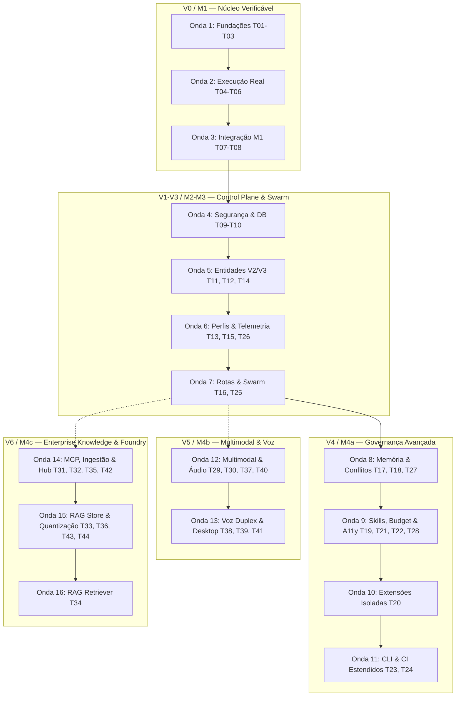

# backlog — Backlog Operacional das Tasks do hydra-orch

**Identificador Formal:** `backlog.md`  
**Caminho Canônico:** `doc/a_context/backlog.md`  
**Versão:** `v01_00_0000`  
**Status:** `PROPOSTO / ATIVO`  
**Autoridade:** Derivado normativo de [`doc/b_spc/prd_tecnico.md`](../b_spc/prd_tecnico.md) (§8), [`doc/b_spc/prd_funcional.md`](../b_spc/prd_funcional.md) e [`doc/a_context/plano_desenvolvimento.md`](plano_desenvolvimento.md).  
**Escopo:** Catálogo operacional das 44 tasks normativas (T01 a T44), prioridades, estimativas de complexidade relativa (Story Points), ondas de execução, matriz de mitigação de colisão de arquivos para agentes e políticas de engenharia.

---

## 1. Purpose (Propósito)

Fornecer uma ferramenta operacional determinística de engenharia de software para o planejamento, alocação, execução e rastreamento das 44 tarefas técnicas de implementação (**T01 a T44**) do `hydra-orch`. 

O backlog traduz os requisitos normativos dos PRDs em unidades de trabalho atômicas e testáveis, organizadas em ondas de execução concebidas para permitir o paralelismo seguro de agentes autônomos sem colisão de arquivos e sob o comando de um único integrador líder.

---

## 2. Why (Justificativa)

O repositório `hydra-orch` possui uma especificação técnica aprofundada, porém dispersa entre PRDs conceituais e listas de tarefas sem atribuição de esforço relativo, sem categorização operacional de épicos e sem ordenação em lotes de execução paralelizáveis. 

Em sistemas onde agentes de software (como Antigravity, Claude Code, Cursor, Copilot ou workers do swarm) atuam no código, a ausência de fronteiras explícitas de propriedade de arquivo gera sobreposição de branches, conflitos de merge destrutivos e retrabalho. O presente backlog estabelece as regras de engajamento, estimativas em Fibonacci e a matriz anti-colisão indispensáveis para a entrega contínua do núcleo e da expansão.

---

## 3. Contract (Contrato Operacional e Convenções)

### 3.1. Hierarquia de Fonte da Verdade
1. **Norma Máxima:** O [`prd_tecnico.md (§8)`](../b_spc/prd_tecnico.md) é a autoridade canônica imutável para a definição técnica, dependências formais, arquivos de propriedade e Definition of Done (DoD) de cada task T01–T44.
2. **Backlog Operacional:** O presente documento espelha fielmente os identificadores, dependências e requisitos do PRD técnico. O DoD sintético aqui apresentado resume a regra normativa; em qualquer divergência textual, prevalece o PRD técnico.
3. **Governança Git:** As diretrizes do [`AGENTS.md`](../../AGENTS.md) prevalecem sobre quaisquer fluxos operacionais de versionamento aqui descritos.
4. **Sincronização:** Toda e qualquer alteração de escopo, divisão de task ou redefinição de arquivos de propriedade deve ser formalizada primeiramente no PRD técnico e refletida neste backlog no mesmo commit.

### 3.2. Prioridades das Tasks (Escala P0–P3)
O backlog adota uma escala de prioridades de quatro níveis estritamente associada aos marcos do produto (diferenciada da escala P0–P2 utilizada exclusivamente para os gaps arquiteturais A01–A18 do código existente):
- **P0 — Bloqueador do Núcleo Verificável (V0 / M1):** Tasks T01 a T08. Pré-requisito inegociável para qualquer execução autônoma de código em worktree real.
- **P1 — Crítico para Control Plane e Coordenação (V1–V3 / M2–M3):** Tasks T09 a T16, T25 e T26. Habilita segurança, persistência relacional, workspaces, catálogo, observabilidade e orquestração Swarm/Relay/Persistente.
- **P2 — Expansão de Governança e Automação (V4 / M4a):** Tasks T17 a T24, T27 e T28. Governança de memória, discovery local, extensões em sandbox, resolução de conflitos, budget rígido e PR packaging.
- **P3 — Capacidades Avançadas e Ecossistema (V5–V6 / M4b–M4c):** Tasks T29 a T44. Comandos de sessão, geração multimodal, voz duplex, computer use, MCP avançado, RAG híbrido e Local LLM Foundry.

### 3.3. Estimativa de Complexidade Relativa (Fibonacci)
As tasks são pontuadas utilizando a sequência clássica de Fibonacci como métrica de complexidade relativa e incerteza técnica (Story Points — SP), **não correspondendo a horas ou dias de calendário**:
- **1 SP:** Alteração pontual, configuração simples ou verificação trivial de schema.
- **2 SP:** Implementação mecânica com padrão pré-existente e testes diretos.
- **3 SP:** Unidade padrão de complexidade moderada (Âncora: **T01** — Configuração canônica tipada com validação e aliases).
- **5 SP:** Módulo substancial com múltiplos fluxos, validações estritas e testes herméticos.
- **8 SP:** Componente crítico com integração de processos, persistência transacional ou protocolos de rede.
- **13 SP:** Subsistema complexo com alta densidade lógica ou orquestração concorrente (**T06, T20, T25, T38**). **Regra:** Toda task de 13 SP exige decomposição obrigatória em subtarefas no spec correspondente antes do início do código.
- **Total do Backlog:** **309 Story Points** distribuídos nas 44 tasks.

### 3.4. Ciclo de Vida e Estados da Task
O estado operacional de cada task progride rigorosamente através do seguinte fluxo:
`pendente` $\rightarrow$ `pronto` $\rightarrow$ `em_andamento` $\rightarrow$ `em_revisao` $\rightarrow$ `concluido` (com estado de exceção `bloqueado`).

- **`pendente`:** Estado inicial. A task está catalogada mas não atende a todos os critérios de entrada (DoR).
- **`pronto`:** DoR atendido: dependências concluídas, spec revisado e arquivos de propriedade desimpedidos.
- **`em_andamento`:** Branch de trabalho criada e implementação iniciada.
- **`em_revisao`:** Código e testes herméticos finalizados, aguardando validação do líder integrador.
- **`concluido`:** DoD integralmente cumprido, suíte de testes 100% aprovada e commit integrado na branch principal.
- **`bloqueado`:** Impedimento técnico ou dependência quebrada; exige registro formal do motivo impeditivo.

---

## 4. Estrutura de Épicos

As 44 tasks normativas são organizadas em 13 épicos de engenharia:

| Épico | Título | Versão / Marco | Tasks Contidas | SP Total |
|---|---|---|---|---|
| **EP01** | Núcleo Verificável Local | V0 / M1 | T01, T02, T03, T04, T05, T06, T07, T08 | 58 |
| **EP02** | Control Plane Seguro e HITL | V1 / M2 | T09, T26 | 13 |
| **EP03** | Workspaces e Catálogo de Perfis | V2 / M3 | T10, T11, T12, T13 | 23 |
| **EP04** | Sessões, Observabilidade, Rotas e Swarm | V3 / M3 | T14, T15, T16, T25 | 34 |
| **EP05** | Memória, Discovery e Extensões | V4 / M4a | T17, T18, T19, T20 | 34 |
| **EP06** | Acessibilidade e Transportes Certificados | V4 / M4a | T21, T22 | 13 |
| **EP07** | Entrega Governada (Conflitos, Budget, PR) | V4 / M4a | T27, T28 | 16 |
| **EP08** | Superfícies CLI, CI e Manuais Estendidos | V4 / M4a | T23, T24 | 13 |
| **EP09** | Sessão, Multimodal e Voz Duplex | V5 / M4b | T29, T30, T37, T38 | 32 |
| **EP10** | Computer Use e Governança de Desktop | V5 / M4b | T39, T40, T41 | 21 |
| **EP11** | MCP Control Plane Avançado e RAG Híbrido | V6 / M4c | T31, T32, T33, T34 | 29 |
| **EP12** | Conectores de Issue & Task Trackers | V6 / M4c | T35, T36 | 10 |
| **EP13** | Local LLM Hub e Foundry | V6 / M4c | T42, T43, T44 | 13 |

---

## 5. Decomposição das 16 Ondas de Execução

As tasks são distribuídas em 16 ondas lógicas sequenciais. Tasks dentro de uma mesma onda com arquivos de propriedade disjuntos podem ser executadas em paralelo por agentes em worktrees isoladas; tasks com arquivos sobrepostos são executadas em estrita ordem serial.

### Detalhamento das Ondas:

- **Onda 1 (V0 / Fundações):** T01 (3 SP), T02 (5 SP), T03 (8 SP) — *Serial estrito*. Cria a base canônica de configuração tipada, schemas Pydantic e persistência SQLite WAL com migração inicial.
- **Onda 2 (V0 / Execução Real):** T04 (8 SP), T05 (8 SP), T06 (13 SP) — *Serial estrito*. Implementa o runner com isolamento de processos, workspace Git em worktree real e serviço de integração serializada com gates de checks.
- **Onda 3 (V0 / Fechamento M1):** T07 (8 SP), T08 (5 SP) — *Serial*. Unifica superfícies CLI e API sobre o mesmo serviço de run e estabelece a suíte offline reproduzível de CI. **Fecha o Marco M1 (Gate G-M1)**.
- **Onda 4 (Segurança e Base Control Plane):** T09 (5 SP), T10 (8 SP) — *Serial*. Implementa token de autenticação local obrigatório, CORS estrito, redaction centralizada de segredos e esquema de migrações DDL da expansão. **Fecha o Gate de Segurança G-SEG**.
- **Onda 5 (Entidades e Registro V2/V3):** T11 (5 SP), T12 (5 SP), T14 (8 SP) — *Paralelo seguro* (arquivos disjuntos: `workspace_registry.py`, `agent_registry.py`, `session_service.py`).
- **Onda 6 (Perfis, Telemetria e HITL):** T13 (5 SP), T15 (5 SP), T26 (8 SP) — *Paralelo governado* (arquivos disjuntos: `profile_service.py`, `metrics.py`, `hitl.py`).
- **Onda 7 (Roteamento Adaptativo e Swarm Completo):** T16 (8 SP), T25 (13 SP) — *Paralelo seguro* (`route_selector.py` e `engine/swarm.py`). **Fecha o Marco M3 (Gate G-M3)**.
- **Onda 8 (Governança Base e Conflitos V4):** T17 (8 SP), T18 (5 SP), T27 (8 SP) — *Paralelo seguro* (`consent.py`/`memory_store.py`, `discovery.py`, `conflict_resolver.py`).
- **Onda 9 (Conectividade, Budget e Acessibilidade):** T19 (8 SP), T21 (5 SP), T22 (8 SP), T28 (8 SP) — *Paralelo seguro* (`skill_registry.py`, `preferences.py`, `transport_registry.py`, `budget.py`/`packaging.py`).
- **Onda 10 (Extensões Isoladas):** T20 (13 SP) — *Serial exclusivo* (`extension_host.py`). Isolamento de processos de plugins com sandbox de permissões.
- **Onda 11 (Fechamento V4):** T23 (8 SP), T24 (5 SP) — *Serial*. CLI estendida para todos os módulos e CI estendido cobrindo todos os cenários negativos. **Fecha o Marco M4a (Gate G-M4a)**.
- **Onda 12 (Multimodal, Áudio e Desktop Base V5):** T29 (3 SP), T30 (8 SP), T37 (8 SP), T40 (5 SP) — *Paralelo seguro* (comandos de sessão, protocolo multimodal, drivers STT/TTS e automação desktop OS).
- **Onda 13 (Voz Duplex e Desktop Avançado V5):** T38 (13 SP), T39 (8 SP), T41 (8 SP) — *Paralelo*. Streaming WebSocket duplex, Playwright isolado e Safety Governor com token assinado de 60s. **Fecha o Marco M4b (Gate G-M4b)**.
- **Onda 14 (Conectores, Ingestão e Hub V6):** T31 (8 SP), T32 (5 SP), T35 (5 SP), T42 (5 SP) — *Paralelo seguro* (MCP client avançado, ingestão de documentos, conector GitHub/GitLab e catálogo LLM local).
- **Onda 15 (Armazenamento Híbrido, Quantização e Modelos V6):** T33 (8 SP), T36 (5 SP), T43 (5 SP), T44 (3 SP) — *Paralelo seguro* (base FTS5+vetores, conectores Jira/Kanbanize, wrapper quantize e Modelfiles).
- **Onda 16 (Retriever RAG V6):** T34 (8 SP) — *Serial*. Busca híbrida cosseno+BM25, Reciprocal Rank Fusion (RRF) e injeção com limiar e teto de tokens. **Fecha o Marco M4c (Gate G-M4c)**.

---

## 6. Tabela Unificada do Backlog (Tasks T01 a T44)

Todas as 44 tasks normativas detalhadas com seus contratos formais, dependências, arquivos de propriedade e Definition of Done (DoD).

> **Nota sobre status:** Todos os itens iniciam como `pendente`. Para tasks T01 a T05, o repositório contém arquivos de scaffold preexistentes, mas nenhum atende integralmente ao DoD normativo e testes herméticos correspondentes.

| ID | Nome da Task | Épico / Versão | Prio | SP | Dependências | RF / RT | Arquivos de Propriedade | Definition of Done (DoD Sintético) | Status |
|---|---|---|---|---|---|---|---|---|---|
| **T01** | Config canônica | EP01 / V0 | P0 | 3 | — | RF02 / RT01 | `config.py`, `config.yaml`, `.gitignore`, `tests/test_config.py` | Aliases resolvidos; inválidos recusados; runtime ignorado; modo direto sem gateway | pendente *(scaffold)* |
| **T02** | Contratos e estados | EP01 / V0 | P0 | 5 | T01 | RF03, RF07 / RT02 | `model.py`, `prd_tecnico.md (§3.4)`, `tests/test_model.py` | Schemas Pydantic + máquinas de transição válidas/inválidas 100% cobertas | pendente *(scaffold)* |
| **T03** | Store e migração | EP01 / V0 | P0 | 8 | T02 | RF03, RF05 / RT03, RT11 | `core/checkpointer.py`, `migrations/`, `tests/test_checkpointer.py` | SQLite WAL, restart seguro, chave de idempotência, transação atômica e FKs ativas | pendente *(scaffold)* |
| **T04** | Runner e fake | EP01 / V0 | P0 | 8 | T03 | RF04, RF06 / RT04 | `bridge/worker_runner.py`, `tests/test_worker_runner.py` | Cwd operacional real, erro tipado, timeout com tree kill, fake restrito a dry-run | pendente *(scaffold)* |
| **T05** | Workspace Git | EP01 / V0 | P0 | 8 | T04 | RF01, RF04 / RT05 | `core/git_workspace.py`, `tests/test_git_workspace.py` | SHA base fixo, worktree real isolada, checkout do usuário intacto, lock cleanup | pendente *(scaffold)* |
| **T06** | Checks e integração | EP01 / V0 | P0 | 13 | T05 | RF07, RF08 / RT06 | `core/git_workspace.py`, `core/run_service.py`, `tests/test_integration.py` | Patch real atribuível, escopo validado, conflito bloqueante, checks determinam aceite | pendente |
| **T07** | Entrada M1 (CLI/API) | EP01 / V0 | P0 | 8 | T06 | RF03–RF08 / RT10 | `cli.py`, `server.py`, `tests/test_server.py`, `tests/test_cli.py` | Submeter/consultar/cancelar/revisar usam mesmo serviço de run; auth local loopback | pendente |
| **T08** | CI e manual M1 | EP01 / V0 | P0 | 5 | T07 | RF15 / RT12 | `.github/workflows/ci.yml`, `doc/j_manual/README.md`, `pyproject.toml` | Suíte offline hermética no CI (Linux, Windows, macOS); manual operacional de M1 | pendente |
| **T09** | Auth e CORS estrito | EP02 / V1 | P1 | 5 | T07 | RF15, RF24 / RT25 | `server.py`, `core/auth.py`, `core/redaction.py`, `tests/test_auth.py` | Token local obrigatório; CORS allowlist estrita; redaction de segredos validada | pendente |
| **T10** | Migrações control plane | EP03 / V2 | P1 | 8 | T03, T09 | RF16–RF30 / RT03, RT25 | `core/checkpointer.py`, `migrations/`, `tests/test_migrations.py` | Tabelas de expansão versionadas; rollback auditável; FKs ativas; legado preservado | pendente |
| **T11** | Registry áreas/repos | EP03 / V2 | P1 | 5 | T10 | RF16 / RT13 | `core/workspace_registry.py`, `tests/test_workspace_registry.py` | Hierarquia Area/Workspace/Project/Repo persistida; path traversal bloqueado | pendente |
| **T12** | Catálogo agentes/capabilities | EP03 / V2 | P1 | 5 | T02, T04, T10 | RF17, RF14 / RT14 | `core/agent_registry.py`, `config.yaml`, `tests/test_agent_registry.py` | Capabilities declaradas; driver não certificado bloqueado; CLI ausente gera erro claro | pendente |
| **T13** | Perfis e snapshots | EP03 / V2 | P1 | 5 | T11, T12 | RF17, RF23 / RT15 | `core/profile_service.py`, `tests/test_profile.py` | Validação pré-execução; ProfileSnapshot imutável com hash SHA-256 por run | pendente |
| **T14** | Sessões, threads, SSE replay | EP04 / V3 | P1 | 8 | T03, T07, T10 | RF18, RF05 / RT16 | `core/session_service.py`, `server.py`, `tests/test_sse_replay.py` | Árvore hierárquica sessões/threads; SSE com Last-Event-ID, replay e dedup | pendente |
| **T15** | Métricas observabilidade | EP04 / V3 | P1 | 5 | T03, T10, T14 | RF19 / RT17 | `core/metrics.py`, `tests/test_metrics.py` | Fila, duração, tokens, custo com status observed/stale/unknown; zero não inventado | pendente |
| **T16** | Seleção adaptativa rotas | EP04 / V3 | P1 | 8 | T12, T15 | RF20, RF11 / RT18 | `core/route_selector.py`, `bridge/omniroute_client.py`, `tests/test_route_selector.py` | RouteDecision auditável; modo direto sem gateway testado; quota unknown | pendente |
| **T17** | Consentimento e memória | EP05 / V4 | P2 | 8 | T09, T10 | RF21 / RT19 | `core/consent.py`, `core/memory_store.py`, `tests/test_memory.py` | Escrita exige ConsentRecord; revogação funcional; isolamento de checkpoints | pendente |
| **T18** | Discovery local controlado | EP05 / V4 | P2 | 5 | T09, T11 | RF22 / RT20 | `core/discovery.py`, `tests/test_discovery.py` | Varredura opt-in restrita a allowlist; hash SHA-256 + untrusted; sem auto-ativação | pendente |
| **T19** | Skills, MCPs, secret refs | EP05 / V4 | P2 | 8 | T12, T17, T18 | RF17, RF22 / RT21 | `core/skill_registry.py`, `bridge/mcp_client.py`, `tests/test_secrets.py` | Segredos como referências externas; resolução no spawn com env filtrado | pendente |
| **T20** | Isolamento extensões/plugins | EP05 / V4 | P2 | 13 | T18, T19 | RF24 / RT22 | `core/extension_host.py`, `tests/test_extension.py` | Manifesto versionado; processo isolado sem acesso ao DB core; revogação imediata | pendente |
| **T21** | Preferências e acessibilidade | EP06 / V4 | P2 | 5 | T13 | RF23 / RT23 | `core/preferences.py`, `tests/test_preferences.py`, `doc/h_test/README.md` | Preferências escopadas e reversíveis; checklist a11y WCAG AA (teclado, foco, contraste) | pendente |
| **T22** | Transportes certificados | EP06 / V4 | P2 | 8 | T04, T09 | RF25, RF14 / RT24 | `bridge/transport_registry.py`, `bridge/ssh_tunnel.py`, `tests/test_transport.py` | Alvo, identidade, healthcheck; host key SSH alterada aborta; isolamento saídas | pendente |
| **T23** | CLI control plane estendida | EP08 / V4 | P2 | 8 | T11, T12, T13, T17, T18, T20 | RF16–RF30 / RT13–RT25 | `cli.py`, `tests/test_cli.py` | Comandos completos para áreas, projetos, perfis, memória, discovery e extensões | pendente |
| **T24** | CI estendido e runbooks | EP08 / V4 | P2 | 5 | T08, T23 | RF15, RF23, RF25 / RT12 | `.github/workflows/ci.yml`, `doc/j_manual/README.md` | Testes offline cobrindo regras negativas da expansão; runbooks operacionais | pendente |
| **T25** | Orquestração Swarm/Relay/Persist | EP04 / V3 | P1 | 13 | T06, T13 | RF26 / RT26 | `engine/swarm.py`, `engine/relay.py`, `engine/persist.py`, `tests/test_orchestration.py` | 3 modos funcionais: DAG+semáforo, handoff checkpoint, pausa/retomada por janela | pendente |
| **T26** | HITL (Humano-no-Loop) | EP02 / V1 | P1 | 8 | T07, T14 | RF27 / RT27 | `core/hitl.py`, `core/run_service.py`, `tests/test_hitl.py` | Pausa needs_context/needs_approval; timeout de expiração; retomada auditada | pendente |
| **T27** | Resolução conflitos merge | EP07 / V4 | P2 | 8 | T06, T08 | RF28 / RT28 | `core/conflict_resolver.py`, `core/git_workspace.py`, `tests/test_conflict.py` | Relatório 3-way; merge_repair com teto de orçamento; opções manual/descarte | pendente |
| **T28** | Budgeting e PR Packaging | EP07 / V4 | P2 | 8 | T07, T15 | RF29, RF30 / RT29, RT30 | `core/budget.py`, `core/packaging.py`, `tests/test_budget_packaging.py` | Tetos USD/tokens/tempo; alerta aos 80% e congelamento aos 100%; PR package auto | pendente |
| **T29** | Comandos sessão e esforço | EP09 / V5 | P3 | 3 | T14 | RF31 / RT31 | `core/session_service.py`, `model.py`, `cli.py`, `tests/test_session_commands.py` | Dispatcher `/compact`, `/plan`, `/build`; repasse do parâmetro `reasoning_effort` | pendente |
| **T30** | Motor e adaptador multimodal | EP09 / V5 | P3 | 8 | T04, T10 | RF32 / RT32 | `adapter/multimodal.py`, `engine/multimodal.py`, `tests/test_multimodal.py` | Protocolo `MultimodalAdapter`; persistência com hash SHA-256 e metadados de mídia | pendente |
| **T31** | MCP Control Plane e Inspetor | EP11 / V6 | P3 | 8 | T19 | RF33 / RT33 | `bridge/mcp_client.py`, `core/mcp_service.py`, `tests/test_mcp_control.py` | Cliente stdio/SSE/HTTP; inspeção dinâmica `tools/list`; ativação seletiva; SecretRef | pendente |
| **T32** | Ingestão RAG de documentos | EP11 / V6 | P3 | 5 | T09, T10 | RF34 / RT34 | `core/knowledge/ingest.py`, `tests/test_rag_ingest.py` | Extratores PDF, MD, Code; sanitização com Redactor; chunks semânticos | pendente |
| **T33** | Armazenamento RAG híbrido | EP11 / V6 | P3 | 8 | T32 | RF34 / RT34 | `core/knowledge/store.py`, `tests/test_rag_store.py` | Base isolada `.orchestrator/knowledge/`; embeddings vetoriais + FTS5 BM25 | pendente |
| **T34** | Retriever e injeção RAG | EP11 / V6 | P3 | 8 | T33, T14 | RF34 / RT34 | `core/knowledge/retriever.py`, `tests/test_rag_retriever.py` | Busca híbrida cosseno+BM25; RRF; injeção de contexto com limiar e teto de tokens | pendente |
| **T35** | Conector GitHub/GitLab | EP12 / V6 | P3 | 5 | T07, T28 | RF35 / RT35 | `bridge/connector/base.py`, `github.py`, `tests/test_github_connector.py` | Contrato `TicketProvider`; conversão card $\rightarrow$ RunSpec; atualização de PRs | pendente |
| **T36** | Conectores Jira e Kanbanize | EP12 / V6 | P3 | 5 | T35 | RF35 / RT35 | `bridge/connector/jira.py`, `kanbanize.py`, `tests/test_jira_kanbanize.py` | REST API Jira e Kanbanize; mapeamento de colunas e transições automáticas | pendente |
| **T37** | Drivers de áudio STT/TTS | EP09 / V5 | P3 | 8 | T04 | RF36 / RT36 | `bridge/voice/stt.py`, `tts.py`, `tests/test_voice_drivers.py` | STT Whisper e TTS Kokoro/ElevenLabs; streaming de áudio em chunks PCM/Opus | pendente |
| **T38** | Sessão voz duplex WebSocket | EP09 / V5 | P3 | 13 | T37, T14 | RF36 / RT36 | `core/voice_session.py`, `server.py`, `tests/test_voice_session.py` | WebSocket streaming; VAD para barge-in; TTFT &lt; 500ms; bloqueio de destrutivos | pendente |
| **T39** | Automação browser Playwright | EP10 / V5 | P3 | 8 | T04, T22 | RF37 / RT37 | `bridge/computer_use/browser.py`, `tests/test_browser_automation.py` | Sessão Playwright isolada por workspace; navegação persistente e cookies | pendente |
| **T40** | Automação desktop OS | EP10 / V5 | P3 | 5 | T04 | RF37 / RT37 | `bridge/computer_use/desktop.py`, `tests/test_desktop_automation.py` | Captura de screenshots periódicos; injeção de eventos de teclado e coordenadas | pendente |
| **T41** | Safety Governor Computer Use | EP10 / V5 | P3 | 8 | T26, T39, T40 | RF37 / RT37 | `core/computer_use_governor.py`, `tests/test_computer_use_governor.py` | Interceptação de efeitos colaterais; HITL `needs_approval`; logs com screenshots | pendente |
| **T42** | Catálogo e busca LLMs locais | EP13 / V6 | P3 | 5 | T10 | RF38 / RT38 | `bridge/local_llm/catalog.py`, `tests/test_local_catalog.py` | Probes Ollama, LM Studio, vLLM; busca Hugging Face com hash SHA-256 | pendente |
| **T43** | Pipeline quantização GGUF | EP13 / V6 | P3 | 5 | T42, T04 | RF38 / RT38 | `bridge/local_llm/quantize.py`, `tests/test_quantize.py` | Wrapper llama.cpp com teto de RAM e concorrência 1; erro tipado sem HW | pendente |
| **T44** | Customização de Modelfile | EP13 / V6 | P3 | 3 | T42 | RF38 / RT38 | `bridge/local_llm/modelfile.py`, `tests/test_modelfile.py` | Construtor interativo de Modelfiles; templates de system prompts; montagem LoRA | pendente |

---

## 7. Matriz de Cobertura de Gaps Arquiteturais (A01 a A18)

Mapeamento formal demonstrando como a execução do backlog elimina todas as lacunas diagnósticas identificadas no código existente ([`plano_desenvolvimento.md §2.1`](plano_desenvolvimento.md)):

| Gap | Prio A | Descrição da Lacuna no Código Existente | Task(s) de Resolução | Tipo de Cobertura |
|---|---|---|---|---|
| **A01** | P0 | Aliases não resolvidos no relay gerando "No active adapters" | **T01** | Total |
| **A02** | P0 | `worker_runner` forja sucesso quando CLI está ausente | **T04** | Total |
| **A03** | P0 | `omniroute_client` fabrica sucesso e quota 100% offline | **T01** (modo disabled), **T16** | Total |
| **A04** | P0 | Swarm gera texto sem executar em worktree real | **T04, T06, T07** | Total |
| **A05** | P0 | Merge e limpeza sem gates, afetam main e forçam remoção | **T05, T06** | Total |
| **A06** | P0 | `create_worktree` cai para pasta comum se Git falhar | **T05** | Total |
| **A07** | P1 | Merge ignora `worker_results` e não vincula artefatos | **T06, T25** | Total |
| **A08** | P1 | Gravação tardia de checkpoints e relay destrutivo | **T03, T25** | Total |
| **A09** | P1 | Contexto limitado a 1.500 caracteres sem persistência | **T25** | Total |
| **A10** | P1 | `healer.py` retorna `True` sem aplicar patch ou testar | **T25** (via RF12/RT26) | Total |
| **A11** | P1 | Ausência de limite de concorrência e tree kill em subprocessos | **T04, T25** | Total |
| **A12** | P1 | Conflito `.hydra/` vs `.orchestrator/` | **T01** | Total |
| **A13** | P1 | Conexão SSH consulta chave inexistente na config | **T01, T22** | Total |
| **A14** | P1 | CORS aberto, sem auth, host key desativada | **T09, T22** | Total |
| **A15** | P1 | Stream com ID novo por chunk e falta de suporte a tool_calls | **T07, T14** | Total |
| **A16** | P2 | Decompositor com 4 tarefas fixas e stitcher inseguro | **T02, T25** | Total |
| **A17** | P2 | Discrepância de dependência do OmniRoute e falta de LICENSE | **G0** (Documental) | Total |
| **A18** | P1 | Suíte de testes superficial dependente de localhost | **T08, T24** e transversal | Total |

---

## 8. Políticas Canônicas para Agentes de Desenvolvimento

Regras compulsórias para qualquer agente LLM ou desenvolvedor humano atuando nas tasks deste repositório, em estrita consonância com [`AGENTS.md`](../../AGENTS.md):

1. **Início da Sessão e Verificação de Checkout:**
   - Confirmar a raiz com `git rev-parse --show-toplevel`.
   - Verificar checkout limpo com `git status --short --branch`.
   - Executar `git pull --ff-only` com upstream configurado antes de editar qualquer arquivo.
   - Ler a seção correspondente em `prd_tecnico.md §8` e confirmar que a task está em estado `pronto` (todas as dependências `concluido`).

2. **Branching e Propriedade de Arquivos:**
   - Cada task é implementada em branch própria no padrão `task/t##_nome_da_task` (minúsculas, singular, sem timestamps).
   - Publicar a branch remota com `git push -u origin <branch>`.
   - Nenhum agente worker faz commit direto em `main`. Apenas o agente líder integra a branch após verificação da suíte.
   - Dois agentes paralelos **nunca** podem editar o mesmo arquivo na mesma onda (obedecer à matriz de colisão do Apêndice A).

3. **Testes Herméticos e Cobertura Obrigatória:**
   - Todo commit de código **deve conter os testes automatizados correspondentes no mesmo commit**.
   - Testes unitários e de integração residem em `tests/` e devem ser 100% reproduzíveis sem rede externa, sem GPU e sem contas pagas (utilizar mocks ou dublês quando aplicável).
   - Testes de Git devem operar sobre repositórios temporários isolados (`tmp_path`), jamais sobre o checkout de desenvolvimento.
   - Cada task de código deve cobrir pelo menos um caso negativo catalogado em `prd_tecnico.md §7.A`.
   - Cobertura mínima de testes: $\ge 80\%$ no módulo implementado (100% obrigatório em `src/hydra_orch/model.py`).

4. **Mensagens de Commit:**
   - Utilizar commits semânticos: `feat:`, `fix:`, `test:`, `docs:`, `chore:`.
   - Incluir o ID da task no escopo: ex.: `feat(t04): implementa runner de subprocessos com tree kill e cwd real`.
   - Concluir a mensagem com a assinatura padrão: `Co-Authored-By: Claude <noreply@anthropic.com>`.

5. **Critérios de Fechamento de Task:**
   - Todos os itens do DoD cumpridos e testados.
   - `git diff --check` sem alertas de formatação ou espaços em branco ao final de linhas.
   - Suíte `pytest tests` passando com 100% de sucesso.
   - Atualização do status no `backlog.md` para `concluido` realizada pelo agente líder no merge da branch.

---

## 9. Apêndices Operacionais

### Apêndice A: Matriz Anti-Colisão de Propriedade de Arquivos

Arquivos compartilhados do projeto com controle estrito de concorrência por onda:

| Arquivo Crítico | Tasks com Escopo de Escrita | Resolução de Concorrência |
|---|---|---|
| `src/hydra_orch/server.py` | T07 (O3), T09 (O4), T14 (O5), T38 (O13) | **Serializado por onda.** Jamais tocar simultaneamente. |
| `src/hydra_orch/cli.py` | T07 (O3), T23 (O11), T29 (O12) | **Serializado por onda.** |
| `src/hydra_orch/model.py` | T02 (O1), T29 (O12) | **Serializado por onda.** |
| `src/hydra_orch/config.py` e `config.yaml` | T01 (O1), T12 (O5) | **Serializado por onda.** |
| `src/hydra_orch/core/checkpointer.py` | T03 (O1), T10 (O4) | **Serializado por onda.** |
| `src/hydra_orch/core/git_workspace.py` | T05 (O2), T06 (O2), T27 (O8) | T05 e T06 são seriais na Onda 2; T27 isolada na Onda 8. |
| `src/hydra_orch/core/run_service.py` | T06 (O2), T26 (O6) | **Serializado por onda.** |
| `src/hydra_orch/core/session_service.py` | T14 (O5), T29 (O12) | **Serializado por onda.** |
| `src/hydra_orch/bridge/mcp_client.py` | T19 (O9), T31 (O14) | **Serializado por onda.** |
| `.github/workflows/ci.yml` | T08 (O3), T24 (O11) | **Serializado por onda.** |

### Apêndice B: Trilha Documental de Coerência (Pré-requisitos de Código)

Documentos formais de especificação que devem ser revisados e validados antes do início do código da respectiva task:

| Documento de Coerência | Caminho Canônico | Exigido Antes de Iniciar |
|---|---|---|
| Schemas JSON e DDL | `doc/b_spc/prd_tecnico.md §3.4` | T02, T10 |
| Modelo Relacional (MER) | `doc/d_mer/mer.md` e `mer.mmd` | T03, T10 |
| Diagrama de Classes | `doc/e_class/diagrama_classe.md` e `.mmd` | T02, T13 |
| Contrato OpenAPI | `doc/f_api/openapi.yaml` | T07, T09 |
| Fronteiras de Arquitetura | `doc/g_code/architecture.md` | T04, T07, T10 |
| Matriz de Testes Herméticos | `doc/h_test/README.md` | T08, T24 |
| Certificação de Transportes | `doc/i_infra/README.md` | T22 |
| Manuais e Runbooks | `doc/j_manual/README.md` | T08, T24 |
