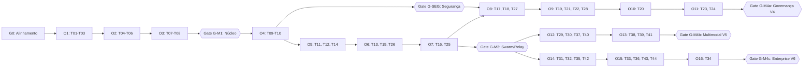

# roadmap — Roadmap Estratégico do hydra-orch

**Identificador Formal:** `roadmap.md`  
**Caminho Canônico:** `doc/a_context/roadmap.md`  
**Versão:** `v01_00_0000`  
**Status:** `PROPOSTO / ATIVO`  
**Autoridade:** Derivado estratégico de [`doc/b_spc/prd_funcional.md`](../b_spc/prd_funcional.md), [`doc/b_spc/prd_tecnico.md`](../b_spc/prd_tecnico.md), [`doc/a_context/plano_desenvolvimento.md`](plano_desenvolvimento.md) e [`doc/g_code/architecture.md`](../g_code/architecture.md) (§6).  
**Escopo:** Horizontes de produto (V0 a V6), marcos de entrega (M1 a M4), gates formais de aceitação (DoR/DoD de marco), timeline visual Mermaid e matriz de riscos arquiteturais.

---

## 1. Purpose (Propósito e Visão Estratégica)

Estabelecer a visão estratégica, os horizontes de entrega e os critérios objetivos de avanço do **hydra-orch** como control plane unificado de engenharia de software agêntica. 

O Roadmap organiza a progressão de maturidade do produto sobre o seguinte princípio arquitetural:  
> **"Verificável antes de visual, local antes de remoto, seguro antes de extensível."**

O produto evolui de um núcleo local comprovável de execução de código em Git worktrees (V0 / M1) até uma plataforma corporativa multi-repositório com RAG híbrido, voz bidirecional, Computer Use e Local LLM Foundry (V6 / M4c).

*Ressalva obrigatória:* O roadmap expressa a ordenação lógica e os critérios de qualidade necessários para cada avanço; a comprovação real de entrega e o status de execução de cada tarefa pertencem unicamente ao [`doc/a_context/backlog.md`](backlog.md).

---

## 2. Why: Mapa de Horizontes e Versões (V0 a V6)

A evolução do produto distribui-se em 7 horizontes arquiteturais, alinhados aos marcos M1 a M4 da arquitetura geral:

| Horizonte | Marco Geral | Épicos | Tasks | Foco Arquitetural e Proposta de Valor | Prioridade |
|---|---|---|---|---|---|
| **V0** | **M1** | EP01 | T01–T08 (58 SP) | **Núcleo Verificável Local:** Um operador, uma tarefa delimitada, executor CLI isolado em worktree real, diff/patch rastreável, checks e integração serializada em branch dedicada. Modo direto sem gateway. | **P0** |
| **V1** | **M2** | EP02 | T09, T26 (13 SP) | **Control Plane Seguro & HITL:** API REST versionada (`/v1/control-plane/*`), autenticação local obrigatória por token, CORS estrito, sanitização centralizada (redaction) e intervenção humano-no-loop (HITL). | **P1** |
| **V2** | **M3a** | EP03 | T10–T13 (23 SP) | **Workspaces e Catálogo de Perfis:** Hierarquia Area $\rightarrow$ Workspace $\rightarrow$ Project $\rightarrow$ Repo, catálogo declarativo de capacidades de agentes/modelos e snapshots imutáveis (`ProfileSnapshot`) com hash SHA-256. | **P1** |
| **V3** | **M3b** | EP04 | T14–T16, T25 (34 SP) | **Coordenação Adaptativa & Orquestração Multi-Modo:** Swarm com DAG acíclico e controle de concorrência, Relay com hot-handoff entre provedores, modo persistente com janela de cota, observabilidade com métricas reais (`observed`/`stale`/`unknown`). | **P1** |
| **G-SEG** | **Gate Transversal** | Transversal | S16, T09 | **Gate de Segurança e Proveniência:** Pré-requisito mandatório para liberação de qualquer task P2/P3. Bloqueia path traversal, vazamento de segredos e ativações automáticas. | **Mandatório** |
| **V4** | **M4a** | EP05–EP08 | T17–T24, T27, T28 (76 SP) | **Governança Avançada & Extensibilidade:** Memória persistente com `ConsentRecord`, discovery local opt-in, plugins em sandbox isolada, resolução 3-way de merge, orçamento rigoroso e PR packaging automático. | **P2** |
| **V5** | **M4b** | EP09–EP10 | T29, T30, T37–T41 (53 SP) | **Multimodalidade & Interação Natural:** Comandos `/compact`, `/plan`, `/build`, controle de esforço (`reasoning_effort`), geração multimodal (imagem/áudio/vídeo), voz duplex WebSocket com barge-in e Computer Use com Safety Governor. | **P3** |
| **V6** | **M4c** | EP11–EP13 | T31–T36, T42–T44 (52 SP) | **Enterprise Knowledge & Local LLM Foundry:** MCP Control Plane avançado, RAG híbrido (vetorial + BM25 FTS5), conectores Jira/Kanbanize/GitHub/GitLab, Hub de LLMs locais e pipeline de quantização GGUF. | **P3** |

---

## 3. Contract: Gates de Saída Objetivos (DoR / DoD de Marco)

O avanço de um horizonte para o seguinte é governado por critérios binários e verificáveis. Um marco nunca é considerado aprovado com base em estimativas de texto, documentação isolada ou alegações não respaldadas por testes herméticos.

### 3.1. Gate G0 (Alinhamento Documental e Governança)
- **Entrada (DoR):** Leitura de `AGENTS.md`, `plano_desenvolvimento.md` e PRDs normativos.
- **Critérios de Saída (DoD):**
  1. Todos os documentos do repositório em estrita conformidade com a taxonomia no singular (`taxonomia_file_system.md`).
  2. Zero ocorrências de termos legados ou referências cruzadas quebradas.
  3. Contadores normativos harmonizados (RF01–RF38, RT01–RT38, RNF01–RNF15, T01–T44, S00–S28, V0–V6, M1–M4).
  4. Ausência de arquivo `LICENSE` formalmente registrada como pendência jurídica (GAP A17).
  5. `git diff --check` 100% limpo e suíte de testes existente aprovada.

### 3.2. Gate G-M1 (Marco M1 — Núcleo Verificável Local / V0)
- **Entrada (DoR):** Gate G0 aprovado; specs S01 a S05 revisadas no PRD técnico.
- **Critérios de Saída (DoD):**
  1. Tasks **T01 a T08** com status `concluido` no backlog.
  2. Suíte de testes offline hermética verde com cobertura mínima $\ge 80\%$ nos módulos centrais e $100\%$ em `src/hydra_orch/model.py` (RNF09).
  3. **Cenário de Execução Real Completo:** Fake subprocess altera arquivo em fixture temporária $\rightarrow$ diff gerado $\rightarrow$ checks executados $\rightarrow$ estado `ready_for_review` $\rightarrow$ comando de revisão $\rightarrow$ integração serializada em branch dedicada com sucesso.
  4. **Critérios Negativos Provados (§7.A do PRD técnico):**
     - CLI de agente ausente gera `executor_unavailable` (nunca finge sucesso — GAP A02).
     - Execução simulada (`simulated=true`) é terminantemente impedida de integrar em branch alvo.
     - Falha de Git não cria pasta comum desprotegida (GAP A06).
     - Timeout e cancelamento encerram comprovadamente toda a árvore de subprocessos sem órfãos (RT04/RNF03).
     - Conflito de merge preserva a worktree e deixa o checkout de trabalho do operador intacto (GAP A05).
  5. Simulação de crash abrupto comprova zero perda de eventos já confirmados no SQLite WAL (RNF04).
  6. Latência de despacho do executor P99 $\le 300\text{ ms}$ (RNF01) e reinicialização completa em $< 5\text{ s}$ (RNF06).
  7. CI offline multiplataforma executando em Linux, macOS e Windows sem depender de contas, GPU ou localhost externo (RNF03).

### 3.3. Gate G-SEG (Gate de Segurança e Proveniência Transversal)
- **Entrada (DoR):** G-M1 aprovado; início do bloco de expansão (T09 concluído).
- **Critérios de Saída (DoD):**
  1. Toda requisição HTTP à API rejeitada com 401 Unauthorized na ausência de token Bearer local.
  2. CORS com allowlist estrita de origens locais; requisições com wildcard (`*`) ou sem origem permitida rejeitadas com 403 Forbidden.
  3. Tentativa de Path Traversal (`../`) em áreas, projetos ou repositórios bloqueada na camada de modelo (RT13).
  4. Motor de Redaction sanitiza ativamente chaves de API, senhas e tokens nos logs e eventos (falso positivo $< 0,1\%$, RNF05).
  5. Tokens armazenados exclusivamente como hashes criptográficos irreversíveis (PBKDF2/Argon2).

### 3.4. Gate G-M2 (Marco M2 — Control Plane e HITL / V1)
- **Entrada (DoR):** G-M1 e G-SEG aprovados.
- **Critérios de Saída (DoD):**
  1. Tasks **T09 e T26** com status `concluido`.
  2. Endpoints do control plane (`/v1/control-plane/*`) testados contra serviço de run com idempotência comprovada por chave única.
  3. Tentativa de acesso a artefatos de outro run rejeitada com 403 Forbidden.
  4. Transição ilegal de estado de execução (ex.: cancelar run já finalizado) rejeitada com 409 Conflict.
  5. Intervenção humano-no-loop (HITL) funcional: pausa auditada em `needs_approval`, expiração por timeout e retomada sem duplicação de efeitos colaterais.

### 3.5. Gate G-M3 (Marco M3 — Workspaces, Perfis e Swarm / V2–V3)
- **Entrada (DoR):** G-M2 aprovado; migrações do banco SQLite (T10) versionadas e testadas com rollback.
- **Critérios de Saída (DoD):**
  1. Tasks **T10 a T16 e T25** com status `concluido`.
  2. Perfil de agente com capabilities incompatíveis rejeitado antes de qualquer spawn de worker (422 Unprocessable Entity).
  3. Replay SSE com cabeçalho `Last-Event-ID` recupera sequência exata de eventos sem gaps e com deduplicação atômica no cliente.
  4. Métricas operacionais em status ausente reportam `unknown` (zero nunca é inventado, RNF08).
  5. Modo direto de inferência opera 100% sem o daemon OmniRoute.
  6. Swarm rejeita grafos de tarefas com dependências cíclicas com 422.
  7. Handoff de relay preserva instruções do sistema e diff Git sem repetir chamadas de ferramentas já executadas.
  8. Concorrência respeita rigorosamente o teto de `max_parallel_worktrees`.

### 3.6. Gate G-M4a (Marco M4a — Governança Avançada & Extensibilidade / V4)
- **Entrada (DoR):** G-M3 e G-SEG aprovados.
- **Critérios de Saída (DoD):**
  1. Tasks **T17 a T24, T27 e T28** com status `concluido`.
  2. Escrita em memória de longo prazo sem `ConsentRecord` explícito rejeitada com 409.
  3. Discovery local restrito a raízes autorizadas; itens modificados recebem status `untrusted` até aprovação do operador.
  4. Extensão de plugin executa em processo isolado sem acesso físico ao arquivo SQLite do núcleo.
  5. Conexão SSH com host key divergente aborta imediatamente a sessão sem bypass.
  6. Gestor de orçamento emite aviso com 80% do teto e congela a execução com 100% (`budget_exhausted`).
  7. Checklist de acessibilidade WCAG AA 100% verificado (navegação por teclado, foco visível, contraste).
  8. Interface CLI estendida cobre 100% das operações de áreas, projetos, perfis, memórias e extensões.

### 3.7. Gate G-M4b (Marco M4b — Multimodal & Interação Natural / V5)
- **Entrada (DoR):** G-M3 aprovado.
- **Critérios de Saída (DoD):**
  1. Tasks **T29, T30, T37 a T41** com status `concluido`.
  2. Comandos de sessão `/plan` executam estritamente em modo read-only (zero mutações de arquivos autorizadas).
  3. Todo artefato multimodal gerado possui hash SHA-256 e tipo MIME verificados (RNF13).
  4. Sessão de voz duplex WebSocket apresenta Time-to-First-Token (TTFT) $< 500\text{ ms}$ com interrupção barge-in funcional (RNF11).
  5. Safety Governor de Computer Use intercepta qualquer ação destrutiva de mouse/teclado exigindo token HITL assinado com validade $\le 60\text{ s}$ (RNF12).

### 3.8. Gate G-M4c (Marco M4c — Enterprise Knowledge & Local Foundry / V6)
- **Entrada (DoR):** G-M3 aprovado; conector T19 funcional.
- **Critérios de Saída (DoD):**
  1. Tasks **T31 a T36, T42 a T44** com status `concluido`.
  2. Modificação dinâmica de ferramentas MCP gera invalidação de cache e status `untrusted`.
  3. Ingestão RAG garante isolamento físico estrito por coleção/área, com zero vazamento entre tenants (RNF14).
  4. Queda de APIs externas de issue trackers (Jira, GitHub) não bloqueia a execução local do orquestrador.
  5. Pipeline de quantização GGUF opera com concorrência máxima 1 e monitoramento de RAM em tempo real (RNF15).

---

## 4. Diagramas Visuais de Alinhamento

### 4.1. Progressão de Horizontes e Ondas

```mermaid
timeline
    title hydra-orch: Roadmap de Horizontes e Ondas de Implementação
    section V0 / M1: Núcleo Verificável
        Onda 1 : T01 Config canônica : T02 Contratos e estados : T03 Store SQLite WAL
        Onda 2 : T04 Runner e fake : T05 Workspace Git : T06 Checks e integração
        Onda 3 : T07 Entrada M1 CLI/API : T08 CI hermético e manual : Gate G-M1
    section V1 / M2: Control Plane
        Onda 4 : T09 Auth e CORS : T10 Migrações control plane : Gate G-SEG
    section V2-V3 / M3: Swarm & Perfis
        Onda 5 : T11 Registry áreas/repos : T12 Catálogo capacidades : T14 Sessões e SSE
        Onda 6 : T13 Perfis imutáveis : T15 Métricas observáveis : T26 HITL
        Onda 7 : T16 Seleção de rotas : T25 Orquestração Swarm/Relay/Persist : Gate G-M3
    section V4 / M4a: Governança
        Onda 8 : T17 Consentimento e memória : T18 Discovery local : T27 Conflitos merge
        Onda 9 : T19 Skills e segredos : T21 Acessibilidade : T22 Transportes : T28 Budget e PR
        Onda 10 : T20 Isolamento de extensões
        Onda 11 : T23 CLI estendida : T24 CI estendido : Gate G-M4a
    section V5 / M4b: Multimodal
        Onda 12 : T29 Comandos sessão : T30 Motor multimodal : T37 Áudio STT/TTS : T40 Automação desktop
        Onda 13 : T38 Voz duplex : T39 Playwright browser : T41 Safety Governor : Gate G-M4b
    section V6 / M4c: Knowledge & Hub
        Onda 14 : T31 MCP control plane : T32 Ingestão RAG : T35 Conector GitHub/GitLab : T42 Hub LLMs locais
        Onda 15 : T33 Armazenamento RAG : T36 Conector Jira/Kanbanize : T43 Quantização GGUF : T44 Modelfiles
        Onda 16 : T34 Retriever RAG : Gate G-M4c
```

### 4.2. Fluxo de Dependências entre Gates e Ondas



---

## 5. Matriz de Riscos Arquiteturais e Mitigações

Os 16 principais riscos arquiteturais mapeados no desenvolvimento do `hydra-orch` e suas estratégias de mitigação:

| ID | Risco Arquitetural | Prob. | Impacto | Afeta | Estratégia de Mitigação | Gatilho de Revisão |
|---|---|---|---|---|---|---|
| **R01** | Cadeia serial estrita T01–T08 sem folga de paralelismo | Alta | Alto | G-M1 | Manter WIP=1 no código; paralelizar apenas documentação de coerência e esqueleto de CI. | Atraso em qualquer elo $> 2$ dias. |
| **R02** | Comportamento de tree-kill divergente entre sistemas operacionais | Média | Alto | T04, RNF03 | Matriz de testes por SO no CI; abstração nativa via `psutil`/`taskkill` no Windows e `os.killpg` no POSIX. | Falha de processo zumbi em teste de cancelamento. |
| **R03** | Instabilidade ou indisponibilidade de CLIs de agentes reais | Média | Alto | G-M1 | O núcleo é 100% certificado via subprocesso fake determinístico; drivers reais possuem certificação isolada. | Falha em ambiente sem CLI externa instalada. |
| **R04** | Colisão de arquivos entre agentes autônomos paralelos | Alta | Médio | Ondas 5–16 | Aplicação compulsória da Matriz Anti-Colisão (Apêndice A do backlog); apenas o líder faz integração. | Tentativa de edição concorrente do mesmo módulo. |
| **R05** | Inversões lógicas de dependência (ex.: T26 depender de T14) | Alta | Médio | G-M2, T26 | Reordenação formal das ondas no backlog (T26 alocada na Onda 6 após T14). | Bloqueio de task por dependência ausente. |
| **R06** | Complexidade excessiva em tasks de 13 SP (T06, T20, T25, T38) | Alta | Alto | O2, O7, O10, O13 | Regra mandatória: divisão obrigatória em subtarefas no documento de spec antes de iniciar a codificação. | Estimativa de implementação ultrapassar 13 SP. |
| **R07** | Migrações de banco (T03/T10) quebrarem schemas legados | Média | Alto | T03, T10 | Banco de dados versionado com script de migração explícito; preservação de tabelas legadas sem descarte forçado. | Erro de parsing em checkpoints antigos. |
| **R08** | Degradação de concorrência no SQLite WAL sob carga local | Média | Médio | T03, T14, RNF07 | Testes de estresse com 10 runs e 20 worktrees; transações curtas e `busy_timeout` calibrado para $5.000\text{ ms}$. | Erro `database is locked` em execuções de teste. |
| **R09** | Janela de vulnerabilidade da API antes de T09 | Média | Alto | T07 | T07 expõe o servidor estritamente em interface loopback (`127.0.0.1`); T09 fecha o gate G-SEG imediatamente na Onda 4. | Acesso não-autenticado originado externamente. |
| **R10** | Sandbox de extensões e plugins (T20) complexa de isolar | Média | Alto | G-M4a | Subprocesso isolado com IPC restrito a pipes e JSON-RPC; sem permissão de escrita direta no file system do host. | Falha de contenção em teste de extensão hostil. |
| **R11** | Dependência de binários externos pesados em V5/V6 (Whisper, Playwright, llama.cpp) | Alta | Médio | T37–T44 | Testes herméticos no CI com adaptadores mock; execução real condicionada a hardware e binários declarados. | Quebra de suíte de testes por falta de binário no CI. |
| **R12** | Latência de áudio duplex (TTFT $< 500\text{ ms}$) inalcançável em hardware comum | Média | Médio | T38, RNF11 | Protocolo de streaming contínuo de chunks de 20ms com VAD local rápido; bypass de modelos pesados em fallback. | TTFT medido ultrapassar $500\text{ ms}$. |
| **R13** | Escopo desproporcional do Marco M4 (28 tasks) | Alta | Médio | M4 | Fatiamento em 3 subgates auditáveis e autônomos: M4a (Governança), M4b (Multimodal), M4c (Enterprise). | Acúmulo de tasks pendentes sem gate fechado. |
| **R14** | Falha de conectividade ou indisponibilidade de ferramentas MCP | Média | Médio | T31 | Healthcheck dinâmico com timeout de 3s e isolamento de falhas: MCP offline é desativado sem derrubar o orquestrador. | Queda de servidor stdio/SSE externo. |
| **R15** | Rota OmniRoute instável ou divergente de cotas presumidas | Média | Baixo | T16 | O orquestrador opera em modo direto de primeira classe; cotas não confirmadas assumem status `unknown`. | Discrepância de saldo de tokens reportado. |
| **R16** | Ausência formal de licença jurídica de distribuição | Baixa | Médio | Release | Registro formal em G0 como pendência jurídica a ser definida pelo titular; sem textos inventados no repo. | Publicação do pacote sem arquivo `LICENSE`. |

### 5.1. Tasks de Maior Fan-Out (Dependências Críticas)
As 8 tarefas estruturais que desbloqueiam o maior número de etapas subsequentes do projeto:

| Task ID | Nome da Task | Número de Tasks Dependentes | Impacto em Caso de Bloqueio |
|---|---|---|---|
| **T04** | Runner e fake de subprocessos | 8 tasks dependentes diretas | Bloqueia Git, transportes, multimodal, voz, quantização e desktop. |
| **T07** | Entrada unificada M1 (CLI/API) | 6 tasks dependentes diretas | Bloqueia auth, sessões, conectores, HITL e budget. |
| **T10** | Migrações control plane | 6 tasks dependentes diretas | Bloqueia todo o ecossistema V2, V4 e V6. |
| **T14** | Sessões, threads e SSE replay | 5 tasks dependentes diretas | Bloqueia métricas, comandos de sessão, voz e retriever RAG. |
| **T03** | Store e migração SQLite WAL | 4 tasks dependentes diretas | Bloqueia todo o pipeline de execução e persistência. |
| **T06** | Checks e integração serializada | 4 tasks dependentes diretas | Bloqueia entrada M1, Swarm adaptativo e resolução de merge. |
| **T09** | Auth local e CORS estrito | 4 tasks dependentes diretas | Bloqueia o Gate G-SEG, memórias, discovery e RAG. |
| **T28** | Budgeting e PR Packaging | 2 tasks dependentes diretas | Bloqueia conectores de issue trackers e fechamento V4. |

---

## 6. Invariants (Garantias Permanentes de Roadmap)

1. **Invariante de Execução Verificável:** Nenhuma capacidade de interface visual, coordenação de swarm ou automação de desktop pode ser implementada ou dada por concluída antes do Marco M1 (execução local comprovada em worktree com diff e checks).
2. **Invariante de Sandbox e Isolamento:** Git worktrees garantem isolamento de sistema de arquivos para controle de versão, mas **não constituem sandbox de segurança**. Limitações de rede e comandos pertencem ao executor.
3. **Invariante de Integridade de Estado:** Toda alteração de estado do orquestrador é registrada primeiramente no banco de dados SQLite WAL antes de ser transmitida a clientes visuais ou terminais.
4. **Invariante de Provedores:** O sistema opera com autonomia total no modo direto; nenhuma dependência externa (provedores pagos, OmniRoute ou gateways remotos) é mandatória para a aprovação dos testes herméticos de desenvolvimento.
5. **Invariante de Governança de Agentes:** Agentes autônomos trabalham em branches dedicadas e worktrees próprias; **apenas o agente líder integra alterações na branch principal e atualiza o estado de conclusão no backlog**.

---

## 7. Governança e Ciclo de Vida do Roadmap

- **Frequência de Revisão:** O Roadmap é revisado a cada fechamento de marco geral (G-M1, G-M2, G-M3, G-M4a, G-M4b, G-M4c) ou na identificação de um novo GAP arquitetural bloqueante.
- **Rastreabilidade Bidirecional:** Qualquer modificação de escopo deve ser refletida simultaneamente em `doc/b_spc/prd_funcional.md`, `doc/b_spc/prd_tecnico.md`, `doc/a_context/roadmap.md` e `doc/a_context/backlog.md`.
- **Auditoria de Conclusão:** O avanço de um horizonte só é publicado no Git após a validação integral da suíte de testes correspondente e atualização formal do checklist de critérios do respectivo Gate de Saída.
