# roadmap — Roadmap Estratégico do hydra-orch

**Identificador Formal:** `roadmap.md`  
**Caminho Canônico:** `doc/a_context/roadmap.md`  
**Versão:** `v02_00_0000`<br>
**Status:** `APROVADO / ESCOPO ENXUTO (V0 a V4)`<br>
**Autoridade:** Derivado estratégico de [`doc/b_spc/prd_funcional.md`](../b_spc/prd_funcional.md), [`doc/b_spc/prd_tecnico.md`](../b_spc/prd_tecnico.md), [`doc/a_context/plano_desenvolvimento.md`](plano_desenvolvimento.md) e [`doc/g_code/architecture.md`](../g_code/architecture.md) (§6).  
**Escopo:** Horizontes de produto focados em Engenharia de Software Autônoma (V0 a V4), marcos de entrega (M1 a M4), gates formais de aceitação (DoR/DoD de marco), timeline visual Mermaid e matriz de riscos arquiteturais. Ideias periféricas (antigos V5 e V6) estão isoladas em [`ideia_futura.md`](ideia_futura.md).

---

## 1. Purpose (Propósito e Visão Estratégica)

Estabelecer a visão estratégica, os horizontes de entrega e os critérios objetivos de avanço do **hydra-orch** como control plane unificado de engenharia de software agêntica.

O Roadmap organiza a progressão de maturidade do produto sobre o seguinte princípio arquitetural:  
> **"Verificável antes de visual, local antes de remoto, seguro antes de extensível, e 100% focado em engenharia de software."**

O produto evolui de um núcleo local comprovável de execução de código em Git worktrees (V0 / M1) até uma plataforma multi-repositório governada com execução Swarm em Duas Ondas (Wave 0: Fundação Compilável + Wave 1: Swarm Paralelo), Handoff por Estado Git/Worktree e empacotamento automatizado de Pull Requests (V4 / M4). Ideias exploratórias fora do domínio estrito de orquestração de código (como geração multimodal de vídeo/áudio, voz duplex, Computer Use e quantização GGUF) permanecem congeladas no Parking Lot ([`doc/a_context/ideia_futura.md`](ideia_futura.md)).

*Ressalva obrigatória:* O roadmap expressa a ordenação lógica e os critérios de qualidade necessários para cada avanço; a comprovação real de entrega e o status de execução de cada tarefa pertencem unicamente ao [`doc/a_context/backlog.md`](backlog.md).

---

## Incrementos iniciais validados

A T01 foi revalidada conforme [S01](../b_spc/configuracao_runtime.md), com configuração estrita, provedores explícitos e política de gateway comprovada offline. O estado e as evidências estão no [backlog](backlog.md#evidência-da-revalidação-da-t01). O primeiro executor planejado é Codex no Windows; revisão e integração serão comandos separados. CLI/API precedem a interface visual. A T02 formalizou os [contratos e estados](../b_spc/contrato_execucao.md), com cobertura integral de linhas no módulo de modelos. A T03 implementou o [store transacional SQLite WAL e migrações versionadas](../b_spc/persistencia_execucao.md), com idempotência, reconciliação pós-crash e replay por cursor. A T04 implementou o [runner de subprocessos e executor fake](../b_spc/executor_cli.md), com `cwd` resolvido, ambiente sanitizado por allowlist, tree kill recursivo e bloqueio de simulação fora de `dry_run`. A T05 implementou o [serviço de workspace Git isolado em worktree real](../b_spc/integracao_git.md), com SHA base fixo, preservação do checkout do operador, auditoria de escopo, integração serializada e limpeza segura de worktrees/locks. A T06 implementou o executor determinístico de checks (`CheckRunner`) e o serviço de aplicação `RunService` em [integracao_git.md](../b_spc/integracao_git.md), unificando execução em worktree, validação de escopo/diff, revisão otimista e integração serializada com checks combinados. A T07 implementou a [entrada unificada M1 na CLI e API REST/SSE sobre `RunService`](../b_spc/api_control_plane.md), com idempotência HTTP/CLI, replay SSE por cursor `Last-Event-ID`, auth loopback/Bearer, allowlist estrita de CORS e códigos de saída determinísticos. A T08 implementou o [pipeline de CI hermético multiplataforma e o manual operacional M1](../b_spc/entrega_operacao.md) (`.github/workflows/ci.yml`, `pyproject.toml` e `doc/j_manual/README.md`), concluindo 100% do **Gate G-M1 (Marco M1 — Núcleo Verificável Local / V0, Tasks T01 a T08)**. A próxima etapa é a Onda 4 (**T09** e **T10** — Gate G-SEG e migrações do control plane).

## 2. Why: Mapa de Horizontes e Versões (V0 a V4)

A evolução do produto distribui-se em 5 horizontes arquiteturais enxutos, alinhados aos marcos M1 a M4 da arquitetura geral:

| Horizonte | Marco Geral | Épicos | Tasks | Foco Arquitetural e Proposta de Valor | Prioridade |
|---|---|---|---|---|---|
| **V0** | **M1** | EP01 | T01–T08 (58 SP) | **Núcleo Verificável Local:** Um operador, uma tarefa delimitada, executor CLI isolado em worktree real, diff/patch rastreável, checks e integração serializada em branch dedicada. Modo direto sem gateway. | **P0** |
| **V1** | **M2** | EP02 | T09, T26 (13 SP) | **Control Plane Seguro & HITL:** API REST versionada (`/v1/control-plane/*`), autenticação local obrigatória por token, CORS estrito, sanitização centralizada (redaction) e intervenção humano-no-loop (HITL). | **P1** |
| **V2** | **M3a** | EP03 | T10–T13 (23 SP) | **Workspaces e Catálogo de Perfis:** Hierarquia Area $\rightarrow$ Workspace $\rightarrow$ Project $\rightarrow$ Repo, catálogo declarativo de capacidades de agentes/modelos e snapshots imutáveis (`ProfileSnapshot`) com hash SHA-256. | **P1** |
| **V3** | **M3b** | EP04 | T14–T16, T25 (34 SP) | **Coordenação Adaptativa & Orquestração Multi-Modo:** Swarm em Duas Ondas (Wave 0: Fundação Compilável $\rightarrow$ Wave 1: Swarm Paralelo com DAG acíclico e trava de dependências), Relay/Persistente com Handoff por Estado Git/Worktree e Retry de Turno Atômico, e observabilidade com métricas reais (`observed`/`stale`/`unknown`). | **P1** |
| **G-SEG** | **Gate Transversal** | Transversal | S16, T09 | **Gate de Segurança e Proveniência:** Pré-requisito mandatório para liberação de qualquer task P2 (V4). Bloqueia path traversal, vazamento de segredos e ativações automáticas. | **Mandatório** |
| **V4** | **M4** | EP05–EP08 | T17–T24, T27, T28 (76 SP) | **Governança Avançada & Entrega Automatizada:** Memória persistente com `ConsentRecord`, discovery local opt-in, plugins em sandbox isolada, resolução 3-way de merge + *Contract Amendment*, orçamento rigoroso e PR packaging automático. | **P2** |

---

## 3. Contract: Gates de Saída Objetivos (DoR / DoD de Marco)

O avanço de um horizonte para o seguinte é governado por critérios binários e verificáveis. Um marco nunca é considerado aprovado com base em estimativas de texto, documentação isolada ou alegações não respaldadas por testes herméticos.

### 3.1. Gate G0 (Alinhamento Documental e Governança)
- **Entrada (DoR):** Leitura de `AGENTS.md`, `plano_desenvolvimento.md` e PRDs normativos.
- **Critérios de Saída (DoD):**
  1. Todos os documentos do repositório em estrita conformidade com a taxonomia no singular (`taxonomia_file_system.md`, incluindo `migration/` no lugar do plural proibido `migrations/`).
  2. Ideias periféricas (antigos V5/V6) isoladas em `doc/a_context/ideia_futura.md`.
  3. Contadores normativos harmonizados (RF01–RF30, RT01–RT30, RNF01–RNF10, T01–T28, S00–S20, V0–V4, M1–M4).
  4. Ausência de arquivo `LICENSE` formalmente registrada como pendência jurídica (GAP A17).
  5. Duplicidades de scaffold entre `core/`, `engine/` e `bridge/` consolidadas e suíte de testes existente aprovada.

### 3.2. Gate G-M1 (Marco M1 — Núcleo Verificável Local / V0)
- **Entrada (DoR):** Gate G0 aprovado; specs S01 a S05 revisadas no PRD técnico.
- **Critérios de Saída (DoD):**
  1. Tasks **T01 a T08** com status `concluido` no backlog.
  2. Suíte de testes offline hermética verde com cobertura mínima $\ge 80\%$ nos módulos centrais e $100\%$ em `src/hydra_orch/model.py` (RNF09).
  3. **Cenário de Execução Real Completo:** Subprocesso executor altera arquivo em fixture temporária $\rightarrow$ diff gerado $\rightarrow$ checks executados $\rightarrow$ estado `ready_for_review` $\rightarrow$ comando de revisão $\rightarrow$ integração serializada em branch dedicada com sucesso.
  4. **Critérios Negativos Provados (§7.A do PRD técnico):**
     - CLI de agente ausente gera `executor_unavailable` (nunca finge sucesso — GAP A02).
     - Execução simulada (`simulated=true`) é terminantemente impedida de integrar em branch alvo.
     - Falha de Git não cria pasta comum desprotegida (GAP A06).
     - Timeout e cancelamento encerram comprovadamente toda a árvore de subprocessos sem órfãos (RT04/RNF03).
     - Conflito de merge preserva a worktree e deixa o checkout de trabalho do operador intacto (GAP A05).
  5. Simulação de crash abrupto comprova zero perda de eventos já confirmados no SQLite WAL (RNF04).
  6. Latência de despacho do executor P99 $\le 300\text{ ms}$ (RNF01) e reinicialização completa em $< 5\text{ s}$ (RNF06).
  7. CI offline multiplataforma executando em Linux, macOS e Windows sem depender de contas, GPU ou localhost externo (RNF03).

### 3.3. Gate G-SEG (Gate de Segurança e Proveniência Transversal)
- **Entrada (DoR):** G-M1 aprovado; início do bloco de expansão (T09 concluído).
- **Critérios de Saída (DoD):**
  1. Toda requisição HTTP à API rejeitada com 401 Unauthorized na ausência de token Bearer local.
  2. CORS com allowlist estrita de origens locais; requisições com wildcard (`*`) ou sem origem permitida rejeitadas com 403 Forbidden.
  3. Tentativa de Path Traversal (`../`) em áreas, projetos ou repositórios bloqueada na camada de modelo (RT13).
  4. Motor de Redaction sanitiza ativamente chaves de API, senhas e tokens nos logs e eventos (falso positivo $< 0,1\%$, RNF05).
  5. Tokens armazenados exclusivamente como hashes criptográficos irreversíveis (PBKDF2/Argon2).

### 3.4. Gate G-M2 (Marco M2 — Control Plane e HITL / V1)
- **Entrada (DoR):** G-M1 e G-SEG aprovados.
- **Critérios de Saída (DoD):**
  1. Tasks **T09 e T26** com status `concluido`.
  2. Endpoints do control plane (`/v1/control-plane/*`) testados contra serviço de run com idempotência comprovada por chave única.
  3. Tentativa de acesso a artefatos de outro run rejeitada com 403 Forbidden.
  4. Transição ilegal de estado de execução (ex.: cancelar run já finalizado) rejeitada com 409 Conflict.
  5. Intervenção humano-no-loop (HITL) funcional: pausa auditada em `needs_approval`, expiração por timeout e retomada sem duplicação de efeitos colaterais.

### 3.5. Gate G-M3 (Marco M3 — Workspaces, Perfis, Swarm em 2 Ondas e Handoff Git / V2–V3)
- **Entrada (DoR):** G-M2 aprovado; migrações do banco SQLite (T10) em `migration/` versionadas e testadas com rollback.
- **Critérios de Saída (DoD):**
  1. Tasks **T10 a T16 e T25** com status `concluido`.
  2. Perfil de agente com capabilities incompatíveis rejeitado antes de qualquer spawn de worker (422 Unprocessable Entity).
  3. Replay SSE com cabeçalho `Last-Event-ID` recupera sequência exata de eventos sem gaps e com deduplicação atômica no cliente.
  4. Métricas operacionais em status ausente reportam `unknown` (zero nunca é inventado, RNF08).
  5. Modo direto de inferência opera 100% sem o daemon OmniRoute.
  6. **Swarm em Duas Ondas (Wave 0 + Wave 1):** Wave 0 cria a fundação compilável (schemas, tipos, dependências em `pyproject.toml`/`package.json` e stubs) e valida com linter/typecheck antes de abrir as worktrees paralelas da Wave 1; mutações não autorizadas em manifestos de dependências durante a Wave 1 são bloqueadas.
  7. **Handoff por Estado Git/Worktree e Retry de Turno Atômico:** Em vez de costurar strings parciais quebradas, interrupções de worker CLI preservam `git status`, `git diff` e relatório de checks na worktree para o próximo agente; quedas no proxy durante `tool_calls` descartam o turno incompleto e reenviam a rodada atômica.
  8. Concorrência respeita rigorosamente o teto de `max_parallel_worktrees`.

### 3.6. Gate G-M4 (Marco M4 — Governança Avançada & Extensibilidade / V4)
- **Entrada (DoR):** G-M3 e G-SEG aprovados.
- **Critérios de Saída (DoD):**
  1. Tasks **T17 a T24, T27 e T28** com status `concluido`.
  2. Escrita em memória de longo prazo sem `ConsentRecord` explícito rejeitada com 409.
  3. Discovery local restrito a raízes autorizadas; itens modificados recebem status `untrusted` até aprovação do operador.
  4. Extensão de plugin executa em processo isolado sem acesso físico ao arquivo SQLite do núcleo.
  5. Conexão SSH com host key divergente aborta imediatamente a sessão sem bypass.
  6. Gestor de orçamento emite aviso com 80% do teto e congela a execução com 100% (`budget_exhausted`).
  7. Checklist de acessibilidade WCAG AA 100% verificado (navegação por teclado, foco visível, contraste).
  8. Interface CLI estendida cobre 100% das operações de áreas, projetos, perfis, memórias e extensões.

---

## 4. Diagramas Visuais de Alinhamento

### 4.1. Progressão de Horizontes e Ondas (Escopo V0–V4)

```mermaid
timeline
    title hydra-orch: Roadmap de Horizontes e Ondas de Implementação (V0 a V4)
    section V0 / M1: Núcleo Verificável
        Onda 1 : T01 Config canônica : T02 Contratos e estados : T03 Store SQLite WAL
        Onda 2 : T04 Runner e fake : T05 Workspace Git : T06 Checks e integração
        Onda 3 : T07 Entrada M1 CLI/API : T08 CI hermético e manual : Gate G-M1
    section V1 / M2: Control Plane
        Onda 4 : T09 Auth e CORS : T10 Migrações control plane : Gate G-SEG
    section V2-V3 / M3: Swarm (Wave 0+1) & Handoff Git
        Onda 5 : T11 Registry áreas/repos : T12 Catálogo capacidades : T14 Sessões e SSE
        Onda 6 : T13 Perfis imutáveis : T15 Métricas observáveis : T26 HITL
        Onda 7 : T16 Seleção de rotas : T25 Orquestração Swarm/Relay/Persist : Gate G-M3
    section V4 / M4: Governança & Entrega
        Onda 8 : T17 Consentimento e memória : T18 Discovery local : T27 Conflitos merge
        Onda 9 : T19 Skills e segredos : T21 Acessibilidade : T22 Transportes : T28 Budget e PR
        Onda 10 : T20 Isolamento de extensões
        Onda 11 : T23 CLI estendida : T24 CI estendido : Gate G-M4
```

### 4.2. Fluxo de Dependências entre Gates e Ondas

```mermaid
flowchart LR
    G0[G0: Alinhamento] --> O1[O1: T01-T03]
    O1 --> O2[O2: T04-T06]
    O2 --> O3[O3: T07-T08]
    O3 --> GM1{{Gate G-M1: Núcleo}}
    
    GM1 --> O4[O4: T09-T10]
    O4 --> GSEG{{Gate G-SEG: Segurança}}
    
    O4 --> O5[O5: T11, T12, T14]
    O5 --> O6[O6: T13, T15, T26]
    O6 --> O7[O7: T16, T25]
    O7 --> GM3{{Gate G-M3: Swarm/Relay}}
    
    GSEG --> O8[O8: T17, T18, T27]
    O7 --> O8
    O8 --> O9[O9: T19, T21, T22, T28]
    O9 --> O10[O10: T20]
    O10 --> O11[O11: T23, T24]
    O11 --> GM4{{Gate G-M4: Governança V4}}
```



---

## 5. Matriz de Riscos Arquiteturais e Mitigações

Os 12 principais riscos arquiteturais mapeados no desenvolvimento do `hydra-orch` (após eliminação do escopo periférico V5/V6) e suas estratégias de mitigação:

| ID | Risco Arquitetural | Prob. | Impacto | Afeta | Estratégia de Mitigação | Gatilho de Revisão |
|---|---|---|---|---|---|---|
| **R01** | Cadeia serial estrita T01–T08 sem folga de paralelismo | Alta | Alto | G-M1 | Manter WIP=1 no código; paralelizar apenas documentação de coerência e esqueleto de CI. | Atraso em qualquer elo $> 2$ dias. |
| **R02** | Comportamento de tree-kill divergente entre sistemas operacionais | Média | Alto | T04, RNF03 | Matriz de testes por SO no CI; abstração nativa via `psutil`/`taskkill` no Windows e `os.killpg` no POSIX. | Falha de processo zumbi em teste de cancelamento. |
| **R03** | Instabilidade ou indisponibilidade de CLIs de agentes reais | Média | Alto | G-M1 | O núcleo é 100% certificado via subprocesso fake determinístico; drivers reais possuem certificação isolada. | Falha em ambiente sem CLI externa instalada. |
| **R04** | Colisão de arquivos entre agentes autônomos paralelos | Alta | Médio | Ondas 5–11 | Aplicação compulsória da Matriz Anti-Colisão (Apêndice A do backlog) + execução Wave 0 antes da Wave 1; apenas o líder integra. | Tentativa de edição concorrente do mesmo módulo. |
| **R05** | Mutações concorrentes de `.venv` / `node_modules` via symlink nas worktrees | Alta | Alto | T05, T25 | Declarar e instalar dependências exclusivamente na Wave 0 (Fundação); bloquear edição de `pyproject.toml`/`package.json` nas worktrees paralelas da Wave 1. | Modificação de manifesto de pacotes em worktree da Wave 1. |
| **R06** | Complexidade excessiva em tasks de 13 SP (T06, T20, T25) | Alta | Alto | O2, O7, O10 | Regra mandatória: divisão obrigatória em subtarefas no documento de spec antes de iniciar a codificação. | Estimativa de implementação ultrapassar 13 SP. |
| **R07** | Migrações de banco (T03/T10) quebrarem schemas legados | Média | Alto | T03, T10 | Banco de dados versionado em `migration/` com script de migração explícito; preservação de tabelas legadas sem descarte forçado. | Erro de parsing em checkpoints antigos. |
| **R08** | Degradação de concorrência no SQLite WAL sob carga local | Média | Médio | T03, T14, RNF07 | Testes de estresse com 10 runs e 20 worktrees; transações curtas e `busy_timeout` calibrado para $5.000\text{ ms}$. | Erro `database is locked` em execuções de teste. |
| **R09** | Janela de vulnerabilidade da API antes de T09 | Média | Alto | T07 | T07 expõe o servidor estritamente em interface loopback (`127.0.0.1`); T09 fecha o gate G-SEG imediatamente na Onda 4. | Acesso não-autenticado originado externamente. |
| **R10** | Sandbox de extensões e plugins (T20) complexa de isolar | Média | Alto | G-M4 | Subprocesso isolado com IPC restrito a pipes e JSON-RPC; sem permissão de escrita direta no file system do host. | Falha de contenção em teste de extensão hostil. |
| **R11** | Rota OmniRoute instável ou divergente de cotas presumidas | Média | Baixo | T16 | O orquestrador opera em modo direto de primeira classe; cotas não confirmadas assumem status `unknown`. | Discrepância de saldo de tokens reportado. |
| **R12** | Ausência formal de licença jurídica de distribuição | Baixa | Médio | Release | Registro formal em G0 como pendência jurídica a ser definida pelo titular; sem textos inventados no repo. | Publicação do pacote sem arquivo `LICENSE`. |

### 5.1. Tasks de Maior Fan-Out (Dependências Críticas)
As tarefas estruturais que desbloqueiam o maior número de etapas subsequentes do projeto:

| Task ID | Nome da Task | Tasks Dependentes Diretas | Impacto em Caso de Bloqueio |
|---|---|---|---|
| **T04** | Runner e fake de subprocessos | T05, T12, T22 | Bloqueia Git workspace, catálogo de agentes e transportes certificados. |
| **T07** | Entrada unificada M1 (CLI/API) | T08, T09, T14, T26, T28 | Bloqueia CI M1, auth, sessões SSE, HITL e budget/PR. |
| **T10** | Migrações control plane | T11, T12, T14, T15, T17 | Bloqueia todo o ecossistema V2, V3 e V4. |
| **T03** | Store e migração SQLite WAL | T04, T10, T14, T15 | Bloqueia todo o pipeline de execução e persistência. |
| **T06** | Checks e integração serializada | T07, T25, T27 | Bloqueia entrada M1, Swarm adaptativo e resolução de merge. |
| **T09** | Auth local e CORS estrito | T10, T17, T18, T22 | Bloqueia o Gate G-SEG, memórias, discovery e transportes. |

---

## 6. Invariants (Garantias Permanentes de Roadmap)

1. **Invariante de Execução Verificável:** Nenhuma capacidade de interface visual ou coordenação de swarm pode ser implementada ou dada por concluída antes do Marco M1 (execução local comprovada em worktree com diff e checks).
2. **Invariante de Sandbox e Isolamento:** Git worktrees garantem isolamento de sistema de arquivos para controle de versão, mas **não constituem sandbox de segurança**. Limitações de rede e comandos pertencem ao executor, e manifestos de dependências (`pyproject.toml`, `package.json`) são bloqueados para escrita durante a Wave 1 paralela.
3. **Invariante de Handoff Verificável:** Retomadas (Relay e Persistente) operam sobre o estado real do Git/Worktree (`git diff`, `git status` e resultados de checks) para agentes CLI e por retry de turno atômico no proxy HTTP — jamais por concatenação cega de strings de código truncadas no meio de `tool_calls`.
4. **Invariante de Integridade de Estado:** Toda alteração de estado do orquestrador é registrada primeiramente no banco de dados SQLite WAL antes de ser transmitida a clientes visuais ou terminais.
5. **Invariante de Provedores:** O sistema opera com autonomia total no modo direto; nenhuma dependência externa (provedores pagos, OmniRoute ou gateways remotos) é mandatória para a aprovação dos testes herméticos de desenvolvimento.
6. **Invariante de Governança de Agentes:** Agentes autônomos trabalham em branches dedicadas e worktrees próprias; **apenas o agente líder integra alterações na branch principal e atualiza o estado de conclusão no backlog**.

---

## 7. Governança e Ciclo de Vida do Roadmap

- **Frequência de Revisão:** O Roadmap é revisado a cada fechamento de marco geral (G-M1, G-M2, G-M3, G-M4) ou na identificação de um novo GAP arquitetural bloqueante.
- **Rastreabilidade Bidirecional:** Qualquer modificação de escopo deve ser refletida simultaneamente em `doc/b_spc/prd_funcional.md`, `doc/b_spc/prd_tecnico.md`, `doc/a_context/roadmap.md` e `doc/a_context/backlog.md`.
- **Ideias Futuras (Parking Lot):** Qualquer proposta fora do núcleo de orquestração de engenharia de software deve ser registrada em [`doc/a_context/ideia_futura.md`](ideia_futura.md).
