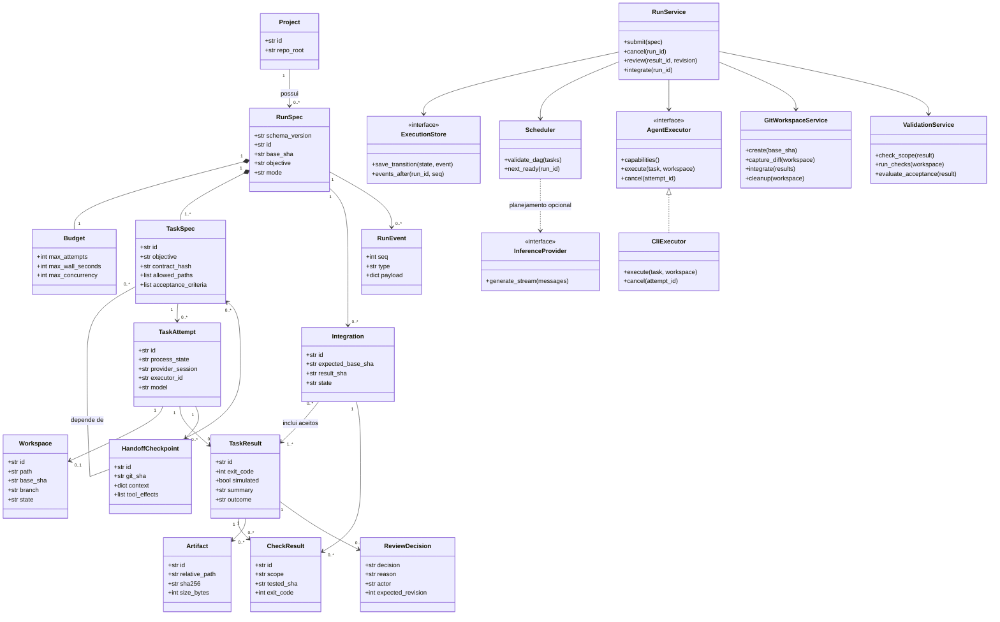

# Diagrama de classes

Status: modelo alvo proposto, não engenharia reversa das classes atuais. Contratos em [PRD técnico](prd_tecnico.md); persistência em [MER](mer.md).

## 1. Propósito

Definir entidades, serviços e interfaces para execução verificável.

## 2. Justificativa

Separar dados, decisões e transporte permite testar sem contas externas e consolidar os motores existentes.

## 3. Contrato estrutural

RunSpec/TaskSpec são snapshots imutáveis. Estado operacional e revisão pertencem aos registros Run/Task no MER; não alterar o snapshot para registrar progresso. TaskResult é evidência imutável, ReviewDecision é decisão posterior. Métodos ilustram responsabilidades; assinaturas Python completas serão fixadas nas specs de módulo.

## 4. Pré-condições

Run possui projeto e pelo menos uma tarefa; dependências pertencem ao mesmo run. Attempt pode existir sem workspace quando preparação falha.

## 5. Pós-condições

Tentativa terminada produz resultado ou falha de persistência explicitamente reconciliável. Checks de integração pertencem à combinação, não substituem checks da tentativa.

## 6. Invariantes

No máximo uma tentativa ativa por tarefa. Integração inclui apenas resultados aceitos e reais. Serviço de aplicação é o único coordenador das transições. Executor não depende da UI nem decide aceite.

## 7. Falhas

Capability ausente impede dispatch; DAG cíclico impede agendamento; revisão vencida impede aceite. Processo zero sem evidência não atravessa ValidationService.

## 8. Aplicação

T02 implementa entidades; T03 store; T04 executor; T05 workspace; T06 validação/integração; T07 serviço público. Scheduler paralelo entra em S06. Não criar todos os serviços como classes vazias antecipadamente.

## 9. Exemplo

RunService recebe RunSpec, persiste início, solicita workspace e executor, coleta TaskResult, valida e espera ReviewDecision. Após aceite, GitWorkspaceService prepara Integration e ValidationService valida a combinação.
