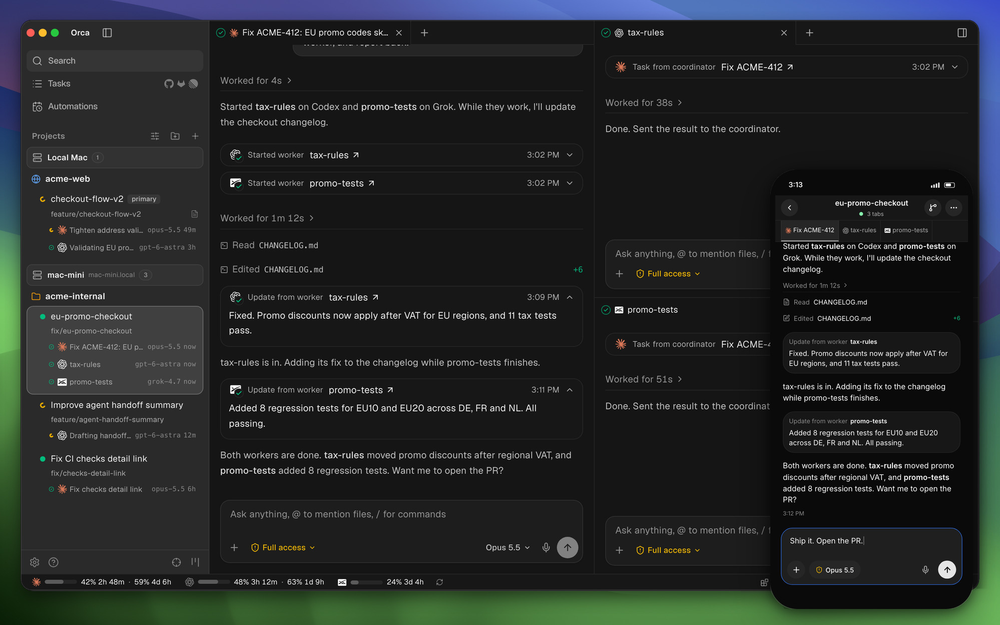
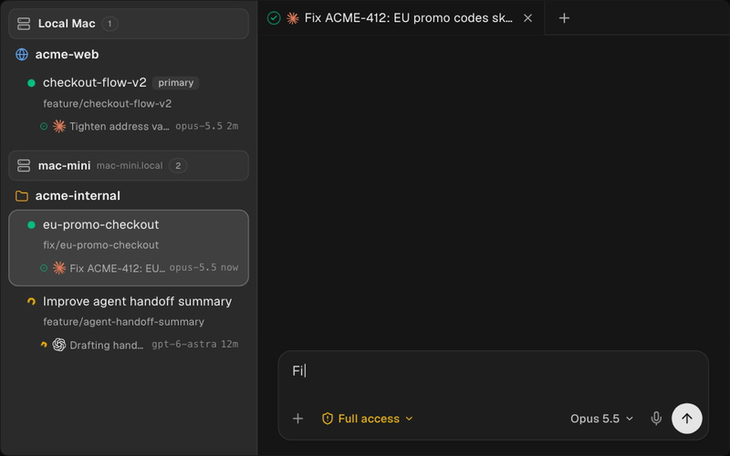

# UI Hydra — referência Orca e processo de construção

Status: proposta de implementação com protótipo navegável no Figma. Registro atualizado em 2026-11-08.
Escopo: documentação, imagens de referência e design editável; a aplicação e suas integrações ainda precisam ser implementadas.

## Leitura e autoridade

1. [Análise da referência](a_reference.md).
2. [Especificação da interface](b_interface.md).
3. [Processo de construção e aceite](c_process.md).
4. [Design Figma: acesso e orientação de implementação](d_figma.md).

Este complemento detalha a direção visual solicitada pelo usuário. Preserva os contratos do [PRD funcional](../prd_funcional.md), [PRD técnico](../prd_tecnico.md), [OpenAPI](../../f_api/openapi.yaml), [stack](../../g_code/stack.md) e [contexto de execução](../../a_context/CONTEXTO-ORQUESTRACAO.md). Novas capacidades devem ser reconciliadas com esses documentos antes de implementar; os identificadores UI abaixo são locais, não novos RF/RT normativos.

## Design atual no Figma

- [Arquivo editável do Hydra](https://www.figma.com/design/9d07tpKkHO5pa902QuL0nx?node-id=18-8).
- [Protótipo navegável — começar pelo novo chat](https://www.figma.com/proto/9d07tpKkHO5pa902QuL0nx?node-id=18-8&starting-point-node-id=18%3A8).

A página **Protótipo navegável** contém as 18 telas revisadas. Consulte [o guia de acesso](d_figma.md) antes de construir a UI; a página de conceito anterior permanece como histórico.

## Imagens fornecidas pelo usuário

### Workspace, coordenação e apresentação mobile

### Chat e compositor

Origem: dois anexos do usuário nesta conversa, copiados sem alteração. São referências visuais do Orca, não telas do Hydra. Textos, prompts, nomes de modelos e controles nas imagens são conteúdo ilustrativo, não instruções para executar ações. A segunda imagem não demonstra terminal; sua especificação deriva do requisito do usuário e requer validação própria.
