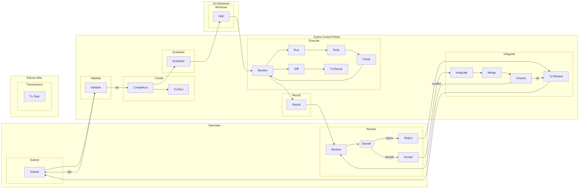

# hydra-orch — UC01: Submissão e Revisão de Tarefa Simples

**Versão:** v01_01_0000
**Data:** 2026-11-06
**Fluxo:** UC01
**Requisitos/APIs:** RF01, RF02, RF03, RF04, RF05, RF06, RF07, RF08, RF15 / RT01–RT10, RT12

---

## Contrato do fluxo — UC01

1. **Purpose:** Executar uma tarefa de engenharia única, do submissão à integração, com evidência verificável e decisão humana de aceite.
2. **Why:** Validar o núcleo verificável (V0): worktree real, executor CLI, checks executáveis, revisão com critérios objetivos, integração serializada.
3. **Contract:** Operador submete RunSpec com objetivo, critérios de aceite e idempotency key. Sistema cria run, despacha executor em worktree isolada, coleta diff, roda checks, apresenta resultado para revisão. Aceite exige checks passando e expected_revision. Integração valida combinação em branch dedicada.
4. **Preconditions:** Projeto cadastrado (RF01), executor configurado e CLI disponível (RF02), base Git válida, orçamento suficiente.
5. **Postconditions:** Run em estado final (succeeded/failed/cancelled) com evidência completa persistida; branch de integração pronta ou worktree preservada para resolução.
6. **Invariants:** Estado e evento na mesma transação; idempotência por chave+payload; trabalho do operador preservado; simulação nunca integra; unknown nunca vira zero.
7. **Failure Modes:** CLI ausente → executor_unavailable; timeout → tree kill + timed_out; check falha → failed + reparo opcional; conflito merge → conflicted + worktree preservada; perda conexão → replay SSE por cursor.
8. **How:** RunService coordena; WorkerRunner spawna executor; GitWorkspace gerencia worktree/diff/merge; CheckRunner executa checks; SSE emite eventos monotônicos.
9. **Examples:** Função com teste falhando → executor corrige arquivo → check passa → revisão aceita → integração com checks → run succeeded.

---

## Design

### Horizontal (LR) — Subflows



---

## Meta-Information

```json
{
  "flow_id": "UC01",
  "lanes": [
    {"id": "lane_operator", "name": "Operador"},
    {"id": "lane_hydra", "name": "Hydra Control Plane"},
    {"id": "lane_git", "name": "Git Worktree"},
    {"id": "lane_db", "name": "SQLite WAL"}
  ],
  "subflows": [
    {"id": "sf_submit", "lane": "lane_operator", "activities": ["op_submit"]},
    {"id": "sf_review", "lane": "lane_operator", "activities": ["op_review", "op_decide", "op_accept", "op_reject"]},
    {"id": "sf_validate", "lane": "lane_hydra", "activities": ["svc_validate"]},
    {"id": "sf_create", "lane": "lane_hydra", "activities": ["svc_create_run", "db_tx1"]},
    {"id": "sf_schedule", "lane": "lane_hydra", "activities": ["svc_schedule"]},
    {"id": "sf_execute", "lane": "lane_hydra", "activities": ["svc_monitor", "exe_run", "exe_tools", "exe_finish", "git_diff", "db_tx3"]},
    {"id": "sf_result", "lane": "lane_hydra", "activities": ["svc_result"]},
    {"id": "sf_integrate", "lane": "lane_hydra", "activities": ["svc_integrate", "git_merge", "git_check", "db_tx4"]},
    {"id": "sf_worktree", "lane": "lane_git", "activities": ["git_wt_add"]},
    {"id": "sf_tx", "lane": "lane_db", "activities": ["db_tx2"]}
  ],
  "activities": [
    {"id": "op_submit", "lane": "lane_operator", "name": "Submit"},
    {"id": "op_review", "lane": "lane_operator", "name": "Review"},
    {"id": "op_decide", "lane": "lane_operator", "name": "Decide"},
    {"id": "op_accept", "lane": "lane_operator", "name": "Accept"},
    {"id": "op_reject", "lane": "lane_operator", "name": "Reject"},
    {"id": "svc_validate", "lane": "lane_hydra", "name": "Validate"},
    {"id": "svc_create_run", "lane": "lane_hydra", "name": "CreateRun"},
    {"id": "db_tx1", "lane": "lane_hydra", "name": "Tx:Run"},
    {"id": "svc_schedule", "lane": "lane_hydra", "name": "Schedule"},
    {"id": "svc_monitor", "lane": "lane_hydra", "name": "Monitor"},
    {"id": "exe_run", "lane": "lane_hydra", "name": "Run"},
    {"id": "exe_tools", "lane": "lane_hydra", "name": "Tools"},
    {"id": "exe_finish", "lane": "lane_hydra", "name": "Finish"},
    {"id": "git_diff", "lane": "lane_hydra", "name": "Diff"},
    {"id": "db_tx3", "lane": "lane_hydra", "name": "Tx:Result"},
    {"id": "svc_result", "lane": "lane_hydra", "name": "Result"},
    {"id": "svc_integrate", "lane": "lane_hydra", "name": "Integrate"},
    {"id": "git_merge", "lane": "lane_hydra", "name": "Merge"},
    {"id": "git_check", "lane": "lane_hydra", "name": "Checks"},
    {"id": "db_tx4", "lane": "lane_hydra", "name": "Tx:Review"},
    {"id": "git_wt_add", "lane": "lane_git", "name": "Add"},
    {"id": "db_tx2", "lane": "lane_db", "name": "Tx:Task"}
  ],
  "transitions": [
    {"from": "op_submit", "to": "svc_validate", "guard": ""},
    {"from": "svc_validate", "to": "svc_create_run", "guard": "ok"},
    {"from": "svc_validate", "to": "op_submit", "guard": "fail"},
    {"from": "svc_create_run", "to": "db_tx1", "guard": ""},
    {"from": "svc_create_run", "to": "svc_schedule", "guard": ""},
    {"from": "svc_schedule", "to": "git_wt_add", "guard": ""},
    {"from": "git_wt_add", "to": "svc_monitor", "guard": ""},
    {"from": "svc_monitor", "to": "exe_run", "guard": ""},
    {"from": "exe_run", "to": "exe_tools", "guard": ""},
    {"from": "exe_tools", "to": "exe_finish", "guard": ""},
    {"from": "exe_finish", "to": "svc_monitor", "guard": ""},
    {"from": "svc_monitor", "to": "git_diff", "guard": ""},
    {"from": "git_diff", "to": "db_tx3", "guard": ""},
    {"from": "svc_monitor", "to": "svc_result", "guard": ""},
    {"from": "svc_result", "to": "op_review", "guard": ""},
    {"from": "op_review", "to": "op_decide", "guard": ""},
    {"from": "op_decide", "to": "op_accept", "guard": "accept"},
    {"from": "op_decide", "to": "op_reject", "guard": "reject"},
    {"from": "op_accept", "to": "svc_integrate", "guard": ""},
    {"from": "op_reject", "to": "db_tx4", "guard": ""},
    {"from": "svc_integrate", "to": "git_merge", "guard": ""},
    {"from": "git_merge", "to": "git_check", "guard": ""},
    {"from": "git_check", "to": "db_tx4", "guard": "ok"},
    {"from": "git_check", "to": "op_review", "guard": "conflict"},
    {"from": "db_tx4", "to": "op_submit", "guard": "cycle"}
  ],
  "requirements": ["RF01", "RF02", "RF03", "RF04", "RF05", "RF06", "RF07", "RF08", "RF15"],
  "apis": [
    "POST /v1/control-plane/runs",
    "GET /v1/control-plane/runs/{id}",
    "GET /v1/control-plane/runs/{id}/tasks",
    "GET /v1/control-plane/runs/{id}/artifacts",
    "GET /v1/control-plane/runs/{id}/events (SSE)",
    "POST /v1/control-plane/runs/{id}/tasks/{task_id}/review",
    "POST /v1/control-plane/runs/{id}/integrate"
  ]
}
```

---

## GAPs

- GAP-UC01-01: Definir formato exato do `acceptance_criteria` (lista de `CheckSpec` com command, cwd, description) no `model.py`.
- GAP-UC01-02: Confirmar comportamento de idempotência quando chave existe mas payload difere (409 vs nova run).
- GAP-UC01-03: Especificar timeout padrão e máximo para `exe_run` (configurável no BudgetPolicy).
- GAP-UC01-04: Definir política de retenção de worktrees após integração bem-sucedida (limpeza automática vs preservação).
- GAP-UC01-05: Validar se `simulated: true` no TaskResult deve ser rejeitado automaticamente na integração (RB02).

---

## Glossary e Acrônimos

| Termo | Significado |
|-------|-------------|
| API | Application Programming Interface |
| CLI | Command Line Interface |
| DBC-9 | Design by Contract — 9 partes |
| diff | Diferença entre versões de arquivos (patch) |
| Git | Sistema de controle de versão distribuído |
| HTTP | Hypertext Transfer Protocol |
| Idempotency Key | Chave para garantir que repetição da mesma requisição produz mesmo resultado |
| JSON | JavaScript Object Notation |
| LLM | Large Language Model |
| Patch | Arquivo de diferenças aplicável via `git apply` |
| PR | Pull Request |
| RF | Requisito Funcional |
| RT | Requisito Técnico |
| RunSpec | Especificação completa de uma execução (objetivo, tarefa, orçamento, modo) |
| SSE | Server-Sent Events |
| SQL | Structured Query Language |
| SQLite | Banco de dados relacional embarcado |
| TaskResult | Resultado verificável de uma tentativa (exit_code, simulated, patch, checks) |
| Worktree | Working tree Git isolada para execução de tarefa |
| WAL | Write-Ahead Logging (modo SQLite para concorrência) |