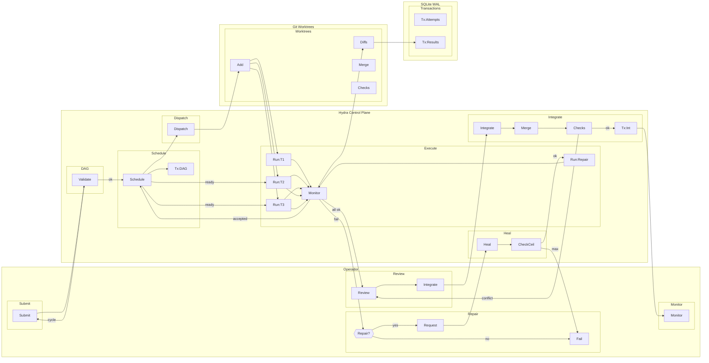

# SAE — hydra-orch — UC02: Execução em Swarm com Auto-Healing

**Versão:** v01_01_0000
**Data:** 2026-11-06
**Fluxo:** UC02
**Requisitos/APIs:** RF03, RF04, RF05, RF06, RF09, RF12, RF15 / RT04, RT05, RT06, RT07, RT12

---

## Contrato do fluxo — UC02

1. **Purpose:** Executar múltiplas tarefas em paralelo (DAG) com worktrees isoladas, reparo automático de checks falhos e integração serializada.
2. **Why:** Validar modo Swarm (V0/V3): DAG válido, scheduler com semáforo, auto-healing com teto de tentativas, merge ordenado.
3. **Contract:** Operador submete run com múltiplas TaskSpecs e dependências. Scheduler valida DAG acíclico (Kahn), despacha tarefas `ready` até `max_parallel_worktrees`. Falha em check → reparo (nova tentativa com prompt cirúrgico, teto `max_repair_attempts`). Tarefas dependentes só despacham após pré-requisitos `accepted`. Integração serializada por posição topológica.
4. **Preconditions:** Projeto cadastrado, perfil com modo `swarm`, DAG válido, concorrência configurada, executores disponíveis.
5. **Postconditions:** Todas tarefas obrigatórias `accepted` e integradas com checks combinados passando; ou worktrees preservadas para resolução manual.
6. **Invariants:** DAG acíclico validado na submissão; concorrência respeita semáforo; tentativas de reparo imutáveis; integração serializada e atômica por run.
7. **Failure Modes:** Ciclo no DAG → 422 na submissão; reparo esgota teto → failed final + dependentes bloqueadas; cancelamento → tree kill todas ativas + worktrees preservadas; crash executor → reconciliação antes de retry.
8. **How:** RunService + SwarmEngine (DAG, scheduler, semáforo); WorkerRunner por tarefa; HealerEngine (extração falha, prompt reparo, teto); GitWorkspace (worktrees paralelas, merge serializado).
9. **Examples:** T1→T2, T1→T3. T1 falha check → reparo (tentativa 2) → aceita → T2,T3 paralelas → integração T1,T2,T3 ordem topológica.

---

## Design

### Horizontal (LR) — Subflows



---

## Meta-Information

```json
{
  "flow_id": "UC02",
  "lanes": [
    {"id": "lane_operator", "name": "Operador"},
    {"id": "lane_hydra", "name": "Hydra Control Plane"},
    {"id": "lane_git", "name": "Git Worktrees"},
    {"id": "lane_db", "name": "SQLite WAL"}
  ],
  "subflows": [
    {"id": "sf_submit", "lane": "lane_operator", "activities": ["op_submit"]},
    {"id": "sf_monitor", "lane": "lane_operator", "activities": ["op_monitor"]},
    {"id": "sf_repair", "lane": "lane_operator", "activities": ["op_repair", "op_repair_yes", "op_repair_no"]},
    {"id": "sf_review", "lane": "lane_operator", "activities": ["op_review", "op_integrate"]},
    {"id": "sf_dag", "lane": "lane_hydra", "activities": ["svc_validate_dag"]},
    {"id": "sf_sched", "lane": "lane_hydra", "activities": ["svc_scheduler", "db_dag"]},
    {"id": "sf_dispatch", "lane": "lane_hydra", "activities": ["svc_dispatch"]},
    {"id": "sf_execute", "lane": "lane_hydra", "activities": ["svc_monitor", "exe_t1", "exe_t2", "exe_t3", "exe_repair"]},
    {"id": "sf_heal", "lane": "lane_hydra", "activities": ["svc_healer", "svc_healer_check"]},
    {"id": "sf_integrate", "lane": "lane_hydra", "activities": ["svc_integrate", "git_merge_seq", "git_checks_int", "db_integration"]},
    {"id": "sf_wt", "lane": "lane_git", "activities": ["git_wt_multi", "git_diffs", "git_merge_seq2", "git_checks_int2"]},
    {"id": "sf_tx", "lane": "lane_db", "activities": ["db_attempts", "db_results"]}
  ],
  "activities": [
    {"id": "op_submit", "lane": "lane_operator", "name": "Submit"},
    {"id": "op_monitor", "lane": "lane_operator", "name": "Monitor"},
    {"id": "op_repair", "lane": "lane_operator", "name": "Repair?"},
    {"id": "op_repair_yes", "lane": "lane_operator", "name": "Request"},
    {"id": "op_repair_no", "lane": "lane_operator", "name": "Fail"},
    {"id": "op_review", "lane": "lane_operator", "name": "Review"},
    {"id": "op_integrate", "lane": "lane_operator", "name": "Integrate"},
    {"id": "svc_validate_dag", "lane": "lane_hydra", "name": "Validate"},
    {"id": "svc_scheduler", "lane": "lane_hydra", "name": "Schedule"},
    {"id": "db_dag", "lane": "lane_hydra", "name": "Tx:DAG"},
    {"id": "svc_dispatch", "lane": "lane_hydra", "name": "Dispatch"},
    {"id": "svc_monitor", "lane": "lane_hydra", "name": "Monitor"},
    {"id": "exe_t1", "lane": "lane_hydra", "name": "Run:T1"},
    {"id": "exe_t2", "lane": "lane_hydra", "name": "Run:T2"},
    {"id": "exe_t3", "lane": "lane_hydra", "name": "Run:T3"},
    {"id": "exe_repair", "lane": "lane_hydra", "name": "Run:Repair"},
    {"id": "svc_healer", "lane": "lane_hydra", "name": "Heal"},
    {"id": "svc_healer_check", "lane": "lane_hydra", "name": "CheckCeil"},
    {"id": "svc_integrate", "lane": "lane_hydra", "name": "Integrate"},
    {"id": "git_merge_seq", "lane": "lane_hydra", "name": "Merge"},
    {"id": "git_checks_int", "lane": "lane_hydra", "name": "Checks"},
    {"id": "db_integration", "lane": "lane_hydra", "name": "Tx:Int"},
    {"id": "git_wt_multi", "lane": "lane_git", "name": "Add"},
    {"id": "git_diffs", "lane": "lane_git", "name": "Diffs"},
    {"id": "git_merge_seq2", "lane": "lane_git", "name": "Merge"},
    {"id": "git_checks_int2", "lane": "lane_git", "name": "Checks"},
    {"id": "db_attempts", "lane": "lane_db", "name": "Tx:Attempts"},
    {"id": "db_results", "lane": "lane_db", "name": "Tx:Results"}
  ],
  "transitions": [
    {"from": "op_submit", "to": "svc_validate_dag", "guard": ""},
    {"from": "svc_validate_dag", "to": "svc_scheduler", "guard": "ok"},
    {"from": "svc_validate_dag", "to": "op_submit", "guard": "cycle"},
    {"from": "svc_scheduler", "to": "db_dag", "guard": ""},
    {"from": "svc_scheduler", "to": "svc_dispatch", "guard": ""},
    {"from": "svc_dispatch", "to": "git_wt_multi", "guard": ""},
    {"from": "git_wt_multi", "to": "exe_t1", "guard": ""},
    {"from": "git_wt_multi", "to": "exe_t2", "guard": ""},
    {"from": "git_wt_multi", "to": "exe_t3", "guard": ""},
    {"from": "exe_t1", "to": "svc_monitor", "guard": ""},
    {"from": "exe_t2", "to": "svc_monitor", "guard": ""},
    {"from": "exe_t3", "to": "svc_monitor", "guard": ""},
    {"from": "svc_monitor", "to": "git_diffs", "guard": ""},
    {"from": "git_diffs", "to": "db_results", "guard": ""},
    {"from": "svc_monitor", "to": "op_repair", "guard": "fail"},
    {"from": "op_repair", "to": "op_repair_yes", "guard": "yes"},
    {"from": "op_repair", "to": "op_repair_no", "guard": "no"},
    {"from": "op_repair_yes", "to": "svc_healer", "guard": ""},
    {"from": "svc_healer", "to": "svc_healer_check", "guard": ""},
    {"from": "svc_healer_check", "to": "exe_repair", "guard": "ok"},
    {"from": "svc_healer_check", "to": "op_repair_no", "guard": "max"},
    {"from": "exe_repair", "to": "svc_monitor", "guard": ""},
    {"from": "svc_monitor", "to": "svc_scheduler", "guard": "accepted"},
    {"from": "svc_scheduler", "to": "exe_t2", "guard": "ready"},
    {"from": "svc_scheduler", "to": "exe_t3", "guard": "ready"},
    {"from": "exe_t2", "to": "svc_monitor", "guard": ""},
    {"from": "exe_t3", "to": "svc_monitor", "guard": ""},
    {"from": "svc_monitor", "to": "op_review", "guard": "all ok"},
    {"from": "op_review", "to": "op_integrate", "guard": ""},
    {"from": "op_integrate", "to": "svc_integrate", "guard": ""},
    {"from": "svc_integrate", "to": "git_merge_seq", "guard": ""},
    {"from": "git_merge_seq", "to": "git_checks_int", "guard": ""},
    {"from": "git_checks_int", "to": "db_integration", "guard": "ok"},
    {"from": "git_checks_int", "to": "op_review", "guard": "conflict"},
    {"from": "db_integration", "to": "op_monitor", "guard": "done"}
  ],
  "requirements": ["RF03", "RF04", "RF05", "RF06", "RF09", "RF12", "RF15"],
  "apis": [
    "POST /v1/control-plane/runs (com DAG)",
    "GET /v1/control-plane/runs/{id}/events (SSE)",
    "POST /v1/control-plane/runs/{id}/tasks/{task_id}/retry",
    "POST /v1/control-plane/runs/{id}/tasks/{task_id}/review",
    "POST /v1/control-plane/runs/{id}/integrate",
    "POST /v1/control-plane/runs/{id}/cancel"
  ]
}
```

---

## GAPs

- GAP-UC02-01: Definir algoritmo exato de extração de falha por linguagem/tool (regex stack trace + arquivo:linha).
- GAP-UC02-02: Confirmar se `max_repair_attempts` é por task ou global por run (atualmente por task no BudgetPolicy).
- GAP-UC02-03: Especificar comportamento quando tarefa independente falha e esgota reparo: run continua ou falha global?
- GAP-UC02-04: Definir estratégia de merge serializada: rebase vs merge --no-ff; ordem topológica vs ordem de aceitação.
- GAP-UC02-05: Validar se checks de integração são os mesmos das tasks ou conjunto expandido.

---

## Glossary e Acrônimos

| Termo | Significado |
|-------|-------------|
| DAG | Directed Acyclic Graph |
| Kahn | Algoritmo de Kahn para ordenação topológica |
| Semaphore | Controle de concorrência assíncrono |
| HealerEngine | Motor de auto-reparo |
| max_repair_attempts | Teto máximo de tentativas de reparo por tarefa |
| Worktree | Working tree Git isolada |
| Merge Serializado | Integração sequencial por ordem topológica |
| Checks Combinados | Reexecução de todos os checks no contexto integrado |
| Ordinal | Número da tentativa (1, 2, 3...) |
| Parent Attempt | Tentativa anterior referenciada para rastreabilidade |