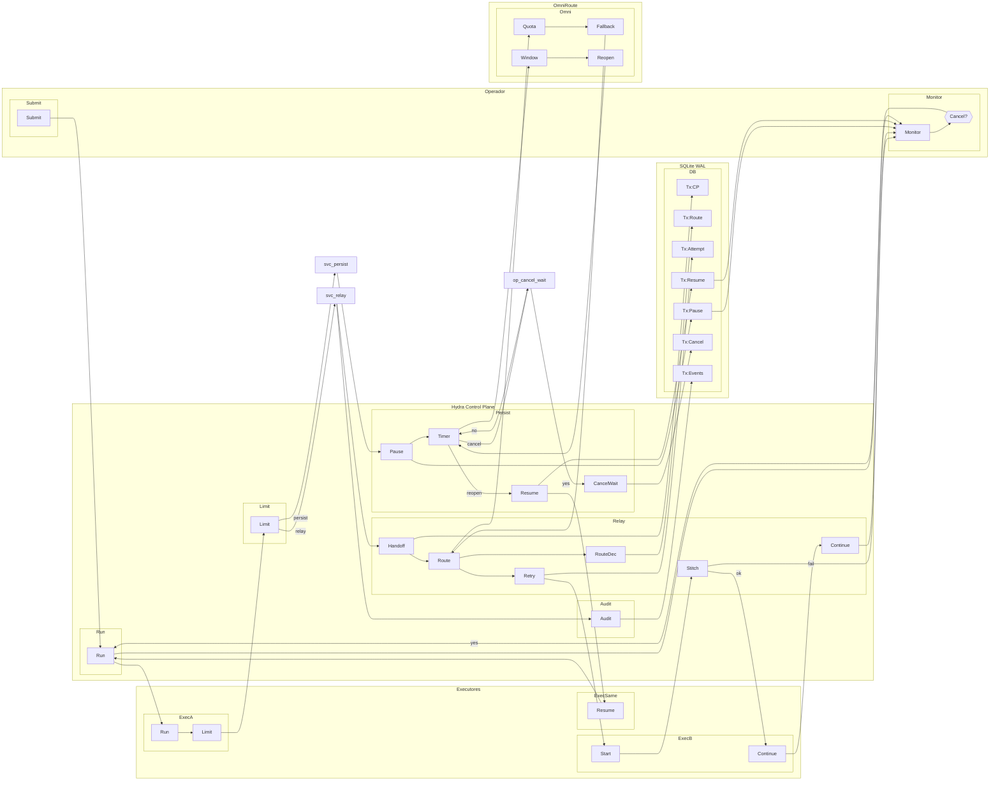

# SAE — hydra-orch — UC03: Interrupção por Rate Limit e Continuidade (Relay / Persistente)

**Versão:** v01_01_0000
**Data:** 2026-11-06
**Fluxo:** UC03
**Requisitos/APIs:** RF10, RF11, RF20, RF26, RF27 / RT08, RT09, RT16, RT18, RT26, RT27

---

## Contrato do fluxo — UC03

1. **Purpose:** Garantir continuidade de execução quando cota/contexto de provedor esgota, via handoff estruturado (Relay) ou pausa/retomada automática por janela de cota (Persistente).
2. **Why:** Validar modos Relay e Persistente (V0/V3): checkpoint de progresso, seleção de fallback, monitoramento de quota, retomada sem perda de efeitos.
3. **Contract:** Run submetido com modo `relay` ou `persist`. Executor atinge limite (rate limit, contexto, janela 5h).
   - **Relay:** Hydra cria `HandoffCheckpoint` (instruções, SHA/diff, ferramentas, saída parcial, próximo passo), seleciona provedor fallback compatível, nova tentativa carrega checkpoint, `tree-sitter` identifica âncora sintática, valida integridade antes de aplicar patch mesclado.
   - **Persistente:** Hydra pausa run (`waiting` causa `rate_limit_window`, limite `window_reset_at`), timer monitora reabertura (consulta OmniRoute ou heurística), retoma automaticamente do mesmo `TaskAttempt` (não cria nova tentativa). Nenhum token gasto na espera.
4. **Preconditions:** Modo `relay` ou `persist` selecionado; executor com cota conhecida; OmniRoute configurado (opcional para modo direto fallback).
5. **Postconditions:** Execução continuada sem efeitos duplicados; handoff auditável (`RouteDecision`, `HandoffCheckpoint`); custo de espera não contabilizado.
6. **Invariants:** Handoff carrega progresso comprovado (não só texto); `unknown` quota nunca vira 100%; modo imutável por run (ProfileSnapshot); âncora sintática validada antes de costura.
7. **Failure Modes:** Nenhum fallback elegível (Relay) → `blocked` aguardando intervenção; quota `unknown` → Persistente não espera cegamente; crash durante handoff → reconciliação de efeitos ambíguos; operador cancela durante espera → `cancelled`.
8. **How:** RunService + RelayEngine/PersistEngine; RouteSelector (DirectSelector/OmniRouteSelector); HandoffCheckpoint + tree-sitter para code stitching; BudgetGovernor monitora quota/janela.
9. **Examples:** Relay: Claude Pro atinge 5h → handoff para Codex com checkpoint → continua do mesmo arquivo. Persistente: Janela 5h fecha → pausa 2h → retoma automaticamente quando reabre.

---

## Design

### Horizontal (LR) — Subflows



---

## Meta-Information

```json
{
  "flow_id": "UC03",
  "lanes": [
    {"id": "lane_operator", "name": "Operador"},
    {"id": "lane_hydra", "name": "Hydra Control Plane"},
    {"id": "lane_executors", "name": "Executores"},
    {"id": "lane_omni", "name": "OmniRoute"},
    {"id": "lane_db", "name": "SQLite WAL"}
  ],
  "subflows": [
    {"id": "sf_submit", "lane": "lane_operator", "activities": ["op_submit"]},
    {"id": "sf_monitor", "lane": "lane_operator", "activities": ["op_monitor", "op_cancel"]},
    {"id": "sf_run", "lane": "lane_hydra", "activities": ["svc_run"]},
    {"id": "sf_limit", "lane": "lane_hydra", "activities": ["svc_limit"]},
    {"id": "sf_relay", "lane": "lane_hydra", "activities": ["svc_handoff", "svc_route", "svc_route_decision", "svc_retry", "svc_stitch", "svc_continue"]},
    {"id": "sf_persist", "lane": "lane_hydra", "activities": ["svc_pause", "svc_timer", "svc_resume", "svc_cancel_wait"]},
    {"id": "sf_audit", "lane": "lane_hydra", "activities": ["svc_audit"]},
    {"id": "sf_exe_a", "lane": "lane_executors", "activities": ["exe_a", "exe_a_limit"]},
    {"id": "sf_exe_b", "lane": "lane_executors", "activities": ["exe_b_start", "exe_b_continue"]},
    {"id": "sf_exe_same", "lane": "lane_executors", "activities": ["exe_same"]},
    {"id": "sf_omni", "lane": "lane_omni", "activities": ["omni_quota", "omni_fallback", "omni_window", "omni_reopen"]},
    {"id": "sf_db", "lane": "lane_db", "activities": ["db_checkpoint", "db_route_dec", "db_attempt_new", "db_pause", "db_resume", "db_cancel", "db_events"]}
  ],
  "activities": [
    {"id": "op_submit", "lane": "lane_operator", "name": "Submit"},
    {"id": "op_monitor", "lane": "lane_operator", "name": "Monitor"},
    {"id": "op_cancel", "lane": "lane_operator", "name": "Cancel?"},
    {"id": "svc_run", "lane": "lane_hydra", "name": "Run"},
    {"id": "svc_limit", "lane": "lane_hydra", "name": "Limit"},
    {"id": "svc_handoff", "lane": "lane_hydra", "name": "Handoff"},
    {"id": "svc_route", "lane": "lane_hydra", "name": "Route"},
    {"id": "svc_route_decision", "lane": "lane_hydra", "name": "RouteDec"},
    {"id": "svc_retry", "lane": "lane_hydra", "name": "Retry"},
    {"id": "svc_stitch", "lane": "lane_hydra", "name": "Stitch"},
    {"id": "svc_continue", "lane": "lane_hydra", "name": "Continue"},
    {"id": "svc_pause", "lane": "lane_hydra", "name": "Pause"},
    {"id": "svc_timer", "lane": "lane_hydra", "name": "Timer"},
    {"id": "svc_resume", "lane": "lane_hydra", "name": "Resume"},
    {"id": "svc_cancel_wait", "lane": "lane_hydra", "name": "CancelWait"},
    {"id": "svc_audit", "lane": "lane_hydra", "name": "Audit"},
    {"id": "exe_a", "lane": "lane_executors", "name": "Run"},
    {"id": "exe_a_limit", "lane": "lane_executors", "name": "Limit"},
    {"id": "exe_b_start", "lane": "lane_executors", "name": "Start"},
    {"id": "exe_b_continue", "lane": "lane_executors", "name": "Continue"},
    {"id": "exe_same", "lane": "lane_executors", "name": "Resume"},
    {"id": "omni_quota", "lane": "lane_omni", "name": "Quota"},
    {"id": "omni_fallback", "lane": "lane_omni", "name": "Fallback"},
    {"id": "omni_window", "lane": "lane_omni", "name": "Window"},
    {"id": "omni_reopen", "lane": "lane_omni", "name": "Reopen"},
    {"id": "db_checkpoint", "lane": "lane_db", "name": "Tx:CP"},
    {"id": "db_route_dec", "lane": "lane_db", "name": "Tx:Route"},
    {"id": "db_attempt_new", "lane": "lane_db", "name": "Tx:Attempt"},
    {"id": "db_pause", "lane": "lane_db", "name": "Tx:Pause"},
    {"id": "db_resume", "lane": "lane_db", "name": "Tx:Resume"},
    {"id": "db_cancel", "lane": "lane_db", "name": "Tx:Cancel"},
    {"id": "db_events", "lane": "lane_db", "name": "Tx:Events"}
  ],
  "transitions": [
    {"from": "op_submit", "to": "svc_run", "guard": ""},
    {"from": "svc_run", "to": "exe_a", "guard": ""},
    {"from": "exe_a", "to": "exe_a_limit", "guard": ""},
    {"from": "exe_a_limit", "to": "svc_limit", "guard": ""},
    {"from": "svc_limit", "to": "svc_handoff", "guard": "relay"},
    {"from": "svc_limit", "to": "svc_pause", "guard": "persist"},
    {"from": "svc_handoff", "to": "db_checkpoint", "guard": ""},
    {"from": "svc_handoff", "to": "svc_route", "guard": ""},
    {"from": "svc_route", "to": "omni_quota", "guard": ""},
    {"from": "omni_quota", "to": "omni_fallback", "guard": ""},
    {"from": "omni_fallback", "to": "svc_route", "guard": ""},
    {"from": "svc_route", "to": "svc_route_decision", "guard": ""},
    {"from": "svc_route_decision", "to": "db_route_dec", "guard": ""},
    {"from": "svc_route", "to": "svc_retry", "guard": ""},
    {"from": "svc_retry", "to": "db_attempt_new", "guard": ""},
    {"from": "svc_retry", "to": "exe_b_start", "guard": ""},
    {"from": "exe_b_start", "to": "svc_stitch", "guard": ""},
    {"from": "svc_stitch", "to": "exe_b_continue", "guard": "ok"},
    {"from": "svc_stitch", "to": "op_monitor", "guard": "fail"},
    {"from": "exe_b_continue", "to": "svc_continue", "guard": ""},
    {"from": "svc_continue", "to": "op_monitor", "guard": ""},
    {"from": "svc_pause", "to": "db_pause", "guard": ""},
    {"from": "db_pause", "to": "op_monitor", "guard": ""},
    {"from": "svc_pause", "to": "svc_timer", "guard": ""},
    {"from": "svc_timer", "to": "omni_window", "guard": ""},
    {"from": "omni_window", "to": "omni_reopen", "guard": ""},
    {"from": "omni_reopen", "to": "svc_timer", "guard": ""},
    {"from": "svc_timer", "to": "svc_resume", "guard": "reopen"},
    {"from": "svc_timer", "to": "op_cancel_wait", "guard": "cancel"},
    {"from": "op_cancel_wait", "to": "svc_cancel_wait", "guard": "yes"},
    {"from": "op_cancel_wait", "to": "svc_timer", "guard": "no"},
    {"from": "svc_cancel_wait", "to": "db_cancel", "guard": ""},
    {"from": "svc_resume", "to": "db_resume", "guard": ""},
    {"from": "db_resume", "to": "op_monitor", "guard": ""},
    {"from": "svc_resume", "to": "exe_same", "guard": ""},
    {"from": "exe_same", "to": "svc_run", "guard": ""},
    {"from": "svc_audit", "to": "db_events", "guard": ""},
    {"from": "svc_run", "to": "op_monitor", "guard": ""},
    {"from": "op_monitor", "to": "op_cancel", "guard": ""},
    {"from": "op_cancel", "to": "svc_run", "guard": "yes"}
  ],
  "requirements": ["RF10", "RF11", "RF20", "RF26", "RF27"],
  "apis": [
    "POST /v1/control-plane/runs (mode=relay|persist)",
    "GET /v1/control-plane/runs/{id}/events (SSE)",
    "GET /v1/control-plane/runs/{id}/route-decisions",
    "POST /v1/control-plane/runs/{id}/cancel",
    "GET /v1/control-plane/runs/{id}/metrics (quota status)"
  ]
}
```

---

## GAPs

- GAP-UC03-01: Definir heurística de `window_reset_at` quando OmniRoute indisponível (ex.: fixo 5h a partir do primeiro request).
- GAP-UC03-02: Confirmar se processo do executor é terminado (SIGTERM) ou apenas suspenso (SIGSTOP) no modo Persistente (depende de suporte do CLI).
- GAP-UC03-03: Especificar formato exato do `HandoffCheckpoint.next_step` (texto livre vs estruturado: arquivo, linha, ação).
- GAP-UC03-04: Validar se `tree-sitter` suporta todas as linguagens alvo (Python, TS, Rust, Go, etc.) ou se precisa fallback regex.
- GAP-UC03-05: Definir política quando fallback selecionado também atinge limite rapidamente (cadeia de fallback com teto).

---

## Glossary e Acrônimos

| Termo | Significado |
|-------|-------------|
| HandoffCheckpoint | Checkpoint estruturado para continuidade entre provedores |
| Code Stitching | Costura de código: identificar âncora sintática no corte |
| tree-sitter | Parser incremental multi-linguagem para AST |
| Rate Limit | Limite de requisições/tokens por janela de tempo |
| Window Reset | Momento em que a janela de cota reabre |
| Fallback Chain | Lista ordenada de provedores/modelos alternativos |
| RouteDecision | Registro auditável da decisão de roteamento |
| Relay | Modo com handoff ativo entre provedores diferentes |
| Persistente | Modo com pausa/retomada automática na mesma janela |
| OmniRoute | Gateway opcional de inferência, quota e fallback |