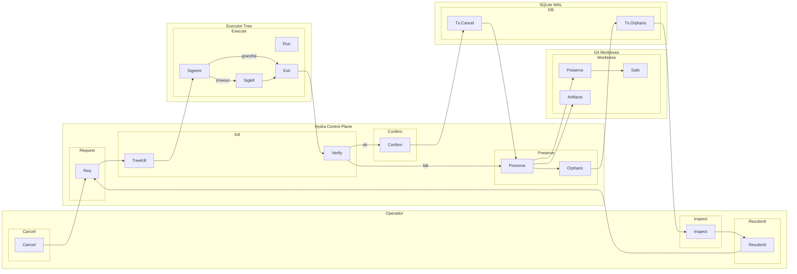

# SAE — hydra-orch — UC04: Cancelamento Forçado com Preservação de Trabalho Parcial

**Versão:** v01_01_0000
**Data:** 2026-11-06
**Fluxo:** UC04
**Requisitos/APIs:** RF04, RF05, RF06, RF15 / RT04, RT05, RT06, RT11

---

## Contrato do fluxo — UC04

1. **Purpose:** Permitir cancelamento seguro e idempotente de run/tarefa/tentativa em qualquer estado, com terminação garantida da árvore de processos e preservação total de evidências para inspeção e recuperação.
2. **Why:** Validar cancelamento robusto (V0): tree kill verificado no SO, worktrees e artefatos preservados, estado final consultável, nova run pode reaproveitar trabalho.
3. **Contract:** Operador emite cancelamento para run, tarefa específica ou tentativa. Hydra solicita cancelamento idempotente ao processo executor, aguarda término de árvore de processos (verificado via `psutil`/`taskkill`), confirma término, emite evento `task.cancelled`/`run.cancelled`. Worktree, artefatos, checkpoints, diff parcial preservados. Operador pode consultar evidência e submeter nova run reaproveitando trabalho.
4. **Preconditions:** Run em execução (`running`) com uma ou mais tentativas ativas; ou run `queued`/`waiting`.
5. **Postconditions:** Nenhum processo remanescente; worktree e evidência íntegros; estado final persistido e consultável; nova run pode ser submetida com mesmo objetivo.
6. **Invariants:** Cancelamento idempotente (repetir não falha); tree kill verificado no SO antes de anunciar conclusão; evidência necessária não expira; branch do operador intocada.
7. **Failure Modes:** Processo não termina em timeout → força kill (SIGKILL/taskkill /F); registra `cancel_failed` mas preserva arquivos; processo órfão (parent morreu) → reconciliação detecta e limpa; disco cheio durante preservação → erro persistível, run `cancelled_partial`.
8. **How:** RunService + WorkerRunner (cancelamento); GitWorkspace (worktree preservada); Checkpointer (estado final); Redactor (exportação sanitizada).
9. **Examples:** Swarm com 3 tasks paralelas → cancela run → todas 3 tree-killed → worktrees preservadas → operador inspeciona diffs parciais → nova run com tasks não iniciadas.

---

## Design

### Horizontal (LR) — Subflows



---

## Meta-Information

```json
{
  "flow_id": "UC04",
  "lanes": [
    {"id": "lane_operator", "name": "Operador"},
    {"id": "lane_hydra", "name": "Hydra Control Plane"},
    {"id": "lane_executor", "name": "Executor Tree"},
    {"id": "lane_git", "name": "Git Worktrees"},
    {"id": "lane_db", "name": "SQLite WAL"}
  ],
  "subflows": [
    {"id": "sf_cancel", "lane": "lane_operator", "activities": ["op_cancel"]},
    {"id": "sf_inspect", "lane": "lane_operator", "activities": ["op_inspect"]},
    {"id": "sf_resubmit", "lane": "lane_operator", "activities": ["op_resubmit"]},
    {"id": "sf_req", "lane": "lane_hydra", "activities": ["svc_cancel_req"]},
    {"id": "sf_kill", "lane": "lane_hydra", "activities": ["svc_tree_kill", "svc_verify_kill"]},
    {"id": "sf_confirm", "lane": "lane_hydra", "activities": ["svc_confirm"]},
    {"id": "sf_preserve", "lane": "lane_hydra", "activities": ["svc_preserve", "svc_orphan_check"]},
    {"id": "sf_exe", "lane": "lane_executor", "activities": ["exe_running", "exe_sigterm", "exe_sigkill", "exe_exited"]},
    {"id": "sf_wt", "lane": "lane_git", "activities": ["git_wt_preserve", "git_artifacts", "git_branch_safe"]},
    {"id": "sf_db", "lane": "lane_db", "activities": ["db_cancel", "db_orphan"]}
  ],
  "activities": [
    {"id": "op_cancel", "lane": "lane_operator", "name": "Cancel"},
    {"id": "op_inspect", "lane": "lane_operator", "name": "Inspect"},
    {"id": "op_resubmit", "lane": "lane_operator", "name": "Resubmit"},
    {"id": "svc_cancel_req", "lane": "lane_hydra", "name": "Request"},
    {"id": "svc_tree_kill", "lane": "lane_hydra", "name": "TreeKill"},
    {"id": "svc_verify_kill", "lane": "lane_hydra", "name": "Verify"},
    {"id": "svc_confirm", "lane": "lane_hydra", "name": "Confirm"},
    {"id": "svc_preserve", "lane": "lane_hydra", "name": "Preserve"},
    {"id": "svc_orphan_check", "lane": "lane_hydra", "name": "Orphans"},
    {"id": "exe_running", "lane": "lane_executor", "name": "Run"},
    {"id": "exe_sigterm", "lane": "lane_executor", "name": "Sigterm"},
    {"id": "exe_sigkill", "lane": "lane_executor", "name": "Sigkill"},
    {"id": "exe_exited", "lane": "lane_executor", "name": "Exit"},
    {"id": "git_wt_preserve", "lane": "lane_git", "name": "Preserve"},
    {"id": "git_artifacts", "lane": "lane_git", "name": "Artifacts"},
    {"id": "git_branch_safe", "lane": "lane_git", "name": "Safe"},
    {"id": "db_cancel", "lane": "lane_db", "name": "Tx:Cancel"},
    {"id": "db_orphan", "lane": "lane_db", "name": "Tx:Orphans"}
  ],
  "transitions": [
    {"from": "op_cancel", "to": "svc_cancel_req", "guard": ""},
    {"from": "svc_cancel_req", "to": "svc_tree_kill", "guard": ""},
    {"from": "svc_tree_kill", "to": "exe_sigterm", "guard": ""},
    {"from": "exe_sigterm", "to": "exe_exited", "guard": "graceful"},
    {"from": "exe_sigterm", "to": "exe_sigkill", "guard": "timeout"},
    {"from": "exe_sigkill", "to": "exe_exited", "guard": "force"},
    {"from": "exe_exited", "to": "svc_verify_kill", "guard": ""},
    {"from": "svc_verify_kill", "to": "svc_confirm", "guard": "ok"},
    {"from": "svc_verify_kill", "to": "svc_preserve", "guard": "fail"},
    {"from": "svc_confirm", "to": "db_cancel", "guard": ""},
    {"from": "db_cancel", "to": "svc_preserve", "guard": ""},
    {"from": "svc_preserve", "to": "git_wt_preserve", "guard": ""},
    {"from": "svc_preserve", "to": "git_artifacts", "guard": ""},
    {"from": "git_wt_preserve", "to": "git_branch_safe", "guard": ""},
    {"from": "svc_preserve", "to": "svc_orphan_check", "guard": ""},
    {"from": "svc_orphan_check", "to": "db_orphan", "guard": ""},
    {"from": "db_orphan", "to": "op_inspect", "guard": ""},
    {"from": "op_inspect", "to": "op_resubmit", "guard": ""},
    {"from": "op_resubmit", "to": "svc_cancel_req", "guard": "cycle"}
  ],
  "requirements": ["RF04", "RF05", "RF06", "RF15"],
  "apis": [
    "POST /v1/control-plane/runs/{id}/cancel",
    "POST /v1/control-plane/runs/{id}/tasks/{task_id}/cancel",
    "GET /v1/control-plane/runs/{id}/artifacts",
    "GET /v1/control-plane/runs/{id}/events (SSE)"
  ]
}
```

---

## GAPs

- GAP-UC04-01: Definir timeout exato para graceful shutdown antes de SIGKILL (padrão 30s? configurável?).
- GAP-UC04-02: Confirmar comportamento de cancelamento de run `queued` (nunca despachou) vs `running` vs `waiting`.
- GAP-UC04-03: Especificar se cancelamento de task em swarm bloqueia dependentes ou apenas a task alvo (atual: dependentes bloqueadas, independentes continuam).
- GAP-UC04-04: Definir política de limpeza automática de worktrees canceladas após N dias (retenção configurável).
- GAP-UC04-05: Validar tree kill em Windows com processos que ignoram CTRL_BREAK_EVENT (precisa `taskkill /F /T` sempre?).

---

## Glossary e Acrônimos

| Termo | Significado |
|-------|-------------|
| Tree Kill | Término de processo e todos descendentes |
| SIGTERM | Sinal de terminação graciosa |
| SIGKILL | Sinal de terminação forçada |
| Idempotent | Operação repetível sem efeito adicional |
| Orphan | Processo sem parent ou arquivo sem ref |
| Worktree | Working tree Git isolada |
| Artifact | Arquivo de saída com hash SHA-256 |
| Reconciliation | Detecção e resolução de inconsistências |