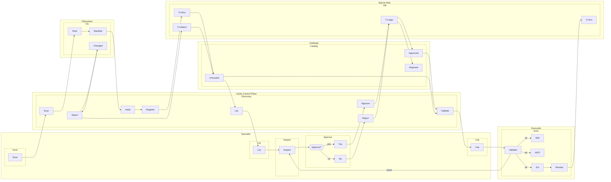

# SAE — hydra-orch — UC05: Descoberta e Ativação Controlada de Ferramenta Local (MCP / Skill)

**Versão:** v01_01_0000
**Data:** 2026-11-06
**Fluxo:** UC05
**Requisitos/APIs:** RF17, RF22, RF24 / RT14, RT20, RT21, RT22

---

## Contrato do fluxo — UC05

1. **Purpose:** Permitir descoberta opt-in de recursos locais (skills, MCPs, memórias, sessões) restrita a raízes autorizadas, com validação de proveniência (hash), estado de confiança (`untrusted` → `approved`) e ativação somente com consentimento explícito do operador.
2. **Why:** Validar discovery controlado e catálogo seguro (V4): varredura restrita, hash SHA-256, estado `untrusted` inicial, aprovação por principal autenticado, bloqueio automático se hash alterado, isolamento de execução.
3. **Contract:** Operador dispara `discovery scan` em raiz allowlisted. `DiscoveryService` varre filesystem, para cada manifesto calcula SHA-256, registra `DiscoveredResource` como `untrusted` com capabilities declaradas e proveniência. Operador consulta recursos, vê detalhes e status. Operador aprova recurso específico → status `approved`, fica disponível para perfis. Em uso: se hash no disco divergir do registrado → transição automática `untrusted` + bloqueio imediato. Extensões/plugins requerem manifesto versionado, consentimento, processo isolado, revogação imediata.
4. **Preconditions:** Discovery opt-in habilitado; raízes autorizadas configuradas (`allowlist`); operador autenticado.
5. **Postconditions:** Catálogo só contém recursos `approved`; proveniência e hash rastreáveis; ativação automática impossível; revogação bloqueia novos usos; extensões em processo isolado sem acesso a DB core.
6. **Invariants:** Recurso fora da raiz allowlisted ignorado; hash alterado → `untrusted` automático; manifesto inválido/capability desconhecida → `untrusted` com motivo; extensão sem manifesto compatível não inicia.
7. **Failure Modes:** Arquivo fora de raiz → ignorado + log auditoria; manifesto inválido → `untrusted` com motivo; tentativa de usar `untrusted` em perfil → 422 na validação pré-exec; extensão revogada → interceptação síncrona + auditoria.
8. **How:** DiscoveryService (varredura, hash, registro); AgentRegistry/ProfileResolver (validação pré-exec); ExtensionHost (processo isolado, manifesto, consentimento, revogação, rollback); Redactor (segredos em manifestos).
9. **Examples:** Operador varre `~/tools/skills` → encontra `skill_lint_python` → `untrusted` (hash abc123) → aprova → `approved` → inclui em perfil → execução usa skill. Se arquivo alterado → hash xyz789 ≠ abc123 → `untrusted` → bloqueado até nova aprovação.

---

## Design

### Horizontal (LR) — Subflows



---

## Meta-Information

```json
{
  "flow_id": "UC05",
  "lanes": [
    {"id": "lane_operator", "name": "Operador"},
    {"id": "lane_hydra", "name": "Hydra Control Plane"},
    {"id": "lane_fs", "name": "Filesystem"},
    {"id": "lane_catalog", "name": "Catálogo"},
    {"id": "lane_exec", "name": "Execução"},
    {"id": "lane_db", "name": "SQLite WAL"}
  ],
  "subflows": [
    {"id": "sf_scan", "lane": "lane_operator", "activities": ["op_scan"]},
    {"id": "sf_list", "lane": "lane_operator", "activities": ["op_list"]},
    {"id": "sf_inspect", "lane": "lane_operator", "activities": ["op_inspect"]},
    {"id": "sf_approve", "lane": "lane_operator", "activities": ["op_approve", "op_yes", "op_no"]},
    {"id": "sf_use", "lane": "lane_operator", "activities": ["op_use"]},
    {"id": "sf_discovery", "lane": "lane_hydra", "activities": ["svc_scan", "svc_hash", "svc_register", "svc_list", "svc_approve", "svc_reject", "svc_profile_val", "svc_watch"]},
    {"id": "sf_fs", "lane": "lane_fs", "activities": ["fs_root", "fs_manifest", "fs_changed"]},
    {"id": "sf_cat", "lane": "lane_catalog", "activities": ["cat_u", "cat_a", "cat_r"]},
    {"id": "sf_exec", "lane": "lane_exec", "activities": ["exe_val", "exe_skill", "exe_mcp", "exe_ext", "exe_rev"]},
    {"id": "sf_db", "lane": "lane_db", "activities": ["db_disc", "db_appr", "db_watch", "db_ext"]}
  ],
  "activities": [
    {"id": "op_scan", "lane": "lane_operator", "name": "Scan"},
    {"id": "op_list", "lane": "lane_operator", "name": "List"},
    {"id": "op_inspect", "lane": "lane_operator", "name": "Inspect"},
    {"id": "op_approve", "lane": "lane_operator", "name": "Approve?"},
    {"id": "op_yes", "lane": "lane_operator", "name": "Yes"},
    {"id": "op_no", "lane": "lane_operator", "name": "No"},
    {"id": "op_use", "lane": "lane_operator", "name": "Use"},
    {"id": "svc_scan", "lane": "lane_hydra", "name": "Scan"},
    {"id": "svc_hash", "lane": "lane_hydra", "name": "Hash"},
    {"id": "svc_register", "lane": "lane_hydra", "name": "Register"},
    {"id": "svc_list", "lane": "lane_hydra", "name": "List"},
    {"id": "svc_approve", "lane": "lane_hydra", "name": "Approve"},
    {"id": "svc_reject", "lane": "lane_hydra", "name": "Reject"},
    {"id": "svc_profile_val", "lane": "lane_hydra", "name": "Validate"},
    {"id": "svc_watch", "lane": "lane_hydra", "name": "Watch"},
    {"id": "fs_root", "lane": "lane_fs", "name": "Root"},
    {"id": "fs_manifest", "lane": "lane_fs", "name": "Manifest"},
    {"id": "fs_changed", "lane": "lane_fs", "name": "Changed"},
    {"id": "cat_u", "lane": "lane_catalog", "name": "Untrusted"},
    {"id": "cat_a", "lane": "lane_catalog", "name": "Approved"},
    {"id": "cat_r", "lane": "lane_catalog", "name": "Rejected"},
    {"id": "exe_val", "lane": "lane_exec", "name": "Validate"},
    {"id": "exe_skill", "lane": "lane_exec", "name": "Skill"},
    {"id": "exe_mcp", "lane": "lane_exec", "name": "MCP"},
    {"id": "exe_ext", "lane": "lane_exec", "name": "Ext"},
    {"id": "exe_rev", "lane": "lane_exec", "name": "Revoke"},
    {"id": "db_disc", "lane": "lane_db", "name": "Tx:Disc"},
    {"id": "db_appr", "lane": "lane_db", "name": "Tx:Appr"},
    {"id": "db_watch", "lane": "lane_db", "name": "Tx:Watch"},
    {"id": "db_ext", "lane": "lane_db", "name": "Tx:Ext"}
  ],
  "transitions": [
    {"from": "op_scan", "to": "svc_scan", "guard": ""},
    {"from": "svc_scan", "to": "fs_root", "guard": ""},
    {"from": "fs_root", "to": "fs_manifest", "guard": ""},
    {"from": "fs_manifest", "to": "svc_hash", "guard": ""},
    {"from": "svc_hash", "to": "svc_register", "guard": ""},
    {"from": "svc_register", "to": "db_disc", "guard": ""},
    {"from": "db_disc", "to": "cat_u", "guard": ""},
    {"from": "cat_u", "to": "svc_list", "guard": ""},
    {"from": "svc_list", "to": "op_list", "guard": ""},
    {"from": "op_list", "to": "op_inspect", "guard": ""},
    {"from": "op_inspect", "to": "op_approve", "guard": ""},
    {"from": "op_approve", "to": "op_yes", "guard": "yes"},
    {"from": "op_approve", "to": "op_no", "guard": "no"},
    {"from": "op_yes", "to": "svc_approve", "guard": ""},
    {"from": "op_no", "to": "svc_reject", "guard": ""},
    {"from": "svc_approve", "to": "db_appr", "guard": ""},
    {"from": "svc_reject", "to": "db_appr", "guard": ""},
    {"from": "db_appr", "to": "cat_a", "guard": "ok"},
    {"from": "db_appr", "to": "cat_r", "guard": "no"},
    {"from": "cat_a", "to": "svc_profile_val", "guard": ""},
    {"from": "svc_profile_val", "to": "op_use", "guard": ""},
    {"from": "op_use", "to": "exe_val", "guard": ""},
    {"from": "exe_val", "to": "exe_skill", "guard": "ok"},
    {"from": "exe_val", "to": "exe_mcp", "guard": "ok"},
    {"from": "exe_val", "to": "exe_ext", "guard": "ok"},
    {"from": "exe_val", "to": "op_inspect", "guard": "block"},
    {"from": "svc_watch", "to": "fs_changed", "guard": ""},
    {"from": "fs_changed", "to": "svc_watch", "guard": ""},
    {"from": "svc_watch", "to": "db_watch", "guard": ""},
    {"from": "db_watch", "to": "cat_u", "guard": ""},
    {"from": "cat_u", "to": "svc_profile_val", "guard": "block"},
    {"from": "exe_ext", "to": "exe_rev", "guard": ""},
    {"from": "exe_rev", "to": "db_ext", "guard": ""}
  ],
  "requirements": ["RF17", "RF22", "RF24"],
  "apis": [
    "POST /v1/control-plane/discovery/scan",
    "GET /v1/control-plane/discovery/resources",
    "POST /v1/control-plane/discovery/resources/{id}/approve",
    "POST /v1/control-plane/discovery/resources/{id}/reject",
    "GET/POST /v1/control-plane/profiles",
    "POST /v1/control-plane/profiles/{id}/resolve",
    "GET/POST /v1/control-plane/extensions",
    "POST /v1/control-plane/extensions/install",
    "POST /v1/control-plane/extensions/{id}/revoke"
  ]
}
```

---

## GAPs

- GAP-UC05-01: Definir formato padrão de manifesto para Skills (JSON Schema) e MCPs (compatível com spec MCP).
- GAP-UC05-02: Confirmar frequência de verificação de hash (polling interval vs inotify/fsevents por SO).
- GAP-UC05-03: Especificar como `ExtensionHost` isola processos (subprocesso com env filtrado, cgroups, namespace?).
- GAP-UC05-04: Definir política de rollback de extensão: quantas versões anteriores manter? Automatizado ou manual?
- GAP-UC05-05: Validar se `SecretRef` para MCPs suporta rotação de segredos sem reiniciar execuções ativas.

---

## Glossary e Acrônimos

| Termo | Significado |
|-------|-------------|
| DiscoveryService | Varredura opt-in de recursos locais |
| DiscoveredResource | Recurso encontrado: hash, caps, proveniência, trust_status |
| trust_status | Estado: untrusted, approved, rejected, revoked |
| Allowlist | Raízes autorizadas para discovery |
| SHA-256 | Hash criptográfico para integridade |
| SecretRef | Referência a segredo externo (env, vault, keyring) |
| ExtensionHost | Host de extensões: processo isolado, manifesto, consent |
| ProfileResolver | Validador pré-exec: só approved em perfis |
| Code Stitching | Costura de código via tree-sitter |
| MCP | Model Context Protocol |