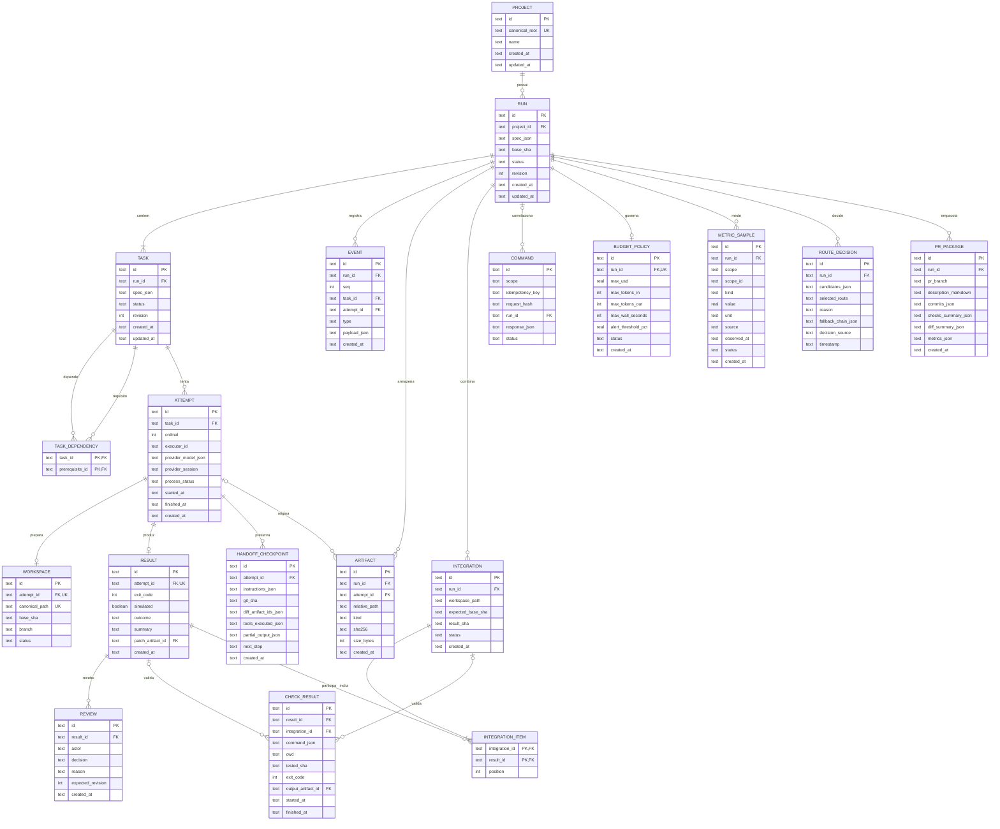

# mer — Modelo Entidade-Relacionamento do hydra-orch

**Identificador Formal:** `mer.md`
**Caminho Canônico:** `doc/d_mer/mer.md`
**Diagrama Complementar:** [`mer.mmd`](mer.mmd)
**Versão:** `v01_02_0000`
**Status:** `PROPOSTO / EM MODELAGEM`
**Autoridade:** Modelagem relacional e persistência transacional em SQLite (`.orchestrator/checkpoints.sqlite`), alinhada ao [PRD técnico](../b_spc/prd_tecnico.md) e ao [diagrama de classes](../e_class/diagrama_classe.md).
**Escopo:** Tabelas de núcleo (projetos, runs, tasks, attempts, workspaces, resultados, checks, artefatos, reviews, integrações) e expansão (áreas, workspaces, repositórios, agentes, perfis, sessões, threads, métricas, rotas, memória, consentimento, discovery, extensões, preferências, transportes, orçamento, conflitos, PR packages, handoff checkpoints).

---

Complemento visual autônomo disponível em [`mer.mmd`](mer.mmd).

Status: modelo lógico do produto; o núcleo 0001 e o schema aditivo T10/0002 estão implementados. Serviços da expansão permanecem faseados. O Workspace organizacional usa `area_workspaces`; `workspaces` preserva as worktrees por tentativa. Mapeamento físico e rollback em [S14](../b_spc/workspaces_perfis.md). Alinhado ao [PRD técnico](../b_spc/prd_tecnico.md) e ao [diagrama de classes](../e_class/diagrama_classe.md).

## 1. Propósito

Persistir execução, tentativas, evidências, revisão, integração, control plane, observabilidade, memória, discovery, extensões, orçamento e empacotamento — sem confundir estado de processo com resultado de negócio, mantendo isolamento estrito entre checkpoints técnicos e memória adaptativa.

## 2. Justificativa

As tabelas atuais de streaming não modelam uma execução completa nem a expansão de control plane. Este MER orienta migração versionada, preservação do legado e implementação faseada (V0 a V4).

## 3. Contrato de dados — Núcleo (V0)

## 4. Contrato de dados — Expansão Control Plane (V1–V4)

```mermaid
erDiagram
    AREA ||--o{ WORKSPACE : contem
    WORKSPACE ||--o{ PROJECT : agrega
    PROJECT ||--o{ REPOSITORY : referencia
    REPOSITORY ||--o| AUTHORIZATION : autoriza
    AREA ||--o{ AUTHORIZATION : concede
    AGENT_DEFINITION ||--o{ CAPABILITY_DECLARATION : declara
    PROFILE ||--o| PROFILE_SNAPSHOT : snapshot
    PROFILE }o--o{ SKILL_DEFINITION : inclui
    PROFILE }o--o{ MCP_DEFINITION : inclui
    PROFILE ||--o| BUDGET_POLICY : define
    RUN ||--o{ SESSION : inicia
    SESSION ||--o{ THREAD : ramifica
    THREAD }o--o{ THREAD : pai_filho
    SESSION ||--o{ EVENT : registra
    MEMORY_ENTRY }|--o{ CONSENT_RECORD : requer
    DISCOVERED_RESOURCE ||--o| SKILL_DEFINITION : origina
    DISCOVERED_RESOURCE ||--o| MCP_DEFINITION : origina
    EXTENSION_MANIFEST ||--o{ EXTENSION_INSTALL : instala
    EXTENSION_INSTALL }|--o{ CONSENT_RECORD : requer
    TRANSPORT_DEFINITION ||--o{ TRANSPORT_HEALTH : monitora
    ACCESS_TOKEN }|--o{ CONSENT_RECORD : escopo
    CONFLICT_REPORT }|--o| INTEGRATION : resolve

    AREA {
        text id PK
        text name
        text description
        text owner_principal_id
        text created_at
    }
    WORKSPACE {
        text id PK
        text area_id FK
        text name
        text status
        text created_at
        text updated_at
    }
    PROJECT {
        text id PK
        text workspace_id FK
        text name
        text metadata_json
        text canonical_root UK
        text base_branch
        text base_sha
        text created_at
        text updated_at
    }
    REPOSITORY {
        text id PK
        text project_id FK
        text root_canonical
        text base_branch
        text base_sha
        text allowed_paths_json
        text authorization_id FK,UK
        text created_at
        text updated_at
    }
    AUTHORIZATION {
        text id PK
        text resource_ref
        text principal_id
        text scopes_json
        text granted_at
        text revoked_at
    }
    AGENT_DEFINITION {
        text id PK
        text name
        text version
        text driver_type
        text declared_capabilities_json
        text limitations_json
        boolean is_certified
        text created_at
    }
    CAPABILITY_DECLARATION {
        text id PK
        text agent_definition_id FK
        text name
        text version
        boolean supports_tools
        boolean supports_workspace
        boolean supports_cancellation
        boolean supports_streaming
        text certified_on
    }
    PROFILE {
        text id PK
        text name
        text agent_ref FK
        text model_ref
        text executor_ref FK
        text skills_refs_json
        text mcp_refs_json
        text memory_policy_json
        text resource_limits_json
        text orchestration_mode
        text created_at
        text updated_at
    }
    PROFILE_SNAPSHOT {
        text id PK
        text profile_id FK
        text snapshot_hash
        text effective_config_json
        text created_at
    }
    SKILL_DEFINITION {
        text id PK
        text name
        text version
        text manifest_ref
        text permissions_declared_json
        text checksum
        text created_at
    }
    MCP_DEFINITION {
        text id PK
        text server_name
        text transport_type
        text endpoint
        text secret_ref FK
        text declared_tools_json
        text permissions_json
        text created_at
    }
    SECRET_REF {
        text id PK
        text secret_name
        text provider_type
        text source_key
    }
    EXTENSION_MANIFEST {
        text id PK
        text name
        text version
        text entrypoint
        text permissions_required_json
        text compatible_api_version
        text checksum
        text created_at
    }
    EXTENSION_INSTALL {
        text id PK
        text extension_manifest_id FK
        text status
        text consent_record_id FK
        text installed_at
        text revoked_at
    }
    SESSION {
        text id PK
        text run_id FK
        text origin_ref
        text agent_ref FK
        text state
        text created_at
        text closed_at
    }
    THREAD {
        text id PK
        text session_id FK
        text parent_thread_id FK
        text agent_ref FK
        text state
        int last_seq
        text created_at
    }
    MEMORY_ENTRY {
        text id PK
        text scope_type
        text scope_id
        text content_redacted
        text author_ref
        text consent_id FK
        int version
        text retention_policy_id
        text status
        text created_at
        text expires_at
    }
    CONSENT_RECORD {
        text id PK
        text principal_id
        text purpose
        text scope
        text granted_at
        text revoked_at
    }
    DISCOVERED_RESOURCE {
        text id PK
        text resource_type
        text source_canonical_path
        text content_hash
        text capabilities_json
        text trust_status
        text discovered_at
        text approved_at
        text approved_by
    }
    PREFERENCE {
        text id PK
        text scope_type
        text scope_id
        text key
        text value_json
        text source
        int version
        text created_at
        text updated_at
    }
    PREFERENCE_SNAPSHOT {
        text id PK
        text run_id FK
        text preferences_hash
        text resolved_preferences_json
        text created_at
    }
    TRANSPORT_DEFINITION {
        text id PK
        text type
        text target_identity
        text capabilities_json
        boolean is_certified
        text created_at
    }
    TRANSPORT_HEALTH {
        text id PK
        text transport_id FK
        text status
        text last_check_at
        text error_detail
    }
    ACCESS_TOKEN {
        text id PK
        text token_hash
        text principal_id
        text scopes_json
        text expires_at
        text revoked_at
    }
    CONFLICT_REPORT {
        text id PK
        text integration_id FK
        text base_sha
        text ours_sha
        text theirs_sha
        text conflicted_files_json
        text resolution_options_json
        text status
        text created_at
        text resolved_at
    }
```

---

### 4.1 Dicionário e restrições complementares (Núcleo + Expansão)

- **PK** é identificador textual gerado pelo serviço (UUIDv7), salvo chaves compostas indicadas; **FK** restringe exclusão (`ON DELETE RESTRICT` ou `CASCADE` conforme semântica). Datas são UTC ISO 8601 (`TEXT` armazenando `datetime('now')`). Campos opcionais ficam `NULL`, nunca valores inventados.
- `spec_json` (RUN, TASK) contém snapshot validado com `schema_version`, critérios, orçamento, política, modo. Segredos são referências externas (`SECRET_REF`). `context_json` (HANDOFF_CHECKPOINT) contém instruções, decisões, efeitos e referências de artefatos redigidos.
- `provider_session`, início/fim, `exit_code` e `patch` podem ser `NULL` conforme ciclo de vida. `ARTIFACT.attempt_id` é opcional para artefato do run/integração. `EVENT.task_id/attempt_id` são opcionais; quando presentes devem pertencer ao run.
- `CHECK_RESULT` exige exatamente um de `result_id`/`integration_id`. Saída pode ser `NULL` antes da captura, mas check obrigatório sem evidência não aprova integração.
- `RESULT.patch_artifact_id` e `CHECK_RESULT.output_artifact_id` referenciam `ARTIFACT` do mesmo run.
- **Uniques adicionais:**
  - `(run_id, seq)` em `EVENT`
  - `(task_id, ordinal)` em `ATTEMPT`
  - `(run_id, relative_path)` em `ARTIFACT`
  - `(integration_id, position)` em `INTEGRATION_ITEM`
  - `(scope, idempotency_key)` em `COMMAND`
  - `(run_id)` em `BUDGET_POLICY` (um por run)
  - `(run_id)` em `PR_PACKAGE` (um por run)
  - `(profile_id)` em `PROFILE_SNAPSHOT` (um por run, mas profile pode ter múltiplos snapshots históricos)
  - `(attempt_id)` em `HANDOFF_CHECKPOINT` (último por tentativa)
- `COMMAND.run_id` pode ser `NULL` para cadastro de projeto ou antes da criação; chave/payload diferentes retornam conflito. Registrar comando e efeito transacional juntos quando possível; spawn externo exige reconciliação.
- **Dependência (TASK_DEPENDENCY):** não pode apontar à própria tarefa, a outro run ou formar ciclo; validar grafo na transação de criação do plano (Kahn/DFS). Referências a tarefas do mesmo run exigem validação adicional na aplicação.
- **Índice parcial único** de `ATTEMPT` por `task_id` para estados `queued`/`running` impede tentativa ativa duplicada.
- **Exclusão mútua de integração** deve ser por projeto, pois runs distintos podem apontar ao mesmo repo.
- **Artefato** guarda bytes fora do banco (filesystem `.orchestrator/run/<run_id>/...`). `RESULT`, `CHECK_RESULT`, `REVIEW`, `EVENT`, `HANDOFF_CHECKPOINT`, `METRIC_SAMPLE`, `ROUTE_DECISION`, `CONFLICT_REPORT`, `PR_PACKAGE` são históricos; correção gera novo registro/decisão, não sobrescreve evidência.
- **Aceite** exige revisão vigente do resultado e integridade dos artefatos (hash verificado).
- `WORKSPACE` é de tentativa; `INTEGRATION.workspace_path` é workspace separado de integração. Reuso/retomada de workspace de tentativa deve ser reconciliado explicitamente antes de criar nova tentativa; não duplicar path único.
- **Expansão:** Tabelas de expansão gerenciadas por migrações versionadas independentes. `MEMORY_ENTRY` tem ciclo de vida, expiração e auditoria próprios — **estritamente separada** de `HANDOFF_CHECKPOINT` (tabelas e lifecycles distintos). `CONSENT_RECORD` é pré-requisito para `MEMORY_ENTRY` e `EXTENSION_INSTALL`. `DISCOVERED_RESOURCE` inicia em `untrusted`; transição para `approved` só via aprovação de principal autenticado. Hash alterado em disco → transição automática `untrusted`.

---

## 5. Pré-condições

Foreign keys habilitadas (`PRAGMA foreign_keys=ON`); modo WAL obrigatório (`PRAGMA journal_mode=WAL`); `PRAGMA busy_timeout = 5000`; `schema_version` do banco reconhecida; migração com backup. A tabela de controle de migração (`schema_migrations`) é infraestrutura e não aparece no domínio do diagrama.

---

## 6. Pós-condições

Toda transição confirmada possui evento na mesma transação. Toda referência de artefato aceito corresponde a arquivo com hash verificado. Run pode estar vazio apenas dentro da transação de criação; não publicar run operacional sem tarefa. Operações de consentimento, aprovação de extensão, revogação geram registros auditáveis imutáveis.

---

## 7. Invariantes

- Não usar cascade de exclusão para apagar histórico de execução. Retenção marca artefatos removidos de forma auditável e exige decisão explícita; evidência necessária a execução ativa não pode expirar.
- Valores de quota/custo futuros devem incluir origem, frescor e nulabilidade, sem converter desconhecido em zero.
- **Checkpoints de execução (`HANDOFF_CHECKPOINT`) são separados de memória adaptativa (`MEMORY_ENTRY`)** — tabelas e lifecycles distintos.
- **Texto produzido por agente ou declaração textual de sucesso nunca constituem prova de execução ou validação de check.**
- **Recursos descobertos iniciam no estado `untrusted` e só transitam com aprovação de principal autenticado.**
- **Extensões operam em processo isolado e não têm acesso direto ao banco de dados do control plane.**
- **A interface visual consome apenas read models persistidos e não pode alterar estado sem comando autenticado correspondente.**
- **Snapshots de perfil (`PROFILE_SNAPSHOT`) e preferências (`PREFERENCE_SNAPSHOT`) são imutáveis por run.**
- **Eventos SSE sequenciais por run, com heartbeat e replay por cursor; deduplicação cliente por `(run_id, seq)`.**
- **SQLite WAL + `busy_timeout=5000` + FKs + concorrência otimista via `revision`.**
- **Exportação e logs passam por redactor determinístico (regex + entropia) antes de exposição.**

---

## 8. Falhas

Banco bloqueado: timeout limitado e erro persistível/reconciliável. Disco cheio: não confirmar sucesso. Arquivo finalizado sem referência após crash: órfão a reconciliar. Referência com arquivo faltante: evidência inválida. Processo externo concluído sem transação: tentativa fica pendente de reconciliação, sem retry cego. Descoberta de recurso adulterado (divergência de hash) força transição para `untrusted` e bloqueia execução. Tentativa de escrita de memória sem consentimento ativo gera erro e não persiste dados. Perda de conexão SSE reconciliada por cursor `Last-Event-ID` com deduplicação sem conclusão prematura. Extensão incompatível ou revogada terminada síncrona sem afetar integridade do processo principal.

---

## 9. Implementação

**T03** cria migrations e testes de integridade/restart (núcleo); **T10** cria migrations da expansão (control plane) com rollback testado, FKs ativas, legado preservado. **T05/T06** adicionam workspace/integração e gates. **T11–T28** adicionam tabelas de expansão conforme faseamento.

**Índices iniciais recomendados:**
- `TASK(run_id, status)`
- `ATTEMPT(task_id, ordinal)`
- `EVENT(run_id, seq)`
- `ARTIFACT(run_id)`
- `INTEGRATION(run_id, status)`
- `METRIC_SAMPLE(run_id, scope, scope_id)`
- `ROUTE_DECISION(run_id)`
- `HANDOFF_CHECKPOINT(attempt_id)`
- `SESSION(run_id)`
- `THREAD(session_id)`
- `MEMORY_ENTRY(scope_type, scope_id, status)`
- `CONSENT_RECORD(principal_id, scope)`
- `DISCOVERED_RESOURCE(trust_status)`
- `EXTENSION_INSTALL(status)`
- `PREFERENCE(scope_type, scope_id, key)`
- `TRANSPORT_HEALTH(transport_id, status)`
- `CONFLICT_REPORT(integration_id, status)`
- `BUDGET_POLICY(run_id, status)`
- `PR_PACKAGE(run_id)`

Testar: duas conexões concorrentes, rollback após falha induzida, migração up/down, reconciliação de órfãos pós-crash.

---

## 10. Exemplo

Projeto P (em Workspace W, Area A) contém run R (modo `swarm`) e tarefas T1, T2, T3 (T1→T2, T1→T3). Tentativa A1 prepara WT1, grava artefato D1, resultado X1 e check C1. Review V1 aceita X1. T2 e T3 despachadas em paralelo (semáforo). Tentativa A2 (T2) falha check → reparo (A3) → aceita. Integração I1 inclui X1, X2, X3 em ordem topológica, registra novos checks da combinação e resultado SHA. Falha em I1 mantém WTs/artefatos/resultados/reviews e registra evento; não apaga trabalho nem altera decisões históricas. `CONFLICT_REPORT` gerado se merge conflitar; operador escolhe `auto_repair` (nova tentativa `merge_repair`), `manual` (WT preservada) ou `discard`. `PR_PACKAGE` gerado se política autoriza: branch `pr/<run_id>`, descrição com objetivo, commits, checks, diff, métricas.