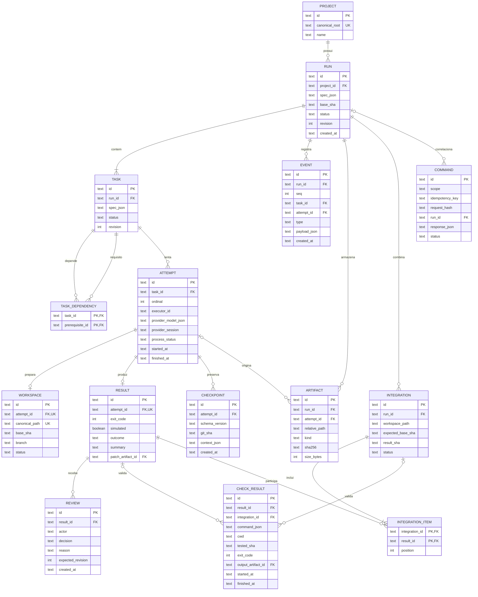

# mer — Modelo Entidade-Relacionamento do hydra-orch

**Identificador Formal:** `mer.md`
**Caminho Canônico:** `doc/d_mer/mer.md`
**Diagrama Complementar:** [`mer.mmd`](mer.mmd)
**Versão:** `v01_00_0000`
**Status:** `PROPOSTO / EM MODELAGEM`
**Autoridade:** Modelagem relacional e persistência transacional em SQLite (`.orchestrator/checkpoints.sqlite`), alinhada ao [PRD técnico](../b_spc/prd_tecnico.md) e ao [diagrama de classes](../e_class/diagrama_classe.md).
**Escopo:** Tabelas de projetos, runs, tasks, attempts, workspaces, resultados, checks, artefatos, reviews e integrações.

---

Complemento visual autônomo disponível em [`mer.mmd`](mer.mmd).

Status: modelo lógico proposto para SQLite; não representa tabelas já migradas. Alinhado ao [PRD técnico](../b_spc/prd_tecnico.md) e ao [diagrama de classes](../e_class/diagrama_classe.md).

## 1. Propósito

Persistir execução, tentativas, evidências, revisão e integração sem confundir estado de processo com resultado de negócio.

## 2. Justificativa

As tabelas atuais de streaming não modelam uma execução completa. Este MER orienta migração versionada e preservação do legado.

## 3. Contrato de dados

### Dicionário e restrições complementares

- PK é identificador textual gerado pelo serviço, salvo chaves compostas indicadas; FK restringe exclusão. Datas são UTC ISO 8601. Campos opcionais ficam NULL, nunca valores inventados.
- `spec_json` contém snapshot validado com schema_version, critérios, orçamento e política. Segredos são referências externas. `context_json` contém instruções, decisões, efeitos e referências de artefatos redigidos.
- `provider_session`, início/fim, exit_code e patch podem ser NULL conforme ciclo de vida. `ARTIFACT.attempt_id` é opcional para artefato do run/integração. `EVENT.task_id/attempt_id` são opcionais; quando presentes devem pertencer ao run.
- `CHECK_RESULT` exige exatamente um de result_id/integration_id. Saída pode ser NULL antes da captura, mas check obrigatório sem evidência não aprova integração.
- `RESULT.patch_artifact_id` e `CHECK_RESULT.output_artifact_id` referenciam ARTIFACT do mesmo run; essas duas FKs são indicadas nos campos para evitar cruzamento visual excessivo.
- Uniques adicionais: `(run_id, seq)` em EVENT; `(task_id, ordinal)` em ATTEMPT; `(run_id, relative_path)` em ARTIFACT; `(integration_id, position)` em INTEGRATION_ITEM; `(scope, idempotency_key)` em COMMAND.
- COMMAND.run_id pode ser NULL para cadastro de projeto ou antes da criação; chave/payload diferentes retornam conflito. Registrar comando e efeito transacional juntos quando possível; spawn externo exige reconciliação.
- Dependência não pode apontar à própria tarefa, a outro run ou formar ciclo; validar grafo na transação de criação do plano. Referências a tarefas do mesmo run exigem validação adicional, pois FKs simples não garantem essa propriedade.
- Índice parcial único de ATTEMPT por task_id para estados queued/running impede tentativa ativa duplicada. Exclusão mútua de integração deve ser por projeto, pois runs distintos podem apontar ao mesmo repo.
- Artefato guarda bytes fora do banco. RESULT, CHECK_RESULT, REVIEW e EVENT são históricos; correção gera novo registro/decisão, não sobrescreve evidência. Aceite exige revisão vigente do resultado e integridade dos artefatos.
- WORKSPACE é de tentativa; INTEGRATION.workspace_path é workspace separado de integração. Reuso/retomada de workspace de tentativa deve ser reconciliado explicitamente antes de criar nova tentativa; não duplicar path único.

## 4. Pré-condições

Foreign keys habilitadas; schema_version do banco reconhecida; migração com backup. A tabela de controle de migração é infraestrutura e não aparece no domínio do diagrama.

## 5. Pós-condições

Toda transição confirmada possui evento na mesma transação. Toda referência de artefato aceito corresponde a arquivo com hash verificado. Run pode estar vazio apenas dentro da transação de criação; não publicar run operacional sem tarefa.

## 6. Invariantes

Não usar cascade de exclusão para apagar histórico de execução. Retenção marca artefatos removidos de forma auditável e exige decisão explícita; evidência necessária a execução ativa não pode expirar. Valores de quota/custo futuros devem incluir origem, frescor e nulabilidade, sem converter desconhecido em zero.

## 7. Falhas

Banco bloqueado: timeout limitado e erro persistível/reconciliável. Disco cheio: não confirmar sucesso. Arquivo finalizado sem referência após crash: órfão a reconciliar. Referência com arquivo faltante: evidência inválida. Processo externo concluído sem transação: tentativa fica pendente de reconciliação, sem retry cego.

## 8. Implementação

T03 cria migrations e testes de integridade/restart; T05/T06 adicionam workspace/integração e gates. Preservar bases legadas de core/engine até validar importação. Índices iniciais: TASK(run_id,status), ATTEMPT(task_id,ordinal), EVENT(run_id,seq), ARTIFACT(run_id), INTEGRATION(run_id,status). Testar duas conexões concorrentes e rollback após falha induzida.

## 9. Exemplo

Projeto P contém run R e tarefa T. Tentativa A prepara W, grava artefato D, resultado X e check C. Review V aceita X. Integração I inclui X, registra novo check da combinação e resultado SHA. Falha em I mantém A/W/D/X/V e registra evento; não apaga trabalho nem altera a decisão histórica.
