# diagrama_classe — Diagrama de Classes e Entidades de Domínio

**Identificador Formal:** `diagrama_classe.md`
**Caminho Canônico:** `doc/e_class/diagrama_classe.md`
**Diagrama Complementar:** [`diagrama_classe.mmd`](diagrama_classe.mmd)
**Versão:** `v01_01_0000`
**Status:** `PROPOSTO / EM MODELAGEM`
**Autoridade:** Modelagem de classes e interfaces do hydra-orch, alinhada ao [PRD técnico](../b_spc/prd_tecnico.md) e ao [MER](../d_mer/mer.md).
**Escopo:** Entidades de execução (núcleo + expansão), serviços de aplicação, interfaces de provedores, executores, control plane, observabilidade, memória, discovery, extensões, orçamento, conflitos e empacotamento.

---

Complemento visual autônomo disponível em [`diagrama_classe.mmd`](diagrama_classe.mmd).

Status: modelo alvo proposto, não engenharia reversa das classes atuais. Contratos em [PRD técnico](../b_spc/prd_tecnico.md); persistência em [MER](../d_mer/mer.md).

## 1. Propósito

Definir entidades, serviços e interfaces para execução verificável com control plane completo, suportando três modos de orquestração (Swarm, Relay, Persistente), handoff estruturado, auto-healing, HITL, budgeting, resolução de conflitos, empacotamento PR, memória consentida, discovery controlado, extensões isoladas e transportes certificados.

## 2. Justificativa

Separar dados, decisões e transporte permite testar sem contas externas e consolidar os motores existentes. A expansão de control plane (áreas, perfis, sessões, métricas, memória, discovery, extensões, orçamento, conflitos, PR) é modelada como serviços e entidades distintas do núcleo de execução, mantendo o princípio de que inferência ≠ execução ≠ coordenação.

**Núcleo implementado:** S02/T02 define os modelos de execução em `hydra_orch.model`; consultar [contrato_execucao.md](../b_spc/contrato_execucao.md) para campos e tipos canônicos. Os diagramas abaixo continuam como modelagem alvo, incluindo serviços ainda não implementados.

## 3. Contrato estrutural — Núcleo (V0)

```mermaid
classDiagram
    class Project {
        +str id
        +str canonical_root
        +str name
        +datetime created_at
        +datetime updated_at
    }
    class RunSpec {
        +str schema_version
        +str id
        +str project_id
        +str objective
        +str mode  %% swarm|relay|persist
        +str base_sha
        +BudgetPolicy budget
        +TaskSpec task_spec
        +str profile_id?
        +str idempotency_key
    }
    class BudgetPolicy {
        +float max_usd?
        +int max_tokens_in?
        +int max_tokens_out?
        +int max_wall_seconds?
        +float alert_threshold_pct
        +str status  %% active|alerted|frozen|exhausted
    }
    class TaskSpec {
        +str id
        +str objective
        +List~CheckSpec~ acceptance_criteria
        +List~str~ allowed_paths
        +List~str~ dependencies  %% task_ids
        +int timeout_seconds
        +int max_repair_attempts
    }
    class CheckSpec {
        +str command
        +str cwd?
        +str description
    }
    class TaskAttempt {
        +str id
        +str task_id
        +int ordinal
        +str executor_id
        +str provider_model_json
        +str provider_session?
        +str process_status  %% queued|running|exited|timed_out|cancelled|crashed
        +datetime started_at?
        +datetime finished_at?
    }
    class Workspace {
        +str id
        +str attempt_id
        +str canonical_path
        +str base_sha
        +str branch
        +str status  %% preparing|ready|integrating|conflicted|preserved|cleaned
    }
    class TaskResult {
        +str id
        +str attempt_id
        +int exit_code?
        +bool simulated
        +str outcome  %% success|failure|partial
        +str summary
        +str patch_artifact_id?
        +datetime created_at
    }
    class CheckResult {
        +str id
        +str result_id?
        +str integration_id?
        +str command_json
        +str cwd
        +str tested_sha
        +int exit_code
        +str output_artifact_id?
        +datetime started_at
        +datetime finished_at
    }
    class Artifact {
        +str id
        +str run_id
        +str attempt_id?
        +str relative_path
        +str kind  %% patch|check_output|log|handoff|export|pr_package
        +str sha256
        +int size_bytes
        +datetime created_at
    }
    class ReviewDecision {
        +str id
        +str result_id
        +str actor
        +str decision  %% accepted|rejected
        +str reason
        +int expected_revision
        +datetime created_at
    }
    class Integration {
        +str id
        +str run_id
        +str workspace_path
        +str expected_base_sha
        +str result_sha?
        +str status  %% pending|running|succeeded|conflicted|failed
        +datetime created_at
    }
    class IntegrationItem {
        +str integration_id
        +str result_id
        +int position
    }
    class HandoffCheckpoint {
        +str id
        +str attempt_id
        +str instructions_json
        +str git_sha
        +List~str~ diff_artifact_ids
        +str tools_executed_json
        +str partial_output_json?
        +str next_step
        +datetime created_at
    }
    class RunEvent {
        +str id
        +str run_id
        +int seq
        +str task_id?
        +str attempt_id?
        +str type
        +dict payload  %% redigido
        +datetime created_at
    }
    class Command {
        +str id
        +str scope
        +str idempotency_key
        +str request_hash
        +str run_id?
        +str response_json?
        +str status
    }
    class BudgetPolicyEntity {
        +str id
        +str run_id
        +float max_usd?
        +int max_tokens_in?
        +int max_tokens_out?
        +int max_wall_seconds?
        +float alert_threshold_pct
        +str status
        +datetime created_at
    }
    class MetricSample {
        +str id
        +str run_id
        +str scope  %% run|attempt|session|thread
        +str scope_id
        +str kind  %% queue|duration|tokens_in|tokens_out|cost
        +float value?  %% NULL = unknown
        +str unit
        +str source
        +datetime observed_at
        +str status  %% observed|stale|unknown
    }
    class RouteDecision {
        +str id
        +str run_id
        +str candidates_json
        +str selected_route
        +str reason
        +str fallback_chain_json
        +str decision_source  %% hydra|omnirouter|operator
        +datetime timestamp
    }
    class PRPackage {
        +str id
        +str run_id
        +str pr_branch
        +str description_markdown
        +str commits_json
        +str checks_summary_json
        +str diff_summary_json
        +str metrics_json
        +datetime created_at
    }
    class ConflictReport {
        +str id
        +str integration_id
        +str base_sha
        +str ours_sha
        +str theirs_sha
        +str conflicted_files_json
        +str resolution_options_json
        +str status  %% open|auto_repair|manual|discarded
        +datetime created_at
        +datetime resolved_at?
    }

    %% Serviços de Aplicação (Núcleo)
    class RunService {
        +submit(spec: RunSpec) -> RunResponse
        +cancel(run_id: str, scope: CancelScope) -> CancelResponse
        +review(result_id: str, revision: int, decision: ReviewDecision) -> ReviewResponse
        +integrate(run_id: str, force: bool) -> IntegrateResponse
        +retry(task_id: str) -> RetryResponse
        +get_run(run_id: str) -> RunDetail
        +get_events(run_id: str, from_seq: int) -> List~RunEvent~
    }
    class Scheduler {
        +validate_dag(tasks: List~TaskSpec~) -> ValidationResult
        +next_ready(run_id: str) -> List~Task~
        +acquire_semaphore(task_id: str) -> bool
        +release_semaphore(task_id: str)
    }
    class ExecutionStore {
        <<interface>>
        +save_transition(state: str, event: RunEvent) -> None
        +events_after(run_id: str, seq: int) -> List~RunEvent~
        +get_run(run_id: str) -> Run
        +get_task(task_id: str) -> Task
    }
    class AgentExecutor {
        <<interface>>
        +capabilities() -> CapabilityDeclaration
        +execute(task: TaskSpec, workspace: Workspace) -> ExecutionResult
        +cancel(attempt_id: str) -> CancelResult
    }
    class CliExecutor {
        +execute(task: TaskSpec, workspace: Workspace) -> ExecutionResult
        +cancel(attempt_id: str) -> CancelResult
    }
    class SshExecutor {
        +execute(task: TaskSpec, workspace: Workspace) -> ExecutionResult
        +cancel(attempt_id: str) -> CancelResult
    }
    class InferenceProvider {
        <<interface>>
        +generate_stream(messages: List~Message~) -> AsyncGenerator~Chunk~
        +get_capabilities() -> ProviderCapabilities
    }
    class GitWorkspaceService {
        +create_worktree(base_sha: str, path: str) -> Workspace
        +capture_diff(workspace: Workspace) -> Artifact
        +integrate(results: List~TaskResult~, target_branch: str) -> IntegrationResult
        +cleanup(workspace: Workspace, preserve: bool) -> None
        +resolve_conflicts(workspace: Workspace) -> ConflictReport
    }
    class ValidationService {
        +check_scope(result: TaskResult, allowed_paths: List~str~) -> ScopeCheckResult
        +run_checks(workspace: Workspace, checks: List~CheckSpec~) -> List~CheckResult~
        +evaluate_acceptance(result: TaskResult, criteria: List~CheckSpec~) -> AcceptanceResult
    }
    class HealerEngine {
        +extract_failure(check: CheckResult, workspace: Workspace) -> FailureContext
        +build_repair_prompt(failure: FailureContext, original_patch: str) -> str
        +apply_repair(attempt: TaskAttempt, repair_patch: str) -> RepairResult
        +check_repair_budget(attempt: TaskAttempt) -> bool
    }

    %% Relacionamentos Núcleo
    Project "1" --> "0..*" RunSpec : possui
    RunSpec "1" *-- "1" BudgetPolicy
    RunSpec "1" *-- "1" TaskSpec
    TaskSpec "0..*" --> "0..*" TaskSpec : depende de
    TaskSpec "1" --> "0..*" TaskAttempt
    TaskAttempt "1" --> "0..1" Workspace
    TaskAttempt "1" --> "0..1" TaskResult
    TaskAttempt "1" --> "0..*" HandoffCheckpoint
    TaskAttempt "1" --> "0..1" BudgetPolicyEntity
    TaskResult "1" --> "0..*" CheckResult
    TaskResult "1" --> "0..*" Artifact
    TaskResult "1" --> "0..*" ReviewDecision
    Integration "0..*" --> "1..*" TaskResult : inclui aceitos
    Integration "1" --> "0..*" CheckResult
    Integration "1" --> "0..*" IntegrationItem
    RunSpec "1" --> "0..*" Integration
    RunSpec "1" --> "0..*" RunEvent
    RunSpec "1" --> "0..*" MetricSample
    RunSpec "1" --> "0..*" RouteDecision
    RunSpec "1" --> "0..1" PRPackage
    RunSpec "1" --> "0..1" BudgetPolicyEntity
    Integration "1" --> "0..1" ConflictReport
    AgentExecutor <|.. CliExecutor
    AgentExecutor <|.. SshExecutor
    RunService --> ExecutionStore
    RunService --> Scheduler
    RunService --> AgentExecutor
    RunService --> GitWorkspaceService
    RunService --> ValidationService
    RunService --> HealerEngine
    Scheduler ..> InferenceProvider : planejamento opcional
```

## 4. Contrato estrutural — Expansão Control Plane (V1–V4)

```mermaid
classDiagram
    %% Entidades de Domínio da Expansão
    class Area {
        +str id
        +str name
        +str description
        +str owner_principal_id
        +datetime created_at
    }
    class WorkspaceExp {
        +str id
        +str area_id
        +str name
        +str status  %% active|archived
        +datetime created_at
        +datetime updated_at
    }
    class ProjectExp {
        +str id
        +str workspace_id
        +str name
        +dict metadata
        +str canonical_root
        +str base_branch
        +str base_sha
        +datetime created_at
        +datetime updated_at
    }
    class Repository {
        +str id
        +str project_id
        +str root_canonical
        +str base_branch
        +str base_sha
        +List~str~ allowed_paths
        +str authorization_id
        +datetime created_at
        +datetime updated_at
    }
    class Authorization {
        +str id
        +str resource_ref
        +str principal_id
        +dict scopes
        +datetime granted_at
        +datetime revoked_at?
    }
    class AgentDefinition {
        +str id
        +str name
        +str version
        +str driver_type
        +dict declared_capabilities
        +dict limitations
        +bool is_certified
        +datetime created_at
    }
    class CapabilityDeclaration {
        +str id
        +str agent_definition_id
        +str name
        +str version
        +bool supports_tools
        +bool supports_workspace
        +bool supports_cancellation
        +bool supports_streaming
        +str certified_on
    }
    class Profile {
        +str id
        +str name
        +str agent_ref
        +str model_ref
        +str executor_ref
        +List~str~ skills_refs
        +List~str~ mcp_refs
        +dict memory_policy
        +dict resource_limits
        +str orchestration_mode  %% swarm|relay|persist
        +datetime created_at
        +datetime updated_at
    }
    class ProfileSnapshot {
        +str id
        +str profile_id
        +str snapshot_hash
        +str effective_config_json
        +datetime created_at
    }
    class SkillDefinition {
        +str id
        +str name
        +str version
        +str manifest_ref
        +dict permissions_declared
        +str checksum
        +datetime created_at
    }
    class McpDefinition {
        +str id
        +str server_name
        +str transport_type
        +str endpoint
        +str secret_ref
        +dict declared_tools
        +dict permissions
        +datetime created_at
    }
    class SecretRef {
        +str id
        +str secret_name
        +str provider_type  %% env|vault|keyring
        +str source_key
    }
    class ExtensionManifest {
        +str id
        +str name
        +str version
        +str entrypoint
        +dict permissions_required
        +str compatible_api_version
        +str checksum
        +datetime created_at
    }
    class ExtensionInstall {
        +str id
        +str extension_manifest_id
        +str status  %% proposed|consented|installed|active|disabled|quarantined|revoked
        +str consent_record_id
        +datetime installed_at
        +datetime revoked_at?
    }
    class Session {
        +str id
        +str run_id?
        +str origin_ref
        +str agent_ref
        +str state  %% created|running|waiting|completed|failed|cancelled|lost
        +datetime created_at
        +datetime closed_at?
    }
    class Thread {
        +str id
        +str session_id
        +str parent_thread_id?
        +str agent_ref
        +str state
        +int last_seq
        +datetime created_at
    }
    class MemoryEntry {
        +str id
        +str scope_type
        +str scope_id
        +str content_redacted
        +str author_ref
        +str consent_id
        +int version
        +str retention_policy_id
        +str status  %% pending_consent|active|revoked|expired
        +datetime created_at
        +datetime expires_at?
    }
    class ConsentRecord {
        +str id
        +str principal_id
        +str purpose
        +str scope
        +datetime granted_at
        +datetime revoked_at?
    }
    class DiscoveredResource {
        +str id
        +str resource_type  %% skill|mcp|memory|session
        +str source_canonical_path
        +str content_hash
        +dict capabilities
        +str trust_status  %% untrusted|approved|rejected|revoked
        +datetime discovered_at
        +datetime approved_at?
        +str approved_by?
    }
    class Preference {
        +str id
        +str scope_type
        +str scope_id
        +str key
        +dict value_json
        +str source  %% explicit|inferred_opt_in
        +int version
        +datetime created_at
        +datetime updated_at
    }
    class PreferenceSnapshot {
        +str id
        +str run_id
        +str preferences_hash
        +str resolved_preferences_json
        +datetime created_at
    }
    class TransportDefinition {
        +str id
        +str type  %% local|ssh|ide|cdp|remote
        +str target_identity
        +dict capabilities
        +bool is_certified
        +datetime created_at
    }
    class TransportHealth {
        +str id
        +str transport_id
        +str status  %% unknown|healthy|degraded|unreachable
        +datetime last_check_at
        +str error_detail?
    }
    class AccessToken {
        +str id
        +str token_hash
        +str principal_id
        +dict scopes
        +datetime expires_at
        +datetime revoked_at?
    }

    %% Serviços de Control Plane (Expansão)
    class WorkspaceRegistry {
        +create_area(area: Area) -> Area
        +create_workspace(ws: WorkspaceExp) -> WorkspaceExp
        +create_project(proj: ProjectExp) -> ProjectExp
        +register_repository(repo: Repository) -> Repository
        +get_authorization(resource: str, principal: str) -> Authorization?
        +resolve_canonical_root(project_id: str) -> str
    }
    class AgentRegistry {
        +register_agent(def: AgentDefinition) -> AgentDefinition
        +resolve_capabilities(profile: Profile) -> EffectiveCapabilities
        +get_certified_agents() -> List~AgentDefinition~
        +validate_driver(driver_type: str, os: str) -> bool
    }
    class ProfileService {
        +create_profile(profile: Profile) -> Profile
        +validate(profile: Profile) -> ValidationResult
        +snapshot(profile_id: str, run_id: str) -> ProfileSnapshot
        +resolve_effective(profile_id: str) -> EffectiveConfig
    }
    class SessionService {
        +create_session(run_id: str, origin: str, agent: str) -> Session
        +create_thread(session_id: str, parent_id: str?, agent: str) -> Thread
        +emit_event(session_id: str, event: SessionEvent) -> None
        +get_events(session_id: str, from_seq: int) -> List~SessionEvent~
        +close_session(session_id: str) -> None
    }
    class MetricsService {
        +record(sample: MetricSample) -> None
        +query(run_id: str, scope: str, scope_id: str) -> List~MetricSample~
        +aggregate(run_id: str, kind: str) -> AggregatedMetric
    }
    class RouteSelector {
        +select(request: RouteRequest, candidates: List~RouteCandidate~, policy: RoutePolicy) -> RouteDecision
    }
    class DirectSelector {
        +select(...) -> RouteDecision
    }
    class OmniRouteSelector {
        +select(...) -> RouteDecision
    }
    class ConsentService {
        +request(purpose: str, scope: str) -> ConsentRequest
        +grant(consent_id: str) -> ConsentRecord
        +revoke(consent_id: str) -> RevocationResult
        +is_active(consent_id: str) -> bool
    }
    class MemoryStore {
        +store(entry: MemoryEntry, consent_id: str) -> MemoryEntry
        +query(scope_type: str, scope_id: str, query: str) -> List~MemoryEntry~
        +revoke(memory_id: str) -> Result
        +expire_old(retention_policy: str) -> int
    }
    class DiscoveryService {
        +scan(authorized_root: str) -> List~DiscoveredResource~
        +approve(discovery_id: str, actor: str) -> DiscoveredResource
        +reject(discovery_id: str, actor: str) -> DiscoveredResource
        +watch_hash_changes() -> None
    }
    class ExtensionHost {
        +install(manifest: ExtensionManifest, consent: ConsentRecord) -> ExtensionInstall
        +execute(install_id: str, call: ExtensionCall) -> CallResult
        +revoke(install_id: str) -> Result
        +rollback(install_id: str) -> Result
    }
    class TransportRegistry {
        +register(transport: TransportDefinition) -> TransportDefinition
        +check_health(transport_id: str) -> TransportHealth
        +assert_target(target_identity: str) -> TargetValidation
    }
    class AuthPolicy {
        +authorize(token_hash: str, scope: str, resource: str) -> AuthorizationDecision
        +issue_token(principal: str, scopes: List~str~) -> AccessToken
        +revoke_token(token_id: str) -> RevocationResult
    }
    class Redactor {
        +redact_payload(data: dict) -> dict
        +redact_log(line: str) -> str
        +redact_artifact(content: bytes) -> bytes
    }
    class BudgetGovernor {
        +check(run_id: str) -> BudgetStatus
        +alert(run_id: str) -> AlertResult
        +extend(run_id: str, additional_usd: float) -> ExtensionResult
        +freeze(run_id: str) -> FreezeResult
    }
    class ConflictResolver {
        +analyze(integration_id: str) -> ConflictReport
        +auto_repair(conflict_id: str) -> RepairResult
        +manual_resolve(conflict_id: str, resolution: str) -> ResolutionResult
        +discard(conflict_id: str) -> DiscardResult
    }
    class PRPackager {
        +build(run_id: str) -> PRPackage
        +publish(package_id: str) -> PublishResult
        +export(package_id: str) -> ExportResult
    }

    %% Relacionamentos Expansão
    Area "1" --> "0..*" WorkspaceExp : contem
    WorkspaceExp "1" --> "0..*" ProjectExp : agrega
    ProjectExp "1" --> "0..*" Repository : referencia
    Repository "1" --> "0..1" Authorization : autoriza
    Area "1" --> "0..*" Authorization : concede
    AgentDefinition "1" --> "0..*" CapabilityDeclaration : declara
    Profile "1" --> "0..1" ProfileSnapshot : snapshot
    Profile "0..*" --> "0..*" SkillDefinition : inclui
    Profile "0..*" --> "0..*" McpDefinition : inclui
    Profile "1" --> "0..1" BudgetPolicyEntity : define
    RunSpec "1" --> "0..*" Session : inicia
    Session "1" --> "0..*" Thread : ramifica
    Thread "0..1" --> "0..*" Thread : pai_filho
    Session "1" --> "0..*" RunEvent : registra
    MemoryEntry "1" --> "1" ConsentRecord : requer
    DiscoveredResource "0..1" --> "0..1" SkillDefinition : origina
    DiscoveredResource "0..1" --> "0..1" McpDefinition : origina
    ExtensionManifest "1" --> "0..*" ExtensionInstall : instala
    ExtensionInstall "1" --> "1" ConsentRecord : requer
    TransportDefinition "1" --> "0..*" TransportHealth : monitora
    AccessToken "0..*" --> "0..*" ConsentRecord : escopo
    Integration "1" --> "0..1" ConflictReport : resolve
```

## 5. Pré-condições

Run possui projeto e pelo menos uma tarefa; dependências pertencem ao mesmo run. Attempt pode existir sem workspace quando preparação falha. Para expansão: áreas, workspaces, projetos e repositórios exigem autorização explícita; perfis requerem agente/executor válidos; sessões requerem run_id; memória requer consentimento ativo; discovery requer raízes allowlisted; extensões requerem manifesto compatível e consentimento.

## 6. Pós-condições

Tentativa terminada produz resultado ou falha de persistência explicitamente reconciliável. Checks de integração pertencem à combinação, não substituem checks da tentativa. Operações de consentimento, aprovação, revogação geram registros auditáveis imutáveis. Snapshots de perfil e preferências são imutáveis por run.

## 7. Invariantes

- No máximo uma tentativa ativa por tarefa.
- Integração inclui apenas resultados aceitos e reais (`simulated=false`).
- Serviço de aplicação é o único coordenador das transições.
- Executor não depende da UI nem decide aceite.
- Checkpoints de execução (`HandoffCheckpoint`) separados de memória adaptativa (`MemoryEntry`).
- Recursos descobertos iniciam `untrusted`; só transitam com aprovação de principal autenticado.
- Extensões em processo isolado sem acesso direto ao DB do control plane.
- UI consome apenas read models persistidos; não altera estado sem comando autenticado.
- SQLite WAL + `busy_timeout=5000` + FKs + concorrência otimista via `revision`.
- Exportação e logs passam por `Redactor` antes de exposição.

## 8. Falhas

Capability ausente impede dispatch; DAG cíclico impede agendamento; revisão vencida impede aceite. Processo zero sem evidência não atravessa ValidationService. Driver não certificado bloqueado em modo produto. Quota `unknown` nunca vira 100%. Hash alterado em recurso descoberto → `untrusted` automático. Extensão revogada → intercepção síncrona. Orçamento esgotado + recusa → `budget_exhausted`. Conflito não resolvido → worktree preservada.

## 9. Aplicação

**Núcleo (T01–T08):** T01 config; T02 entidades (model.py); T03 store/migração; T04 executor (CliExecutor); T05 GitWorkspaceService; T06 ValidationService + integração; T07 RunService + CLI/API; T08 CI/manual.

**Expansão (T09–T28):** T09 Auth/Redactor; T10 migrações expansão; T11 WorkspaceRegistry; T12 AgentRegistry; T13 ProfileService; T14 SessionService + SSE; T15 MetricsService; T16 RouteSelector; T17 ConsentService + MemoryStore; T18 DiscoveryService; T19 Skill/MCP/SecretRef; T20 ExtensionHost; T21 Preference + A11y; T22 TransportRegistry; T23 CLI expansão; T24 CI/runbooks; T25 Swarm/Relay/Persist engines; T26 HITL; T27 ConflictResolver; T28 BudgetGovernor + PRPackager.

Não criar todos os serviços como classes vazias antecipadamente; implementar conforme faseamento e necessidades dos testes.

## 10. Exemplo

RunService recebe RunSpec (mode=swarm), persiste início, Scheduler valida DAG, despacha T1 (sem deps), WorkerRunner (CliExecutor) cria worktree, executa, HealerEngine monitora checks. T1 falha check → HealerEngine extrai falha, builda prompt reparo, nova tentativa ordinal+1. T1 aceita → Scheduler libera T2,T3 (paralelas, semáforo). Todas aceitas → GitWorkspaceService integra serializada (topológica), ValidationService roda checks combinados. RunService emite eventos SSE monotônicos. ProfileService snapshot imutável no início. BudgetGovernor monitora custo; 80% → alerta; 100% → freeze + solicita extensão. PRPackager.build() gera branch PR com descrição completa.